# yt-whisper-subs

`yt_whisper_subs.py` is the launcher for a Windows-oriented subtitle pipeline
for YouTube videos and local video files. The implementation lives in the
`yt_whisper_subs/` package. It downloads a lossy compressed video when given a
URL, extracts a small lossy audio track, runs local OpenAI Whisper to create
primary language subtitles, conservatively checks their words, punctuation and
capitalization with Luna, optionally translates Dutch subtitles to English
with the OpenAI Responses API, can create bilingual topic chapters from the
finished timestamped transcript, and optionally launches `mpv` with dual
subtitles and chapter navigation.

`yt_whisper_library.pyw` is the native Windows desktop companion. It presents
downloaded and remote channel videos in a searchable library, persists YouTube
metadata, tracks channel uploads, optionally runs the existing subtitle
pipeline for new videos, and opens downloaded entries through the same `mpv`
dual-subtitle playback implementation. It is a PySide6 desktop application,
not a web UI and not a local web server.

This README is intentionally extensive. It is meant both as user documentation
and as a design handoff for future Codex sessions that need to modify the
script without rediscovering all of the local decisions.

## Screenshots

The screenshots show an example catalog and sample Dutch practice rounds.
Select any image to view it at full size, or jump to [Quick Start](#quick-start).

### YouTube library

Browse tracked channels, check download and watch progress, and jump to
bilingual chapters from the selected video's details.

[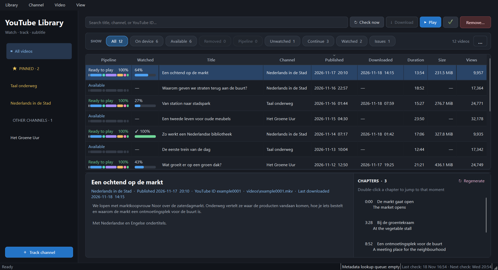](docs/screenshots/video-library.png)

### Tray notification balloon

<table>
  <tr>
    <td width="33%" valign="top">
      <strong>Combined notification</strong><br>
      <a href="docs/screenshots/notification-combined.png">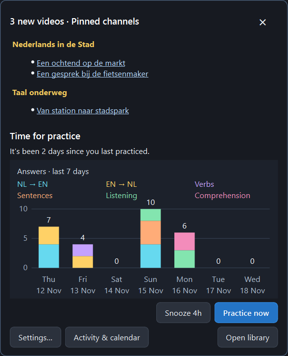</a>
    </td>
    <td width="33%" valign="top">
      <strong>New videos</strong><br>
      <a href="docs/screenshots/notification-videos.png"></a>
    </td>
    <td width="33%" valign="top">
      <strong>Practice reminder</strong><br>
      <a href="docs/screenshots/notification-practice.png">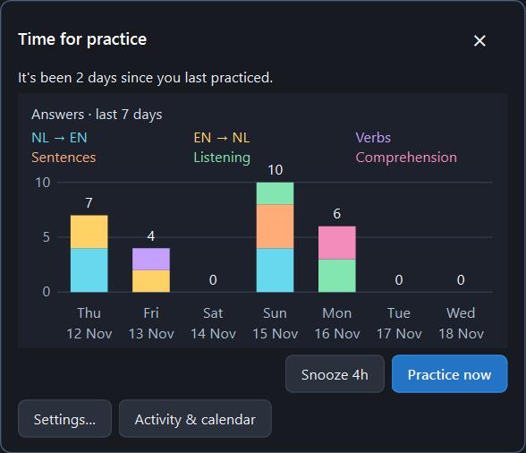</a>
    </td>
  </tr>
</table>

### Clickable subtitles in mpv

Click a word in either subtitle track to save it to Vocabulary. In this example,
the saved word <em>liep</em> is green and underlined, and mpv shows its English
meaning and tense. The `1/1` count means one click in one video.

[](docs/screenshots/mpv-clickable-subtitles.jpg)

### Vocabulary and practice

<table>
  <tr>
    <td width="50%" valign="top">
      <strong>Saved vocabulary</strong><br>
      <a href="docs/screenshots/saved-vocabulary.png">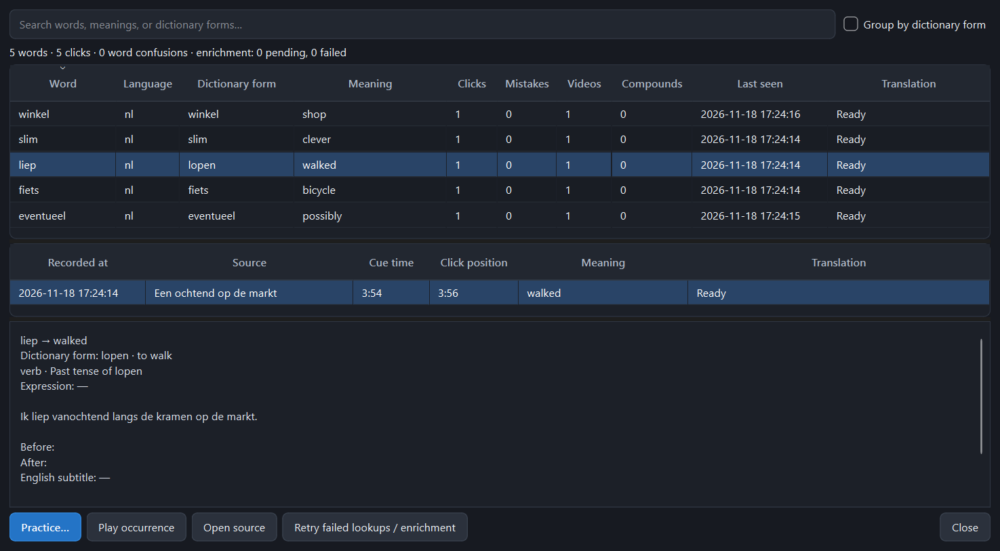</a>
    </td>
    <td width="50%" valign="top">
      <strong>Verb transformations</strong><br>
      <a href="docs/screenshots/verb-transformations.png">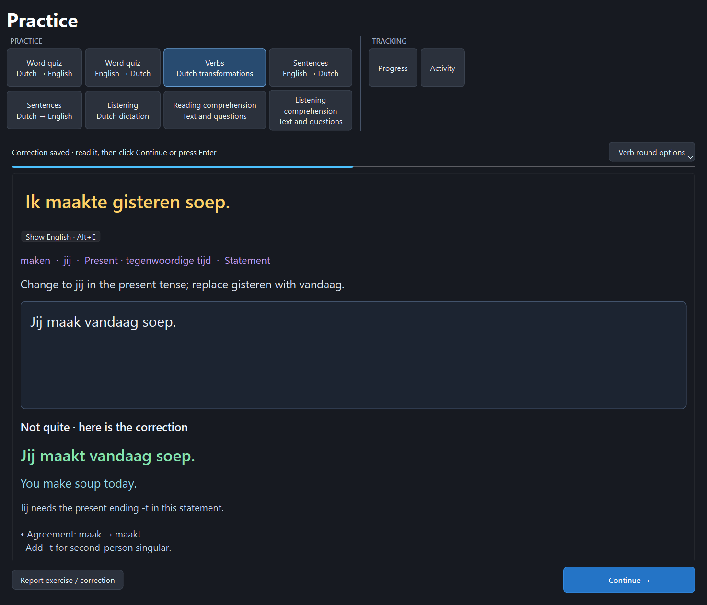</a>
    </td>
  </tr>
  <tr>
    <td width="50%" valign="top">
      <strong>Word quiz · Dutch → English</strong><br>
      <a href="docs/screenshots/word-quiz.png">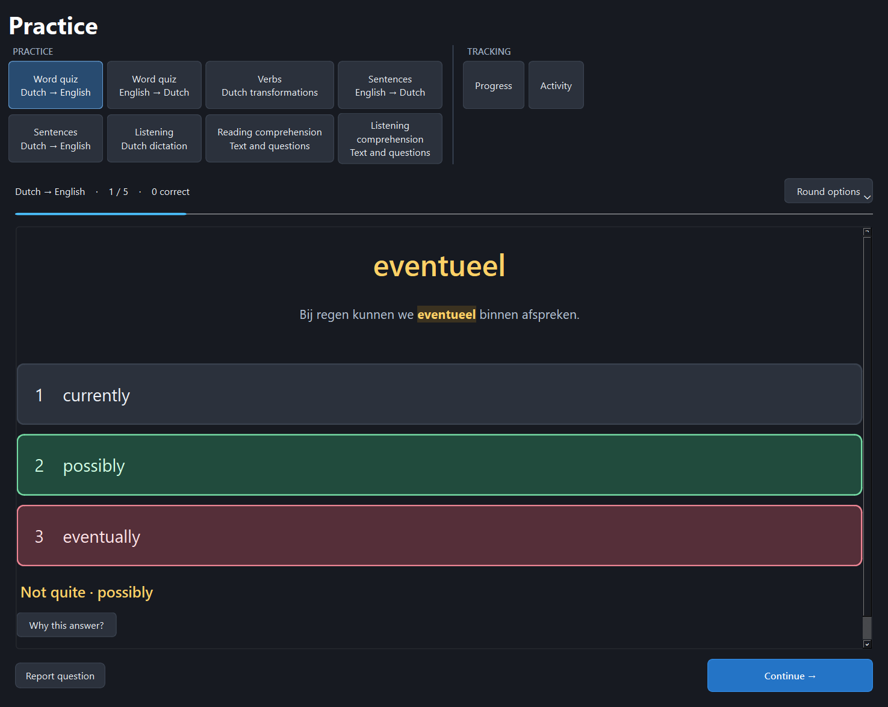</a>
    </td>
    <td width="50%" valign="top">
      <strong>Word quiz · English → Dutch</strong><br>
      <a href="docs/screenshots/reverse-word-quiz.png">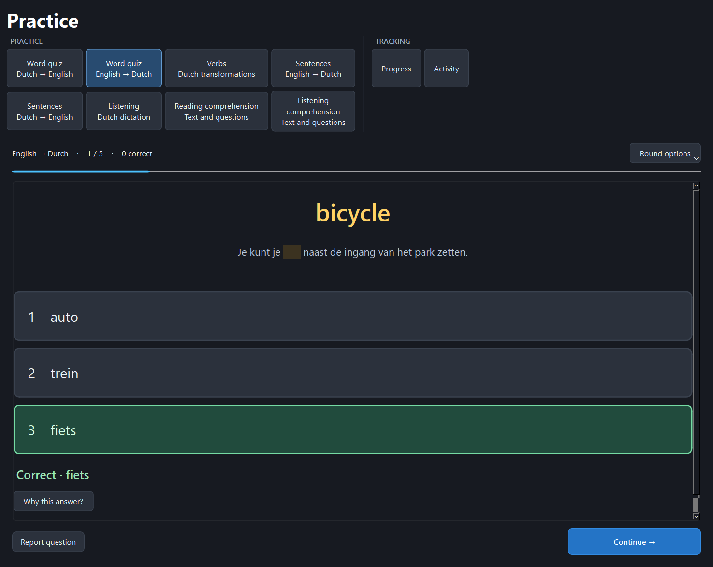</a>
    </td>
  </tr>
  <tr>
    <td width="50%" valign="top">
      <strong>Sentence translation</strong><br>
      <a href="docs/screenshots/sentence-translation.png">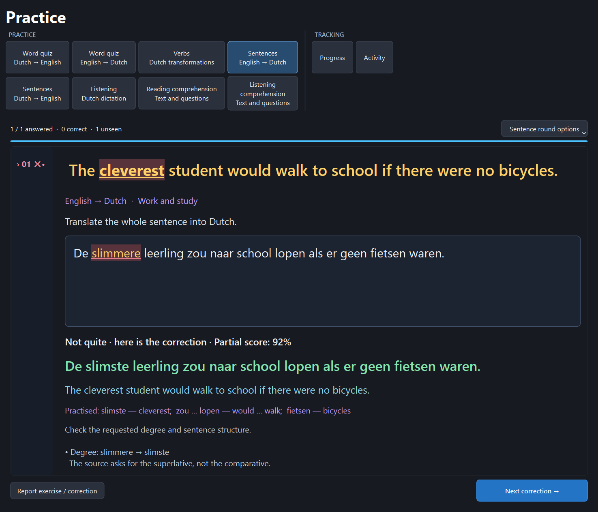</a>
    </td>
    <td width="50%" valign="top">
      <strong>Dutch dictation</strong><br>
      <a href="docs/screenshots/dutch-dictation.png">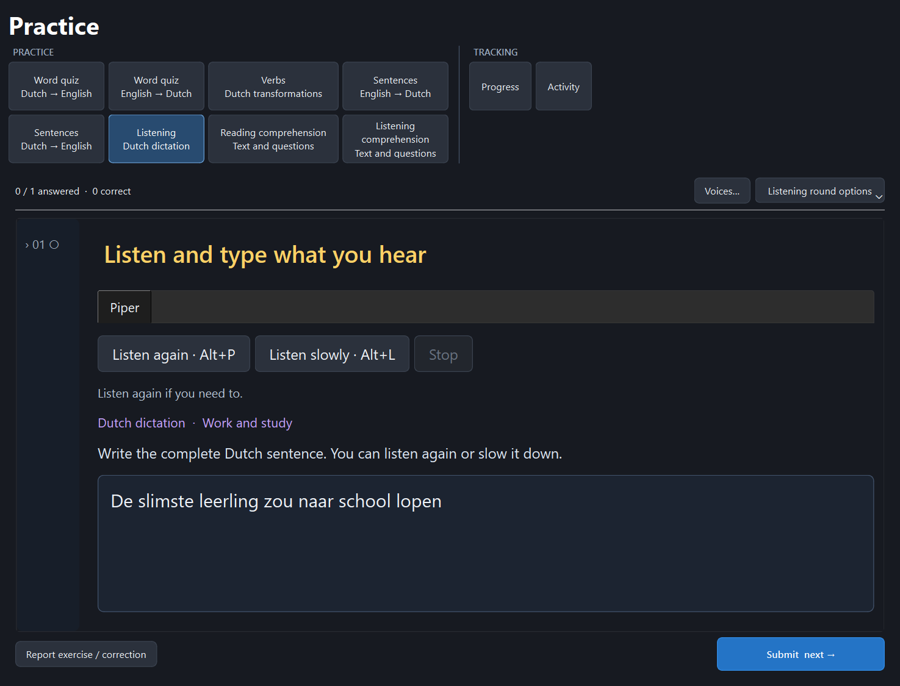</a>
    </td>
  </tr>
  <tr>
    <td width="50%" valign="top">
      <strong>Reading comprehension</strong><br>
      <a href="docs/screenshots/reading-comprehension.png">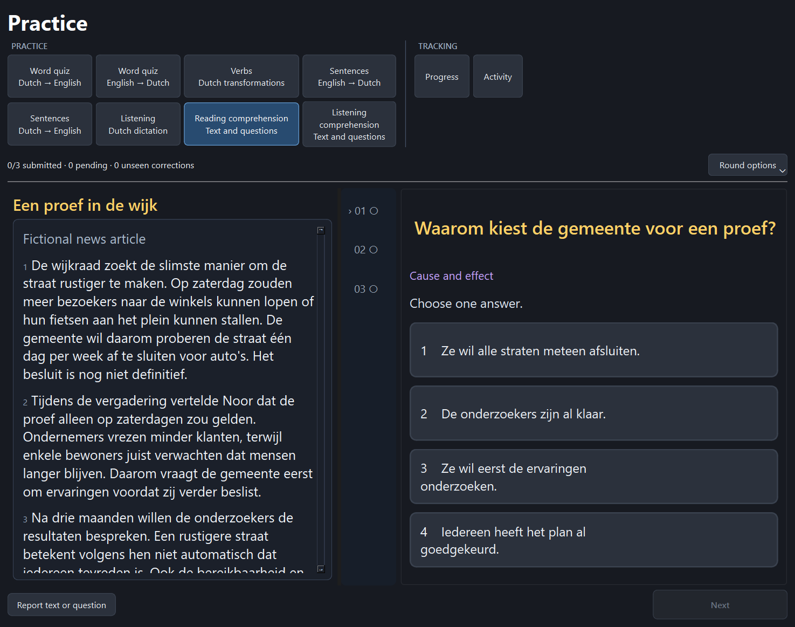</a>
    </td>
    <td width="50%" valign="top">
      <strong>Listening comprehension</strong><br>
      <a href="docs/screenshots/listening-comprehension.png">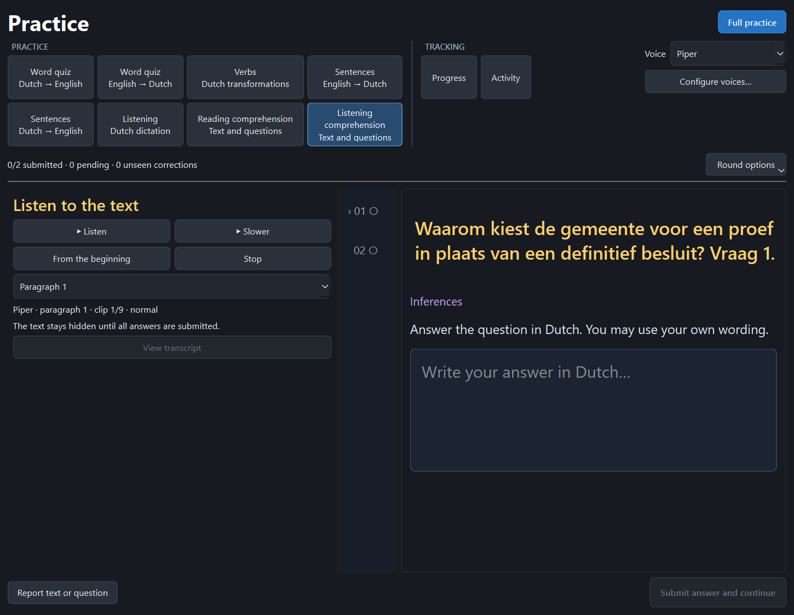</a>
    </td>
  </tr>
  <tr>
    <td width="50%" valign="top">
      <strong>Practice progress</strong><br>
      <a href="docs/screenshots/practice-progress.png">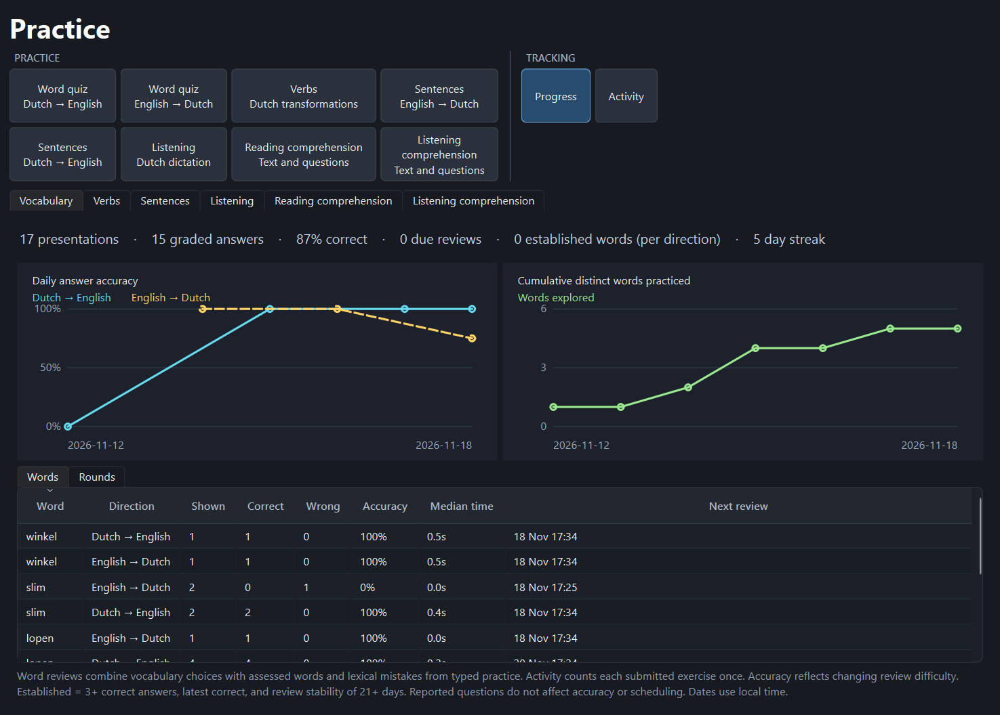</a>
    </td>
    <td width="50%" valign="top">
      <strong>Practice activity</strong><br>
      <a href="docs/screenshots/practice-activity.png">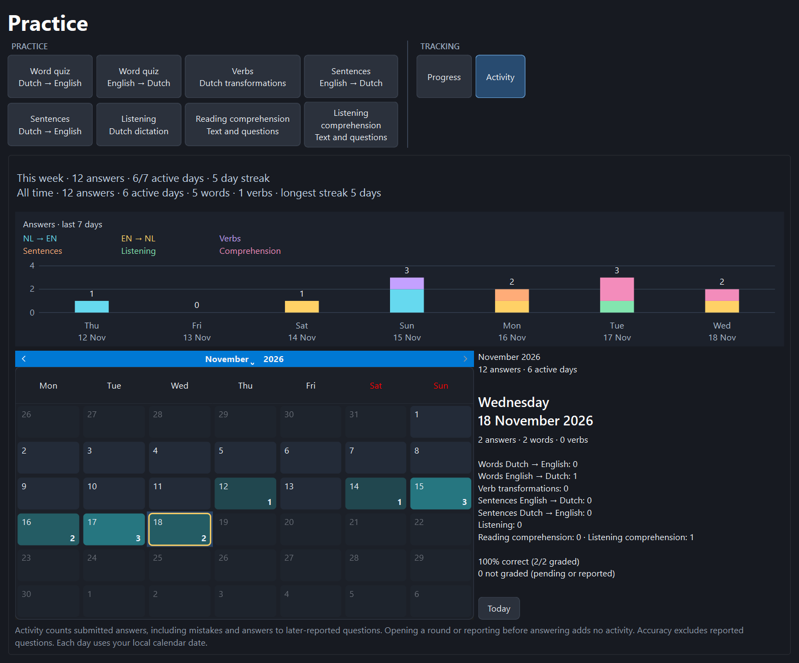</a>
    </td>
  </tr>
</table>

## Current Intent

The script is optimized for this workflow:

1. Run it on a Dutch YouTube video.
2. Keep a local lossy video file under `~/Videos/yt-whisper-subs/videos`,
   named from the YouTube video ID.
3. Generate Dutch subtitles locally with Whisper, then retry bounded internal
   gaps for confident speech that the first decode omitted.
4. Compact the Dutch subtitle cues so fragmented speech becomes easier to read,
   then extend cue end times slightly into following silence. Check new
   transcriptions for rare sound-alike errors plus clear punctuation/case errors
   before generating translations or chapters.
5. Send the compacted and gap-extended Dutch cue texts to the OpenAI API as
   bounded indexed JSON chunks whose cue order is dispersed inside each batch.
6. Receive natural English translations with the exact same cue count and time
   markings as the compacted and gap-extended Dutch SRT.
7. Store subtitle archives under `~/Videos/yt-whisper-subs/subtitles`.
8. Store the `.srt` sidecars beside the video so `mpv` can discover them.
9. When requested, generate durable primary-language/English topic chapters
   whose boundaries are mapped locally to real subtitle timestamps.
10. Write a timestamped run log under `~/Videos/yt-whisper-subs/logs`.
11. Re-run cheaply: if the video and requested subtitles/chapters already
    exist, skip download, audio extraction, CUDA checks, Whisper, and OpenAI,
    then just open `mpv`.

The script can also be used on a local video file, can skip playback, can avoid
English translation, and can fall back to Whisper's built-in audio translation.

The companion library is optimized for a second workflow:

1. Scan every existing ID-named or old title-with-ID video into a durable SQLite
   catalog.
2. Backfill old download titles, source channels, upload dates, duration, view
   count, description, and thumbnails from YouTube when metadata is missing.
3. Subscribe to YouTube channel handles or URLs and display a bounded recent
   history of their long-form videos and streams plus every local download.
4. Pin the most relevant subscriptions into a dedicated quick-access shelf.
5. Check channels every four hours while the app is open or in the system tray.
6. Optionally run the unchanged one-video subtitle pipeline for videos first
   discovered after a channel's initial baseline check.
7. Double-click downloaded videos to open the same English-first dual-subtitle
   `mpv` view used by the CLI.
8. Track furthest watched position and automatic watched status for library-launched
   playback without changing the user's mpv configuration.
9. Queue multiple selected videos for serial download, repair, resume, or chapter
   generation without waiting for the current pipeline to finish.
10. Generate bilingual chapters for new downloads, show them in the selected-video
   inspector, and double-click any chapter to open or seek mpv at that moment.
11. Cancel the active download/transcription/translation pipeline without stopping
   playback or discarding channel work already waiting in the serial queue.
12. Preserve download, watch, and deliberate-removal history after deleting a
    video's files; use the Removed filter to find those entries again.
13. Pause and resume the active pipeline process tree without discarding its
    in-memory model state.
14. Recover a pipeline left by a system crash from durable stage checkpoints and
    reuse every complete or partial yield when the user clicks Resume.
15. Detect missing, corrupt, or long repeated Whisper-loop subtitle yields, show
    the exact reason as an Issue, and offer one-click Repair instead of claiming
    that the pipeline is complete.
16. Announce new pinned-channel discoveries in a shared tray balloon, with titles
    grouped by channel and the daily practice reminder included when it's due.
17. Click subtitle words inside mpv, preserve every selection in SQLite, and
    review contextual English meanings, repeated clicks, and distinct-video counts.
18. Practice saved Dutch vocabulary in either translation direction with challenging
    three-choice rounds, adaptive spaced review, and a native progress dashboard.
19. Get a daily practice reminder with a persistent snooze and seven-day activity
    chart; browse answered-question counts in the practice activity calendar.
20. Rewrite Dutch sentences using captured vocabulary verbs plus a starter set,
    for different subjects, tenses, moods and situations;
    learn from precise corrections and adaptive verb-form review, including
    conditionals and the Dutch subjunctive.
21. Translate complete sentences between English and Dutch using saved vocabulary
    in varied everyday situations, with natural supporting words, diagnostic
    corrections and independent review of vocabulary and sentence writing.
22. Listen to Dutch sentences built around saved vocabulary, type what you hear,
    then review the transcript and English meaning, with local speech, slow replay,
    adaptive word review and separate listening progress. Compare the same sentence
    through Piper and multiple independently configured ZONOS3-Mini voice presets.
23. Practise **Leesbegrip** and **Luisterbegrip** with longer Dutch stories,
    fictional news or reflective texts, independently checked nuanced choices,
    and open answers with partial comprehension credit and Dutch corrections.

## Important Defaults

These defaults live in `cfg.py` and the feature modules or preference types that own them:

| Area | Default |
| --- | --- |
| Library/practice interface language | English; English, Dutch, French and Italian selectable in Library Settings; applied on restart |
| Output root | `~/Videos/yt-whisper-subs` |
| Pipeline scratch directory | `.tmp` under the configured output root |
| Managed virtual environment | `.venv` beside the script |
| Whisper language | `nl` |
| Primary Whisper model | `turbo` |
| Whisper anti-loop decoding | previous-text conditioning off; word timestamps and hallucination silence skipping on |
| Whisper gap recovery | one extra decode for up to 8 internal gaps of 8–30 seconds; only confident speech inside those gaps is inserted |
| English translation provider | `openai` |
| OpenAI translation model | `gpt-6-luna` |
| OpenAI reasoning effort | `medium` |
| Primary transcription review | enabled for new `transcribe` output; same Luna model/effort; 40 cues plus 3 neighbors per side; explicit cue coverage and independent verification of candidates |
| Subtitle semantic review | same model/effort; batches of up to `40` cues, at most `2` correction rounds |
| Practice question generation and quality review | `gpt-6-luna`, reasoning `medium` |
| Verb transformations and diagnostic correction | same dedicated practice model; 10 exercises, configurable 1–50 |
| Verb sources | saved Dutch vocabulary plus 36 starter verbs; captured verbs receive extra priority |
| Verb sentence meanings | Show English / Alt+E reveals the source; feedback includes corrected-sentence English |
| Sentence translations | English → Dutch by default; both directions available; 10 sentences, configurable 1–50, with 2 saved targets per sentence (1–3) |
| Sentence generation, audit and correction | same dedicated `gpt-6-luna` / `medium` practice model; varied life contexts and word forms |
| Ready practice rounds | eight independent destinations, including reading/listening comprehension; two background workers; one bounded standby after practice starts; unused approvals consumed first |
| Listening | Dutch dictation; 10 questions, configurable 1–50; the Dutch transcript and English meaning stay hidden until feedback |
| Listening speech | local CPU Piper 1.7.0 by default; optional ZONOS3-Mini with named voice/style presets; cached normal and slower audio for every enabled preset; no speech API fees |
| Optional Dutch pronunciation | **Read aloud** in text-based exercises; **Auto-read Dutch** is off initially and remembered across practice modes |
| Comprehension | Reading/listening comprehension (Leesbegrip/Luisterbegrip in Dutch UI); B2; 5 paragraphs, 5 four-choice and 3 open questions; learning content and feedback in Dutch; counts, genre, level and vocabulary load configurable |
| Comprehension narration | local Piper/Zonos presets; normal and slow clips prepared in the background for the selected voice, live switching on the same passage; transcript and feedback concealed until all listening answers are submitted |
| Shared vocabulary learning | word quiz, verbs, translation, dictation and comprehension share lexical reviews and import intended/genuinely confused dictionary words; saved compounds also add verified constituents as unassessed vocabulary |
| Vocabulary accretion | independent background lane; up to 12 discoveries per batch; cached positive/negative analyses; positive proposals independently verified before publication |
| OpenAI timeout | `900` seconds |
| OpenAI transient retries | `3` |
| OpenAI translation chunk size | `120` cues |
| OpenAI translation context | `3` neighboring cues |
| AI chapter density | at least `1` chapter per `4` minutes; 15 for 60 minutes |
| CLI chapter generation | opt-in with `--chapters`; library downloads enable it |
| Subprocess silence heartbeat | `60` seconds |
| OpenAI env file | `.env` beside the script |
| Run logs | timestamped under `~/Videos/yt-whisper-subs/logs` |
| Device | `cuda` |
| Python version for uv venv | `3.14` |
| Torch CUDA wheel index | `https://download.pytorch.org/whl/cu128` |
| Downloaded video container | `mkv` |
| Preferred video resolution | `1080p`; configurable in Library Settings and the CLI |
| Resolution preference order | `1080p` → `720p` → higher than `1080p` → remaining lower resolutions |
| Higher-resolution fallback | allowed only after the preferred resolution and next lower preset are unavailable |
| yt-dlp format selector | derived from the resolution preferences; explicit CLI override supported |
| YouTube media fallback | default-client HLS, then `web_safari` HLS; at most three attempts |
| yt-dlp progress interval | `1` second |
| Extracted audio format | `opus` |
| Keep audio after run | yes |
| Play after generation | yes |
| Dutch-to-English subtitles | yes, when `--language` is Dutch and task is `transcribe` |
| Dual subtitle mode | yes |
| Primary subtitle color | `#FFE066` |
| Secondary subtitle color | `#66D9EF` |
| Primary subtitle position | `100` |
| Secondary subtitle position | `8` |
| Dual subtitle font size | `80` |
| Primary font scale | `0.45` |
| Library channel check interval | `4` hours |
| Recent channel history | `50` entries per Videos/Streams section; Shorts ignored |
| Adaptive channel scan ceiling | `500` entries per section when bridging an offline gap |
| Earliest publication date | optional; disabled until configured |
| Channel feed enrichment | publication date and description from one Atom request |
| Library metadata hydration pace | at most `1` video lookup per minute |
| Failed metadata lookup cooldown | `24` hours |
| Metadata queue pause before other ready work after failure | `15` minutes |
| Retention metadata memory | durable info sidecars prevent old videos from re-queuing |
| Library close behavior | keep running in the system tray; explicit Quit closes owned mpv/workers |
| Library database backups | one asynchronous verified snapshot per startup; newest `10` retained under `<output root>/library/backups` |
| Start with Windows | disabled; optional per-user quiet tray launch |
| Library activity trace | hidden by default; last `5,000` lines retained per session |
| Library pipeline display | segmented per-video phase bar with live stage wording |
| Library watched-progress sample | every `5` seconds during mpv playback |
| mpv Left / Right arrows | exact `−1.5` / `+1.5` second seeks; configurable in Library Settings and with `--mpv-seek-seconds` |
| mpv word capture | clickable text tracks; committed selections turn green and underlined |
| Vocabulary review | Library → Vocabulary; `Ctrl+Shift+W` in the library |
| Word translation | on-demand contextual OpenAI lookup; English meaning and source dictionary form |
| Vocabulary persistence | every intentional click, including repeats; same catalog SQLite file |
| Library watched rule | configurable threshold, default more than `95%`; confirmed mpv end-of-file or manual marking also completes |
| Library smart view | counted Pipeline filter plus remembered browsing views; search and channel remain independent |
| Channel quick access | clickable Pinned and Other channels groups; right-click or `Alt+P` to pin |
| Pinned-channel notifications | enabled; scrollable video list in the shared tray balloon |
| Notification grouping delay | `30` seconds after channel discovery; adjustable from `0` to `3,600` |
| New-video list timeout | `20` seconds, paused while hovering; `0` keeps the list visible until dismissed |
| Notification visibility | visible and hidden library windows by default; optional hidden/minimized only |
| Daily practice reminders | enabled once eligible Dutch vocabulary exists or a verb round has been started; quiet for at least 24 hours after any submitted answer and throughout its local calendar day |
| Practice reminder snooze | `4` hours; configurable from `1` to `72` hours; persisted across restarts |
| Practice activity amount | submitted vocabulary, verb, translation, dictation and comprehension answers, including mistakes and pending corrections; seven-day bars and monthly calendar |
| Library column layout | resizable, reorderable, and remembered across launches |
| Library inspector layout | vertically resizable and remembered across launches |
| Library execution queue | visible FIFO for video pipelines; one heavy-work lane |
| Library cancellation | visible Cancel button during active work; `Ctrl+Shift+X` |
| Library pause/resume | process-tree suspension; `Ctrl+Shift+P` |
| Library crash recovery | durable stage/overall-progress checkpoint; one-click Resume |
| Library yield removal | selected video or captured filter matches; confirmed exact manifests; individual non-recursive unlinks; durable Removed state |
| Library personal history | download/removal dates and watch progress survive retention and channel removal |
| Channel auto-download baseline | future discoveries only; never the initial backlog |
| Subtitle compaction mode | `english` |
| Compaction gap | `0.9` seconds |
| Compaction max merged duration | `9.0` seconds |
| Compaction max merged chars | `180` |
| Compaction max characters per second | `25.0` |
| Wrapped subtitle line width | `50` |
| Subtitle gap extension | `5` seconds |

One subtle default matters: when OpenAI English translation is enabled, the
primary Dutch SRT is compacted before translation even though `--compact-subs`
defaults to `english`. It is also gap-extended before translation. This exists
so the OpenAI-translated English file has the same timestamps and cue count as
the Dutch file that the user actually wants to read.

If `--no-compact-subs` is used, the compaction override is disabled. In that
case OpenAI receives cue text from the un-compacted primary SRT, still
gap-extended unless `--subtitle-gap-extension 0` is used.

## Quick Start

Open the native desktop library by double-clicking `yt_whisper_library.pyw`, or
run it from PowerShell:

```powershell
python .\yt_whisper_library.pyw
```

The launcher creates or reuses `.venv`, installs `yt-dlp[default]` and
`PySide6-Essentials`, `psutil`, and the practice dependencies (Pydantic, FSRS, NumPy,
Polars, RapidFuzz, and Babel), plus the pinned Piper speech runtime when needed,
and relaunches with `pythonw.exe`.
The window first opens the saved catalog, then scans local downloads in the
background and refreshes the results. An overdue channel check and the
gently paced metadata queue then run in the background without freezing the
GUI. On Windows, background child operations run without opening or flashing a
terminal window. mpv remains a normal visible application with a taskbar icon
and Alt+Tab entry. Phase progress remains visible in the table and status bar,
while exact tool output and errors remain available in the activity trace and
run logs.

When this launcher is started from PowerShell, WezTerm, or another terminal, the
outer process remains attached until the managed GUI exits. Pressing **Ctrl+C**
now terminates that managed `pythonw.exe` process and immediately restores the
prompt with the conventional interrupted exit code `130`. Closing the window
can still hide it in the tray by design; use **Library → Quit** or the tray
icon's persistent **Quit** action for a normal zero-code exit. Explicit shutdown
hides the icon immediately, cancels owned background work, and asks every
library-launched mpv session to close so worker threads cannot strand the process.

The managed GUI uses the visible-application launch policy: its console stays
suppressed, while Windows is allowed to show the library window. On Windows it
receives null standard input because keyboard input belongs to its own window;
this also avoids uv's **Making stdin inheritable failed** warning when launching
from a terminal. The tray's **Show library** action resets Qt's visibility before
restoring the window, recovering even when Windows hid it while Qt still
considered it visible. **Start quietly in the system tray** remains controlled
by the application's explicit startup flag.

Choose **Library → Settings**, enable **Start quietly in the system tray when I
sign in**, and click Save to start the library with the current Windows user.
This writes one exact value under the current user's standard Windows Run key,
needs no administrator rights, preserves the selected output root, and uses
`pythonw.exe`, so login does not flash a terminal. Disabling the checkbox removes
only that value. Manual launches still open the main window normally.

Use the same non-default output root as the CLI:

```powershell
python .\yt_whisper_library.pyw --out-dir "D:\Videos\yt-whisper-subs"
```

The existing one-video CLI remains:

From the directory containing the script:

```powershell
python .\yt_whisper_subs.py "https://www.youtube.com/watch?v=VIDEO_ID"
```

or:

```powershell
uv run .\yt_whisper_subs.py --url "https://www.youtube.com/watch?v=VIDEO_ID"
```

If the `.venv` beside the script is missing, the script uses `uv` to create it
and install the Python dependencies it needs for Whisper and yt-dlp.

For transcription review, OpenAI translation, or chapters, create a `.env` file next to the script:

```dotenv
OPENAI_API_KEY=sk-...
```

Do not commit `.env`.

Run without opening `mpv`:

```powershell
python .\yt_whisper_subs.py --no-play "https://www.youtube.com/watch?v=VIDEO_ID"
```

Force a fresh download and fresh subtitle generation:

```powershell
python .\yt_whisper_subs.py --force "https://www.youtube.com/watch?v=VIDEO_ID"
```

Regenerate only the English subtitle yield from the existing Dutch SRT:

```powershell
python .\yt_whisper_subs.py --force-english "https://www.youtube.com/watch?v=VIDEO_ID"
```

Generate chapters while otherwise reusing existing yields:

```powershell
python .\yt_whisper_subs.py --chapters "https://www.youtube.com/watch?v=VIDEO_ID"
```

Regenerate only an existing chapter plan:

```powershell
python .\yt_whisper_subs.py --force-chapters "https://www.youtube.com/watch?v=VIDEO_ID"
```

Use local Whisper audio translation instead of OpenAI SRT translation:

```powershell
python .\yt_whisper_subs.py --english-translation-provider whisper "https://www.youtube.com/watch?v=VIDEO_ID"
```

Use a local video file:

```powershell
python .\yt_whisper_subs.py --video-file "C:\path\to\video.mkv"
```

Pass browser cookies to yt-dlp:

```powershell
python .\yt_whisper_subs.py --cookies-from-browser firefox "https://www.youtube.com/watch?v=VIDEO_ID"
```

## What The Script Produces

For a YouTube URL, the default output root is:

```text
C:\Users\<you>\Videos\yt-whisper-subs
```

Inside it:

```text
yt-whisper-subs\
  .tmp\
    library.lock
    pipeline.lock
  videos\
    youtube_id.mkv
    youtube_id.srt
    youtube_id.en.srt
  audio\
    youtube_id.opus
    youtube_id.opus.source.json
  logs\
    youtube_id-YYYYMMDD-HHMMSS.log
  metadata\
    youtube_id.info.json
  subtitles\
    youtube_id.srt
    youtube_id.srt.transcription-review.json
    youtube_id.en.srt
    youtube_id.uncompact.srt
    youtube_id.en.uncompact.srt
  chapters\
    youtube_id.chapters.json
    youtube_id.chapters.ffmetadata
  library\
    catalog.sqlite3
    backups\
      catalog-YYYYMMDDTHHMMSSffffffZ.sqlite3
```

The application-owned `.tmp` directory is the explicit working directory for
GUI-launched pipelines and the explicit yt-dlp temporary path. This prevents a
Windows shortcut, startup entry, or shell launch from redirecting scratch files
into an inherited directory such as `C:\Windows\System32`. Its contents are
transient and are never treated as durable video yields.

The exact `.uncompact.*` files appear only when compaction changed an existing
subtitle file and a backup did not already exist.

When upstream subtitles are regenerated, `.en.srt.stale` in `subtitles\` and
`.chapters.json.stale` in `chapters\` record unfinished downstream work.
These markers survive failure, cancellation, and restart; they disappear only
after usable replacements are committed. Old outputs remain on disk while
marked stale and are not treated as ready or shown as current chapters.

For YouTube URLs, filenames are based on the video ID instead of the title. This
avoids title punctuation, Unicode, path length, and title-change problems. If an
older title-based yield such as `Video title [youtube_id].mkv` exists, the
script migrates it to `youtube_id.mkv` when the ID-named target does not already
exist. Local video files still use the local file stem.

The script writes subtitles in two places:

1. Sidecar subtitles beside the video, for `mpv` auto-detection:
   `videos\youtube_id.srt` and `videos\youtube_id.en.srt`.
2. Archive subtitles under `subtitles\`, so subtitle yields survive even if
   sidecars are moved or missing.

This duplication is intentional. Sidecars are for playback ergonomics. The
archive directory is for durable yield tracking.

Chapter JSON is the authoritative bilingual plan, including exact millisecond
boundaries, generation time, language, model, and video duration. The adjacent
FFmetadata file is a derived mpv input. It can be reconstructed from JSON and
does not modify or remux the downloaded video.

Every new YouTube download also writes the extractor's cleaned `.info.json`
under `metadata\`, embeds normal media metadata into the downloaded container,
and embeds the info JSON as an MKV attachment when the container supports it.
The sidecar is the catalog's durable source for title, channel, upload time,
duration, views, description, thumbnail URL, source URL, and other yt-dlp
fields. Its `live_status` is only a past observation: fresh channel listings or
an explicitly requested video lookup take precedence for current stream state.
The library database is a query cache and subscription store; deleting it does
not delete any videos or metadata sidecars, and the next library start can
rebuild local download state.

Privacy note: yt-dlp warns that info JSON can contain personal information and
temporary extractor URLs. Keep the `metadata\` directory private; the project
does not upload these sidecars or put them in the repository.

The video file is intentionally not lossless. New downloads try 1080p, then
720p, then higher than 1080p, then remaining lower resolutions. This saves disk
space when 720p is available alongside higher resolutions but 1080p is missing.
The yt-dlp format selector keeps YouTube's already-compressed audio/video streams
and merges them into an `mkv` container without resizing or re-encoding. Audio
extracted for Whisper is also lossy, defaulting to Opus at 48 kbps, mono, 16 kHz.

## The End-To-End Pipeline

The main flow is:

```text
parse args
start timestamped run log
resolve source
  if URL:
    find exact cached video by YouTube ID unless --force
    otherwise download with yt-dlp
    if requested, check local media duration before reusing it or transcribing
    canonicalize URL yields to video-id filenames
  if local file:
    resolve local path
derive yield paths from video ID for URLs or video stem for local files
hydrate missing sidecar/archive subtitle pairs
compact existing subtitles when needed
extend subtitle cues into following silence when needed
print yield paths
if all requested yields exist and not --force:
  skip expensive work
  optionally delete audio
  optionally play in mpv
otherwise:
  decide whether Whisper is needed
  if Whisper is needed:
    ensure .venv
    check ffmpeg
    check CUDA if --device cuda
  generate primary subtitles if needed
  review new/pending primary text; optionally review cached primary on explicit request
  generate English subtitles if requested and needed
  generate bilingual chapters if requested and needed
  optionally delete audio
  optionally play in mpv
```

The most important engineering property is parsimony: the script should not
consume bandwidth, GPU time, CPU time, or OpenAI API calls when the requested
yields are already present.

## Yield Reuse And `--force`

On normal runs, the script reuses existing yields.

Missing or invalid subtitle sidecars are restored from a usable archive before
generation is considered. A usable canonical copy takes precedence over an
older uncompacted backup. Invalid sidecars never overwrite usable archives;
copying, transforming, and replacing subtitle files uses atomic staged writes.

Primary regeneration marks English and chapters stale before generating new
cues. English regeneration marks chapters stale too. A retry therefore resumes
unfinished dependent stages even when obsolete files still parse successfully,
while retaining a primary or English replacement that already succeeded.
Unrequested dependent stages remain marked stale for a later requested run.

Audio extraction also writes into a staging file and promotes it only after
ffmpeg succeeds and ffprobe validates the output. When the source audio stream
reports a duration, the result must match within 2% or 500 milliseconds,
whichever is larger. This compares audio stream length rather than the whole
video, which can legitimately continue after its audio ends. A `.source.json`
record binds the validated cache to the source and audio file revisions.
Unvalidated, externally modified, or differently sourced audio is rebuilt when
extraction is needed. A failed replacement preserves the previous audio.

For URL input, the video cache lookup is intentionally exact. The script extracts
the YouTube video ID from supported URL shapes and looks first for a final media
file whose stem is exactly `video_id`. It also recognizes the older
`Video title [video_id]` cache form so existing downloads can be migrated. It
does not pick "the newest downloaded video" as a fallback. That earlier behavior
was risky because a new URL could
accidentally play a previously downloaded video.

Supported YouTube URL shapes include:

- `https://www.youtube.com/watch?v=VIDEO_ID`
- `https://youtu.be/VIDEO_ID`
- `/shorts/VIDEO_ID`
- `/live/VIDEO_ID`
- `/embed/VIDEO_ID`
- `/v/VIDEO_ID`

If everything requested already exists, the script prints a skip message and
does not run yt-dlp, ffmpeg, CUDA probing, Whisper, or OpenAI. It still launches
`mpv` unless `--no-play` is set.

`--force` means:

- Re-download URL videos instead of reusing a cached one.
- Pass `--force-overwrites` to yt-dlp.
- Regenerate subtitles.
- Do not fall back to an existing final video if yt-dlp fails during a forced
  redownload.

This is deliberately strong. It is useful when a previous yield is corrupt or
when the user wants to replace old English subtitles with the current OpenAI
translation path. It is also expensive.

If only one yield is unwanted, manually deleting that yield can be cheaper than
using `--force`. For example, deleting only `*.en.srt` lets the script regenerate
English translation from an existing primary SRT without re-downloading video or
rerunning Whisper.

`--force-english` is the supported shortcut for that common case. It keeps the
cached video, audio, and primary Dutch subtitles, then regenerates only the
Dutch-to-English subtitle yield when English generation is enabled for the run.

`--force-chapters` similarly implies `--chapters` and regenerates only the
chapter plan from reusable subtitles. It does not redownload the video, and it
does not rerun Whisper when primary subtitles already exist. Direct CLI chapter
generation remains opt-in so established one-video CLI interaction and API cost
do not change unexpectedly; native-library downloads explicitly enable it.

## Dependency Management

The script expects to run on Windows. It uses:

- `uv`
- Python 3.14 in a script-local `.venv`
- `yt-dlp`
- `yt-dlp-ejs` through yt-dlp's `default` package extra
- `openai-whisper`
- `torch`
- `ffmpeg`
- `mpv`
- `PySide6-Essentials` for the native library GUI
- `psutil` for pausing/resuming the owned pipeline process tree and distinguishing
  live pipeline owners from crashed or reused process IDs
- `pydantic`, `fsrs`, `numpy`, `polars`, and `rapidfuzz` for validated practice content,
  spaced review, word-edit sentence scores, and progress analytics in the native library
- `piper-tts==1.7.0` for local Dutch listening speech
- `Babel>=2.17,<3` for interface date/number formatting and gettext catalog maintenance

Python dependencies are installed into `.venv` beside the script. This choice
was made because the script is intended to be portable as a single project
folder and should not depend on whichever Python packages happen to be installed
globally.

The `.pyw` library launcher bootstraps only `yt-dlp[default]`,
`PySide6-Essentials`, `psutil`, Pydantic, FSRS, NumPy, Polars, RapidFuzz, Piper, and Babel, keeping a first GUI start much smaller than a Whisper/CUDA
installation. If the user downloads a remote catalog entry, the library invokes
`yt_whisper_subs.py --no-play`; that existing pipeline then installs or validates
Whisper and Torch exactly as a direct CLI run would. The launcher checks Piper's
pinned version even when invoked directly with the managed `python.exe` or `pythonw.exe`,
so an already importable speech package cannot bypass its version pin.

The repository also includes a tracked `.python-version` file set to `3.14` so
local Python tooling and the script-managed environment share the same project
default.

The script creates or updates `.venv` when:

- `--install-python-deps` is passed, or
- the expected `.venv\Scripts\python.exe` is missing, or
- the existing `.venv` uses a different Python major/minor version than
  `--python-version`.

It installs:

```text
wheel
setuptools
yt-dlp[default]
openai-whisper
torch
```

When `--device cuda` is used, Torch is installed from the configured CUDA index:

```text
https://download.pytorch.org/whl/cu128
```

The Torch install is forced to reinstall the `torch` package in CUDA mode. This
matters because an existing CPU-only Torch wheel can otherwise satisfy the plain
`torch` requirement and survive a normal upgrade, leaving PyTorch unable to see
the NVIDIA GPU.

The script does not install the OpenAI Python SDK. The OpenAI Responses API call
uses the Python standard library (`urllib`). That was a deliberate dependency
decision: the OpenAI translation path should not require adding and maintaining
another Python package in the Whisper environment.

`ffmpeg` and `mpv` are external executables. With `--install-tools`, the script
attempts to install/update `uv`, `ffmpeg`, and `mpv` via Scoop. If Scoop is not
available, install those tools manually.

Because YouTube extraction changes frequently, the managed runtime checks for a
new yt-dlp release at most once every seven days. Update failure is non-fatal
when an older installation is already usable. The `default` package extra
includes yt-dlp's EJS solver component; the script automatically enables Deno
or Node from `PATH` (in that order) for YouTube's JavaScript challenges.

## Source Handling

The script accepts exactly one source:

- positional `source`
- `--url`
- `--video-file`

If a positional source starts with `http://` or `https://`, it is treated as a
URL. Otherwise it is treated as a local video file.

Local video files are resolved with `Path(...).expanduser().resolve()` and must
already exist.

## Download Design

The download command is built around yt-dlp:

```text
python -m yt_dlp
  --js-runtimes <installed deno-or-node>
  --no-playlist
  --windows-filenames
  --part
  --continue
  --progress
  --progress-delta <seconds>
  -f <format selector>
  --merge-output-format <container>
  --write-info-json
  --embed-metadata
  --embed-info-json
  --print after_move:filepath
  -o "%(id)s.%(ext)s"
  -o "infojson:<metadata directory>/%(id)s.%(ext)s"
```

Design notes:

- `--no-playlist` avoids accidentally downloading an entire playlist.
- `--windows-filenames` prevents filenames that are awkward on Windows.
- `--part` and `--continue` keep yt-dlp's normal resume behavior explicit, so
  interrupted downloads can continue instead of fetching the same bytes again.
- `--progress-delta` defaults to `1`, so progress output is visible but not too
  noisy.
- `--write-info-json` preserves the full cleaned extractor result outside the
  media container, where the catalog can ingest it cheaply.
- `--embed-metadata` adds standard title, uploader, date, description, and
  related tags supported by the selected container.
- `--embed-info-json` also attaches the complete JSON to MKV when supported.
- The typed `infojson:` output template keeps metadata under `metadata\`
  instead of cluttering `videos\`. A typed output template is used instead of
  `--paths`, because yt-dlp ignores `--paths` when the main media template is an
  absolute path.
- `--print after_move:filepath` gives the script the final filename.
- The output filename is the extractor/video ID only, which avoids title-derived
  filesystem problems and makes exact cache lookup direct.

The default format selector is:

```text
bv*[height=1080]+ba/b[height=1080]/bv*[height=720]+ba/b[height=720]/bv*[height>1080]+ba/b[height>1080]/bv*[height<1080]+ba/b[height<1080]/bv*+ba/b
```

This tries four stages: exactly 1080 pixels high, exactly 720 pixels high,
higher than 1080 pixels, then remaining lower heights. Within each stage it
selects the best video stream with the best audio, or a combined format. Formats
with unreported heights are a last resort after all known heights. The stages
are checked before transport preferences on HLS retries. These are compressed
source streams; the script does not resize or re-encode them.

Under **Library → Settings**, choose **Preferred video resolution** (360p through
4320p, or **Best available**) and **Allow higher resolution when preferred is
unavailable**. The defaults are 1080p with higher-resolution fallback enabled.
Choosing another preferred resolution substitutes that target and its next
lower preset: for example, 1440p → 1080p → higher than 1440p → remaining lower
heights. The lowest preset, 360p, has no second preferred preset. Turning higher
fallback off skips the higher stage and rejects unreported heights, keeping the
selected preference as a strict ceiling. If every format exceeds that ceiling,
the download fails instead of exceeding it. Settings are persisted in SQLite and
apply to subsequent downloads, including videos already queued. An active
download keeps its current settings,
and existing downloaded videos remain reusable at their original resolution.

The CLI has the same preferences. For example, to cap new downloads at 720p:

```powershell
python .\yt_whisper_subs.py --video-resolution 720 --no-allow-higher-resolution "https://www.youtube.com/watch?v=VIDEO_ID"
```

Use `--video-resolution 0` for best available quality. An explicit
`--video-format FORMAT` overrides both resolution preferences. Direct CLI runs
use their own flags/defaults; the desktop library passes its saved preferences
to the shared pipeline. Source video height defines the `p` value.

For YouTube HTTP 403 or unavailable-format failures, downloads retry with HLS
preferred on the default clients first, then with `web_safari` HLS. Some videos
expose working HLS on the default client while Safari exposes only storyboard
images. Both retries use `--format-sort-force --format-sort proto:m3u8` so video
and audio prefer HLS; the user's `--video-format` selector still applies. There
are at most three attempts, unrelated errors stop immediately, and the final
error retains the causes from failed attempts. A retry can select a combined HLS
format and therefore does not necessarily use the requested merge container.

The default merge container is:

```text
mkv
```

`mkv` is a forgiving container for mixed codecs, which is useful for YouTube
downloads.

## Native YouTube Library

The desktop library is a native PySide6/Qt application with a dark Windows UI.
It contains:

- counted smart views for All, On device, Available, Removed, Pipeline, Unwatched,
  Continue, Watched, and Issues;
- counted, clickable **Pinned** and **Other channels** groups for combined videos;
- instant title, channel, and YouTube-ID search that composes with smart views;
- sortable, resizable, and reorderable pipeline, watched, title, channel,
  published, downloaded, duration, size, and view-count columns;
- a selected-video inspector with a scrollable description, local path, errors,
  and a scrollable bilingual chapter list with exact jump points;
- manual Check, Download/Repair/Resume, Pause, Cancel, Play, Open on YouTube,
  and exact-yield removal actions;
- configurable browser cookies, check interval, and current-user Windows login start;
- an optional timestamped activity trace for live pipeline and subprocess output;
- a system tray so periodic checks continue when the main window is closed;
- aggregated, dismissible new-video balloons for pinned channels, with a full
  scrollable list and configurable grouping, dismissal, and visibility.

The native title bar includes the current application version. That value comes
directly from `yt_whisper_subs.__version__`, the single source used by the GUI;
it is not duplicated in the window code.

### Interface Languages

Version **0.6.10** adds **English**, **Nederlands**, **Français**, and **Italiano**
under **Library → Settings → Interface language**. English is the initial default.
Language names always appear in their own language so the selector remains
recognizable. Save the preference, then quit and reopen the library to apply it;
closing to the tray alone does not restart it. The restart notice appears only
when the saved language changes. The preference belongs to the output root's
catalog, alongside other library settings.

The interface choice covers library menus, filters, table headings, dialogs,
notifications, vocabulary tools, practice navigation, exercise controls,
comprehension options, correction states, and progress/activity labels. Native
Qt buttons and calendar controls use Qt's matching translation catalog. Month
and weekday names and formatted numeric metrics follow the selected language
without changing the process-wide locale used by background tools. Navigation
wraps longer captions and Settings wraps long form rows.

This is an **interface language**, independent of the learning languages.
Dutch/English vocabulary and translation directions, Dutch dictation, Dutch
passages/questions, saved answers and model-generated teaching feedback keep
their original content. In English, the former **Leesbegrip / Luisterbegrip**
destinations read **Reading comprehension / Listening comprehension**; Dutch
still uses their Dutch names. Video titles, subtitle/chapter content, voice
preset names, model-supplied voice terminology, and raw external tool diagnostics
also retain their source text. Changing the interface does not regenerate any
exercise, translation, narration, or subtitle.

Translations use Python's standard [gettext catalogs](https://docs.python.org/3/library/gettext.html):
English source messages in code, a shared `yt_whisper_subs/locales/ui.pot`, and
editable UTF-8 `locales/{nl,fr,it}/LC_MESSAGES/ui.po` files with shipped compiled
`ui.mo` catalogs. Babel supplies catalog validation/compilation and locale
formatting; Qt supplies [native control translations](https://doc.qt.io/qt-6/localization.html).
No translation API or runtime internet access is needed. Missing messages or
unsupported language codes fall back to English.

For maintenance, wrap complete literal UI messages with `i18n.tr()`, interpolate
named fields **after** translation, and use `i18n.nt()` for singular/plural
messages. Use a gettext context (`ctx="voice style"`, for example) when identical
English words have different meanings, such as Clear in a log versus a voice.
Mark shared source labels with `i18n.mark()` and translate them when
displayed, so importing modules before locale initialization cannot freeze
English labels. Keep persisted keys, model prompts and exercise text separate
from presentation. The extractor reads literal calls from the Python AST;
dynamic dictionary lookups are never mistaken for translatable storage keys.
The supported-language registry lives in `i18n.LANGUAGES`.

After editing UI messages, update catalogs, edit any new translations with a
gettext editor such as Poedit, then compile and validate:

```powershell
.venv\Scripts\python.exe tools\update_translations.py
.venv\Scripts\python.exe tools\update_translations.py --check
.venv\Scripts\python.exe -m unittest tests.test_i18n -v
```

The update command reports missing/fuzzy entries and rejects changed placeholder
names, conversions or format specifications. `--check` also verifies that the
shipped compiled catalogs match their editable sources. The regression tests
render every catalog message, exercise language-specific plurals and separators,
construct the actual settings/practice widgets in all four languages, check
native Save captions and stable exercise identities, and persist a language
through the real Settings save path without restarting in-flight work.

Release verification for **0.6.10**: all 893 catalog messages validate; the
629-test suite has 626 passes, two skips and one existing offscreen Qt Alt+E
verb-help failure (`test_source_english_reveal_is_instant_scoped_and_preserves_typing`).
That same test also fails unchanged on the preceding `0.6.9` commit.

### Automatic Database Backups

Every library startup, including a quiet Windows tray launch, schedules one
database backup on its own background worker. The window opens without waiting
for the copy, and channel checks, downloads, and playback keep their own workers.
Backups live in `<output root>/library/backups`, beside `catalog.sqlite3`; custom
output roots use their own backup folder. The catalog contains subscriptions,
watch history, settings, vocabulary, and all practice modes and answer history.

The SQLite online backup API includes committed WAL changes while the library
continues using its database. Each snapshot is checked with SQLite's full
integrity check and published as a standalone timestamped `.sqlite3` file only
after it succeeds. The newest **10 automatic backups** are retained; older
automatic snapshots are deleted after the new one is verified. Other filenames
are left alone. At the current catalog size, ten snapshots use about 155 MiB;
space scales with the size of the database. Media and cached speech are not copied.

Failures appear in **View → Activity trace** without a blocking dialog. Failed
or cancelled copies are removed, and unfinished copies from a crashed process
are cleaned up at the next startup. Backup work times out after two minutes;
Quit requests cooperative cancellation without waiting on the GUI thread.
A failed copy or integrity check preserves the previous successful backups.

To restore a snapshot, quit the library and any CLI process using that output
root. Preserve the current catalog and any `catalog.sqlite3-wal` and
`catalog.sqlite3-shm` companions elsewhere, then copy the chosen snapshot to
`library/catalog.sqlite3` with no old WAL/SHM files alongside it. Reopen the library.

Run the isolated backup and background-startup checks:

```powershell
python -m unittest tests.test_library_backup -v
```

### Channel Groups

Channels that matter most can be moved to the starred **Pinned** shelf at the
top of the sidebar. Select a channel and use **Channel → Pin selected channel**,
press **Alt+P**, or right-click the row and choose **Pin to quick access**.
Pinned channels are shown only in that shelf, so they are not duplicated in the
**Other channels** list. The most recently pinned channel appears first; unpinned
channels remain alphabetical. Pin state is durable SQLite subscription data and
survives restarts. The same context menu also exposes automatic-download and
stop-tracking controls.

Click **Pinned** to see the combined video list from all pinned channels, or
**Other channels** to see videos from tracked channels that are not pinned.
The count beside each heading is the number of channels in that group; add the
two counts for the total tracked channels. **All videos** includes the whole
catalog, including videos from channels that are not tracked.

Search, sorting, smart views, and their counts apply within either combined
scope, just as they do for an individual channel. **Clear** keeps the selected
channel group. Both lists follow pin changes and catalog refreshes; if the
selected group becomes empty, the sidebar returns to **All videos**.

### New-Video Tray Notifications

After a manual or scheduled channel check discovers new videos from **Pinned**
channels, one nonmodal balloon appears beside the tray icon. It lists each
channel and all its new video titles; large batches scroll instead of cutting
off titles. The balloon appears without taking focus away from your current
application. If Windows cannot provide the icon's position, it uses a corner
of the library window's monitor.

All channels in a check are collected before notification delivery starts,
and the default **30-second** grouping interval also combines nearby completed
checks. The interval starts with the first completed batch and is not extended
by more arrivals. When the batch is ready, its titles join any open practice
reminder in the same balloon. Later batches extend a visible list of new titles.
Duplicate video IDs appear once. Initial subscription history, repeat
checks with no discoveries, and videos already known through archived metadata
remain quiet. Pinning an existing channel does not announce its existing rows.
Current pin and subscription membership are checked again before delivery.

Notifications describe catalog additions, independently of automatic downloads
or subtitle generation. The grouping timer starts after discovery without
waiting for auto-downloads to finish; a failed or cancelled download does not
erase the discovery. If a channel
check is cancelled or fails after earlier channels were saved, those committed
discoveries still form one batch. The old separate auto-download-attempt tray
message has been removed.

Dismiss with **×**, or press **Escape** when the balloon has keyboard focus.
The video list expires after **20 seconds** by default. Hovering pauses that
timer, and leaving gives you the full reading time again. A practice reminder
stays visible in the balloon when the video list expires. Click a title to
restore the library, clear search and smart-view filters, and select that video
in **Pinned**. This does not start playback or a download. **Open library**
opens the Pinned list, and **Settings…** opens the same library settings dialog.

Under **Library → Settings → Pinned-channel notifications**, configure:

- **Notify me about new videos** turns video alerts on or off. Turning it off
  clears the video list and its queued titles.
- **Group arrivals for** supports `0`–`3,600` seconds. A value of `0` delivers
  as soon as all channels in the check have been scanned.
- **Dismiss after** sets the video list timeout from `0`–`600` seconds.
  A value of `0` means **Until dismissed**.
- **Only while hidden or minimized** consumes new-video batches while the
  library is visible.

Changes take effect on Save and persist per output root in SQLite. Pending
balloons are session-scoped. Settings uses a scrollable form so Save and Cancel
remain reachable on smaller screens. These are application-owned Qt balloons,
so Windows notification-center history and Focus Assist do not manage them.

### Daily Practice Reminder

Once you have eligible saved Dutch words or have started a verb round, the tray
balloon shows **Time for practice** to remind
you when you have not submitted a practice answer for at least **24 hours** and
have not answered on the current local calendar day. A late session at **23:55**
keeps the reminder quiet until at least **23:55 the following day**, including
after an app restart; midnight does not reset practice credit. Vocabulary,
typed verb, translation, dictation and comprehension submissions share this rule. The activity calendar and streaks still
use the actual local answer dates. The reminder checks shortly after startup
and once per minute while the library is open or
in the system tray, including after waking from sleep. Opening Practice alone
does not count; one submitted answer, correct or wrong, stops that day's reminder.
The reminder waits while the Practice window is active in the foreground or
while a modal dialog is open. When videos are already being grouped, a newly
due reminder joins them when the grouping timer finishes.

**Snooze 4h** postpones the reminder by the configured number of real hours
and leaves any new videos visible. Closing the entire balloon with **×** or
**Escape** also snoozes a displayed reminder. Opening a destination from the
balloon closes it and snoozes any reminder it showed. Submit an answer to earn
practice credit. The reminder stays visible until acted on or until you
practice. The catalog saves the snooze deadline across restarts and midnight.
When that deadline arrives, the reminder can reappear if you're still due for
practice. A change to the snooze duration takes effect on the next snooze.
Opening Practice or Activity from the menu/tray also snoozes a visible reminder.
**Practice now**, the reminder text and its chart open or resume **Full practice**.
In a combined balloon, the video titles still open their videos and
**Activity & calendar** opens the activity page.

When your last answer was two or more local calendar days ago, the balloon says
how many days it has been. With no recorded answers, it invites your first
practice without inventing an inactivity start date. The **last 7 days** chart
shows questions answered, including zero days, with weekday/date labels and
separate colors for vocabulary Dutch → English, vocabulary English → Dutch, verbs,
sentence translations, dictation and comprehension. Reading/listening comprehension
remain separately inspectable in the selected-day details. It ends today rather
than starting on Monday. The balloon and Activity page share the same counts.

Under **Library → Settings → Daily practice reminder**, enable/disable reminders
independently of pinned-channel notifications and set **Snooze for** from **1–72
hours**, default **4**. Disabling the reminder removes its section immediately.
The reminder uses local SQLite history.
They cannot appear while the library process is fully quit; the existing
**Start with Windows** option can keep the library available in the tray.

### Responsiveness And Derived-State Safety

Channel selection no longer queries SQLite or resets and resorts thousands of
table rows. The complete current catalog lives in one Qt source model and the
selected channel or channel group is applied by its proxy as an in-memory scope.
Stable YouTube IDs have an O(1) row index for pipeline/playback updates and
selection restore; facet counts classify each matching row once instead of
evaluating every view strategy repeatedly. Cell painting formats only the
requested field and never opens or parses a file. Pipeline progress updates do
not recalculate watched facets. The Pipeline facet refreshes only when a row
enters or leaves active work, while percentage updates remain local to that row.
Playback updates refresh watched facets only when their classification can change.

SQLite, media, SRT, and chapter files remain the sources of truth. The only
cross-refresh cache contains derived SRT validity and parsed chapter data. Every
entry carries the authoritative file path, size, and nanosecond modification
time, so changing, replacing, deleting, or creating a sidecar invalidates that
entry automatically. Catalog mutations still trigger a fresh SQLite snapshot.
WAL mode is configured once when the database opens instead of being renegotiated
for every short read connection.

The window also watches the output root and the media, metadata, and chapter
directories for local changes. It coalesces notifications into one scan after
three quiet seconds and waits for active work to finish; it does not poll the
disk. External media deletion or subtitle repair therefore updates the table
and Issues view while the app is open.

Startup and local reconciliation read info JSON only for catalog entries and
local media actually being reconciled. Archived metadata for unrelated historical
videos stays unopened. Channel discovery loads an archived sidecar on demand if
that video reappears, preserving its publication cutoff and preventing repeated
metadata lookups. A scan or check shares each parsed sidecar within that operation;
later operations reread requested files so external metadata edits are respected.
Large archives therefore do not need to be decoded before the window appears.
The launcher also probes the managed Python version and GUI dependencies in one
child process; a launch already inside the managed environment checks its own
module specs directly instead of spawning another interpreter for each module.

Background subprocesses launched from the desktop application—including
dependency setup, channel discovery, downloads, ffmpeg, and Whisper—use
Windows' hidden, no-console process mode. mpv uses a distinct visible-application
policy: its console is suppressed, but its video window, taskbar icon, and
Alt+Tab entry remain visible. This keeps computational work visually quiet
without hiding the application the user explicitly asked to open.

Choose **View → Activity trace** or press **Ctrl+Shift+L** to open the dockable
trace panel. It timestamps download progress, command lines, ffmpeg and Whisper
output, OpenAI translation/chapter stages and token usage, channel checks, task
completion, and failures. The newest 5,000 lines are retained in memory even
while the panel is hidden; **Copy all** and **Clear** are available in the
panel. Visibility is remembered across launches. Durable per-video pipeline
logs continue to be written under `logs\`.

### Smart Views And Search

The compact **Show** shelf above the table answers common library questions
without opening dialogs or combining contradictory dropdowns:

- **All** shows every video within the selected channel or channel group.
- **On device** shows every downloaded, playable video.
- **Available** shows videos without a local download, including removed entries.
- **Removed** shows entries whose video and yields were deliberately removed.
- **Pipeline** shows videos waiting in the FIFO or currently moving through an
  active processing stage. Completed, failed, cancelled, paused, and
  restart-interrupted rows are excluded because they are not presently running.
- **Unwatched** shows current or previous downloads with no observed playback position.
- **Continue** shows videos that were started but have not been marked watched.
- **Watched** shows videos marked manually, past the configured percentage
  threshold, or completed through mpv end-of-file.
- **Issues** isolates videos whose latest download or subtitle processing
  attempt failed, whose media file vanished, or whose required Dutch/English
  SRT files are missing, unreadable, empty, or contain no valid cues.

The number on every chip is calculated from the current channel and search
scope, but independently of the selected chip. This makes the shelf a small
faceted overview as well as navigation: while searching one channel, it still
shows how many matching results are downloaded, unfinished, or in need of
attention. Empty inactive views become unavailable rather than leading to a
surprising blank table.

These contextual counts replace the older four-card Videos, Downloaded,
Available, and Channels summary row, reclaiming vertical space for the catalog.
The sidebar shows separate channel counts for **Pinned** and **Other channels**.

Only one smart view can be active, so availability and viewing-state filters
cannot contradict each other. Channel selection remains in the sidebar and
free-text search remains in the top bar; all three scopes compose. **Clear** or
**Ctrl+Shift+F** resets search and the smart view without leaving the selected
channel or channel group. **Ctrl+F** focuses search. The chosen smart view is
remembered across application launches.

Every table header divider can be dragged to resize its column, and every
header can be dragged left or right to change the visual order. Qt's native
header state is saved in the library database shortly after each change and
again when the app exits, then restored on the next launch. Choose **View →
Reset column layout** to return to the shipped order and readable default
widths. Sorting remains available by clicking any header.

The divider between the video table and selected-video inspector can also be
dragged vertically. Its position is saved in the same SQLite settings source
and restored on the next launch. Long descriptions scroll inside the inspector
instead of changing its height. Choose **View → Reset video inspector size** to
restore the shipped proportion.

### Pipeline Progress And Diagnostics

The first table column is both a status display and an eMule/BitTorrent-style
segmented progress bar. Its colored sections represent preparation, video
download, audio extraction, speech-to-text, English translation, AI chapter
planning, and final file work. The label above the bar changes through
**Queued**, **Preparing**,
**Downloading**, **Extracting audio**, **Speech-to-text**, **Translating**,
**Checking transcription** (within speech-to-text), **Creating chapters**,
**Finalizing**, and **Ready to play**. Available, live,
upcoming, post-live, unknown-live-state, and failed rows use the same column, so
status is not split across unrelated UI elements. A table refresh keeps only
active or paused in-memory pipeline labels; completed labels are rebuilt from
the current catalog and local file state.

Percentages are sourced where the underlying tool exposes meaningful progress:
yt-dlp supplies download percentage, Whisper's frame progress supplies
speech-to-text or audio-translation percentage, and OpenAI subtitle translation
reports completed chunks. Short stages without a trustworthy percentage show
their active segment and label without inventing one. The right-hand percentage
is a weighted indication of the whole pipeline, not an ETA. Skipped or reused
stages advance immediately. A failed run preserves the reached position in red
instead of falling back to zero; hovering the cell shows its diagnostic label.

The status bar mirrors the current fine-grained stage without being overwritten
by noisy subprocess lines. Those lines still flow, timestamped, into the
optional activity trace. This gives the normal view a calm answer to “what is
it doing now?” and the trace a precise answer to “what exactly happened?”.

Download, Repair, Resume, and manual chapter-generation requests are admitted
while another library operation is active. Waiting rows say **Queued · next**,
**Queued · #2**, and so on; the status-bar footer shows the active and waiting
counts. Duplicate requests for the same video are ignored. The FIFO advances
after success, failure, or cancellation, while the single worker still prevents
yt-dlp, Whisper, ffmpeg, and OpenAI stages from competing with one another.
Select another row and click its process action, or simply double-click another
remote video, to add it. The queue is intentionally session-scoped; the one
pipeline that was actually active at an unclean exit retains the existing
durable crash-recovery checkpoint.

Version `0.4.8` protects running, paused, and interrupted checkpoints from all
catalog pruning paths, including date retention and stopping channel tracking.
Recovery checks the recorded owner's PID and process creation time and offers
only work whose owner has gone away. It also waits to offer recovery if an
orphaned pipeline child still owns the output root.

Only one native-library instance may open a given output root. A second launch
reports that the library is already open before scanning or changing its
catalog. GUI children, direct CLI processing, and yield removal share a separate
OS write lock for that root. Competing writers report that the root is in use;
an OS lock is released automatically after process exit or a crash, without
deleting lock files. CLI playback releases pipeline ownership before launching
mpv so playing a completed video does not block another pipeline. These checks
are event-driven and introduce no background polling.

The counted **Pipeline** smart-view chip filters the table to the active video
and every waiting FIFO entry. Its count follows the current search and selected
channel, enters immediately when work is queued, and disappears when that work
finishes, fails, is cancelled, or is paused.

The GUI child process opts into these structured events with a private
environment variable. A direct `yt_whisper_subs.py` run does not enable that
protocol, so its established command-line interaction and output remain
unchanged.

### Pause, Resume, And Crash Recovery

While a video pipeline is active, the toolbar exposes **Pause** and **Cancel**.
Pause (or **Ctrl+Shift+P**) suspends the GUI-owned CLI process and its full child
tree, including yt-dlp, ffmpeg, Whisper, or the currently active Python request.
The amber bar retains the exact reached overall position and the button changes
to **Resume**. Playback remains independent and can still be started while the
pipeline is paused. Cancel remains available from the paused state.

Pipeline kind, stage, label, and overall fraction are checkpointed in SQLite at
phase changes and whole percentage points. A normal completion, reported error,
or explicit cancellation removes that recovery marker. If Windows, the machine,
or the GUI process terminates without reaching a normal outcome, the next launch
marks the row **Interrupted** and offers **Resume** without a confirmation dialog.
The resumed operation uses the normal idempotent pipeline: yt-dlp continues its
`.part` file, completed media/audio/subtitles are reused, transcription review
resumes its completed batches, OpenAI translation can
reuse its chunk checkpoint, and only unfinished work reruns. Whisper itself does
not expose a serializable in-memory CUDA checkpoint, so a crash during that one
stage restarts speech-to-text while preserving all earlier stages.
Cancel affects only the active item. Every later video retains its FIFO position
and the next entry starts automatically after cancellation completes.

### Watched Progress And Completion

The **Watched** column is a compact progress bar for downloaded videos opened
from the desktop library. While mpv is running, the app samples its playback
position and duration every five seconds. SQLite retains the furthest observed
position, so rewinding or replaying a video never moves the bar backward.
The bar and saved completion remain visible after the download and yields are removed.

Under **Library → Settings**, **Watched threshold** controls the percentage
required for automatic completion, from 1% to 100% in 0.1% steps. It defaults
to 95% and is saved per library output root. Saving applies immediately to
existing progress and active playback sessions. Lowering the threshold can
mark previously unfinished entries watched; raising it keeps already watched
entries watched. At 100%, normal automatic completion requires mpv end-of-file.

Once the furthest observed position exceeds that percentage of the known
duration, the app marks the video **Watched**, writes a separate completion
timestamp, and adds a checkmark and green styling. The percentage and bar fill always reflect the
furthest recorded position: a video stopped at 98% shows green **✓ 98%**.
Whole percentages are rounded, capped at 99% until the full duration is reached;
100% is reserved for the end. Without a known duration, a completed video shows
**✓ Watched** without a percentage. Exactly the threshold remains unfinished.
An mpv `end-file` event with reason `eof` also marks the video watched, even
without a known duration. Closing or stopping playback flushes the last position and applies
the same threshold. The actual position is retained rather than rounded up to
the duration, and watched status survives rewinding, replaying, and restarts.
Existing saved progress above the configured threshold qualifies immediately
when loaded, without replaying the video. Seeking past the threshold counts
too; progress tracks the furthest reached position rather than second-by-second viewing coverage.

Select a video and click the **✓ (Mark as watched)** button beside Play, choose
**Video → Mark as watched**, or right-click its table row and choose **Mark as watched**. This
works for downloaded, removed, and remote entries, including while another
pipeline or playback is running. It records a persistent completion timestamp
without downloading files or inventing a playback position: an entry observed
at 20% remains **✓ 20%**, and one never played remains **✓ 0%** when duration
is known. Marked entries join the Watched filter immediately, and their status
survives restart, removal, redownload, and later playback. The action is disabled
for entries already watched.

Tracking uses a unique local JSON IPC named pipe supplied on that single mpv
command line. It does not edit `mpv.conf`, pass `--no-config`, or interfere with
`save-position-on-quit`. The endpoint disappears with the player process.
Existing mpv watch-later files are not bulk-imported because their hashed
filenames do not reliably distinguish never-watched from completed videos.
Opening a resumable video from the library immediately teaches the catalog its
resumed position.

### Existing Downloads And Metadata Backfill

On startup the library scans `videos\` by exact YouTube ID. Both
`youtube_id.mkv` and old `Title [youtube_id].mkv` forms are recognized. A matching
`metadata\youtube_id.info.json` is ingested without network access. Older files
without sidecars appear immediately with their best offline title and download
time, then receive full remote metadata through a separate paced queue. The app
attempts at most one video lookup per minute, pauses the queue while a channel
check or subtitle-pipeline task is active, and waits 24 hours before retrying a
failed lookup. Any failure also pauses other ready work for 15 minutes, which
keeps a broad YouTube refusal from cascading across the backlog. When every
item is cooling down, the timer sleeps until the exact earliest retry instead
of polling every 15 minutes. Untouched rows always run before retries, so one
unavailable video cannot block the backlog. This avoids request bursts while
steadily restoring missing publication times. The status-bar footer reports
ready items as **queued**, cooling-down items as **deferred**, and shows the
earliest retry time when no work is currently eligible. The activity trace
records each saved, deferred, and queue-paused lookup.

Ordinary manual lookups of blocked streams share the persisted one-minute
global spacing. An explicit double-click bypasses that wait but updates the
shared request clock, postponing subsequent background metadata work. An empty
footer means the metadata lookup queue has no work, not that every live status
is current.

A missing description alone does not place a historical row in this queue.
Doing so would turn every dated legacy row into a separate YouTube request.
Recent descriptions instead arrive through the channel's existing Atom request,
while downloaded-video sidecars continue to provide complete durable metadata.

Full metadata is written to its durable sidecar before an entry is removed by
the publication-date cutoff. Later channel checks consult those sidecars before
admitting flat, undated YouTube rows, so an old video is resolved once and does
not return to the metadata queue every four hours. Startup reconciliation also
applies existing sidecars to catalog rows and removes entries they prove are
outside the configured retention window without another network request.

When old and new info JSON files both exist, `metadata\` wins over the legacy
copy beside the video. Sidecars restore stable fields but never restore an old
live claim over a newer channel observation.

Filesystem creation time is used as the best available historical download
time. It is distinct from YouTube publication time and is shown in a separate
column.

### Channel Subscription Checks

**Check now** and scheduled checks update the video list, filter counts, and
channel warnings after each individual channel finishes. Newly discovered
videos appear while the remaining channels are still scanning, before any
automatic downloads begin. Search, channel scope, sorting, the selected video,
and the browsing position are preserved; if you are at the top, new uploads
appear there normally. Cancelling a check keeps every result already saved.

The channel currently being checked has a rotating blue indicator, a blue
title, and a **Checking…** label beneath its title. This also covers the
first lookup after tracking a channel. The indicator starts when that channel's
lookup actually begins, stays visible while browsing other channels or changing
pin state, and clears on completion, failure, or cancellation. Waiting channels
keep their normal appearance; automatic downloads do not leave a channel marked
as still being checked.

Track a channel with an `@handle` or a `/channel/`, `/c/`, or `/user/` URL. The
service checks the channel's Videos and Streams tabs with yt-dlp's flat
playlist mode and deduplicates them by video ID. A normal check requests only
the newest 50 entries from each section. If that slice contains no already-known
ID, the request expands geometrically up to 500 entries so a long offline gap is
less likely to hide uploads. YouTube's Atom feed supplies exact publication
timestamps and descriptions for its latest entries in the same request. These
values fill only fields omitted by the flat listing, preserving richer yt-dlp
values when present. Remaining rows without a flat timestamp are progressively
hydrated with full per-video metadata.

Shorts are deliberately excluded from subscriptions. An absent Videos or
Streams tab is a valid empty section. Channel identity comes from either
available tab; if neither supplies it, one metadata-only lookup of the main
channel page resolves the official title and ID without importing home-page
videos or Shorts. A channel with no public long-form videos can therefore
display its proper title with an empty catalog. Missing identity is a visible
lookup failure, never a successful URL-titled baseline. Genuine extraction or
network failures preserve old rows rather than risking destructive
synchronization.

Tracking is visible immediately: the app first persists and selects a compact
handle-based placeholder in the sidebar, then queues resolution of the official
channel title and initial history. You can therefore enter several channels
while a download, Whisper transcription, translation, or earlier channel lookup
is running; every placeholder appears at once. The actual work uses one shared
single-worker queue and starts later in entry order, so expensive operations do
not compete for CPU, GPU, disk, or network resources. The activity trace marks
waiting entries as **Channel queued** and records when each really starts.
Metadata hydration is low priority, schedules only one item at a time, and does
not add its entire backlog to the queue.

Configure both controls under **Library → Settings**. **Recent history** is a
per-section count, so the default retains at most roughly 100 deduplicated
remote entries per channel. **Published since** is optional; choose a date such
as `2026-04-01` to discard older untouched remote listings. Saving a cutoff
immediately removes eligible rows already known to be older. Each later
successful channel refresh also removes untouched remote listings outside its
complete bounded snapshot, including old rows whose date was never available.
A partial refresh never prunes. Any entry with download, watch, or deliberate
removal history is exempt from both retention controls, even with no local file.
Retention never deletes subtitle, chapter, or metadata files.

The default interval is four hours and can be changed from **Library →
Settings**. The schedule is persisted in SQLite, so reopening the app performs
an overdue check. Checks run only while the application process is open; closing
the window keeps it in the system tray by default. Choose **Library → Quit** to
stop checks completely.

The bottom-right status bar quietly shows **Last check** beside **Next check**,
using local dates and times. The last completed all-channel run is saved across
restarts; an unfinished or cancelled run keeps the previous timestamp. Before
the first completed run it says **Last check: never**. Hover over the times for
the full last-check date, including seconds and timezone.

These scheduled flat listings are also the normal path for updating a stream
from live or upcoming to finished; there is no extra background per-video
live-status poll. If a fresh listing omits a previously active status, the row
becomes uncertain rather than retaining the old claim.

Ordinary uploads whose Videos-tab listing omits `live_status` show **Available**;
that omission is normal and does not identify a stream. Entries on the Streams
tab, or videos previously observed live/upcoming/processing, remain blocked
when their current status is missing. They show **Availability unconfirmed**;
the tooltip explains that double-clicking checks the current status. A
publication date alone does not confirm a stream's
availability. Channel refreshes clear the old false upload warnings when no
prior stream observation or explicit status probe was recorded; rows with such
evidence remain conservative until YouTube supplies a ready status.

Channel checks only discover catalog entries; they never launch a burst of
per-video metadata requests. Metadata enrichment has its own one-item timer and
runs only while the application process is open.

Browser cookies can be configured in the same dialog using values such as
`firefox`, `chrome`, or `edge`. They are forwarded to both channel discovery and
the existing download pipeline. Supplying or changing a non-empty browser-cookie
source immediately releases deferred metadata lookups, so an age-gated video
does not remain in its old 24-hour cooldown after credentials become available.

### Safe Automatic Downloads

Automatic download is a per-channel policy. The first successful channel check
is always a baseline: it makes the existing back catalog browseable but never
downloads it. If automatic download is enabled, only video IDs absent from the
catalog and discovered by later checks are candidates. Active, upcoming,
post-live, and uncertain streams wait without a download attempt. Ordinary
uploads with no stream marker are eligible even when yt-dlp omits their status.
Download eligibility uses the resolved catalog state, including prior stream
observations, rather than only the newest incomplete listing. Pending stream
auto-download eligibility is stored in SQLite, so a later scheduled channel
listing can release them when YouTube explicitly reports `was_live` or
`not_live`. Disabling automatic download clears those pending entries. No
additional channel checks are scheduled for this transition.

Double-clicking a blocked remote stream checks its current status immediately,
regardless of the channel observation's cooldown, the per-video 15-minute
cooldown, or the shared one-minute lookup timer. This override applies only to
an explicit row double-click; the Download button, background metadata queue,
and automatic channel checks remain paced. The forced check updates both stored
timers so later background work waits normally. Live, upcoming, and unknown
streams remain blocked. A `post_live` response still means YouTube is processing
the replay, but an explicit double-click can attempt its download if YouTube
reports a duration. Before transcription, the CLI checks that the local media
lasts at least 98% of that reported duration. A short or unreadable file is kept
for inspection and shown as a failed row; a later explicit retry checks the
status again and redownloads that short file once. A complete cached file needs
only one local duration probe and no repeat media download. The Download button
and automatic downloads still wait for `was_live` or `not_live`.

An automatic or manual library download is not a second media implementation.
It executes the existing CLI with the video's canonical URL, the shared output
root, and `--no-play`. The normal video download, Whisper transcription, OpenAI
translation, bilingual chapter generation, subtitle compaction, archival,
metadata, logging, reuse, and error
behavior therefore remain single-sourced.

Double-clicking a remote-only row starts that pipeline immediately; there is no
extra confirmation dialog after the deliberate double-click. Repeating this on
other rows queues them immediately instead of rejecting the action. Double-click
the same row again while it is queued, processing, or paused to request playback
as soon as its pipeline succeeds. The status bar confirms **Will play when
processing finishes**. Further double-clicks keep that one request; changing
selection or filters does not change the playback target. Failure, cancellation,
or quitting clears the request, and requests do not survive an app restart. During
active heavy work the header exposes **Cancel**; **Video → Cancel current operation**
and **Ctrl+Shift+X** are equivalent. Cancellation terminates the isolated child
process tree, so yt-dlp, ffmpeg, Whisper, or an in-flight API-stage parent cannot
be orphaned. It is rendered as an amber **Cancelled** state rather than a red
operational failure. Work already queued behind it remains queued.

A downloaded media file is not sufficient proof of pipeline completion. Dutch
and English sidecar/archive pairs must contain parseable SRT cues without a long
consecutive same-phrase loop, and stage completion is emitted only after its
durable outputs validate. Damaged, hallucinated, or incomplete rows expose
**Repair**, which reuses the media and valid prior yields while rerunning only
what is missing. Replacing primary subtitles also regenerates dependent English
subtitles and chapters, so downstream files cannot remain based on rejected
speech recognition.

An external repair clears a saved pipeline error only after the local yields
change and the subtitles and chapter plan validate. An unchanged older valid
yield cannot hide a failed rerun.

Click **Remove…** beside **Play** in the top toolbar, use **Video → Remove
download and yields…**, or press **Shift+Delete** to show a confirmation with
the exact file manifest. The toolbar button stays visible and is enabled only
for a selected downloaded video while no library operation is active. All
three controls share the same removal action. Removal enumerates only immediate
files in the managed `videos`, `audio`, `metadata`, `subtitles`, `chapters`, and
`logs` folders whose name has the selected 11-character ID plus its required
delimiter. It rejects paths outside those folders and unlinks one explicit path
at a time—never a recursive command or wildcard. After every yield is removed,
the catalog entry is marked **Video + yields removed** and appears in the
**Removed** filter. Its last download date remains in the Downloaded column;
the inspector and tooltips show the removal date. Watched progress stays visible
and continues to participate in the Watched, Continue, and Unwatched filters.
Removed entries also remain Available for an explicit download.

To reclaim space from multiple videos, choose **Remove filtered downloads…**
from the filter bar's **...** menu or the **Video** menu. The filter chips stay
on one row at their natural widths. When a narrow window cannot fit them all,
Qt's toolbar overflow menu exposes the remaining filters. The result count,
Clear control, and cleanup menu stay on the same row at the right.
For watched downloads, select **Watched** first. The action combines the current smart filter, channel
scope, and search; it includes every matching row, even outside the visible
viewport, and needs no row selection. With **All** and no channel/search
restriction, it applies to the entire library. Matching videos with only
leftover generated files are also eligible; entries with no managed files
are omitted.

Inspection runs in the background and captures the matching IDs when clicked.
The confirmation shows video/file counts, an estimated total file size, and
the exact titles and paths in **Show Details**; **Cancel** is the default.
Changing the filters during inspection cannot expand that captured selection.
Playing videos, queued work, and active, paused, or interrupted pipeline jobs
are skipped, and protection is checked again before removal. The batch holds
the same pipeline writer lock as single-video removal and CLI processing.
If extra files appear before execution, it stops before deleting anything and
requires a fresh preview. Folder junctions and directory symlinks are rejected.
Cancellation or a file error preserves completed removals and reconciles the
catalog without claiming incomplete removals succeeded. Both removal actions
preserve catalog entries and download/watch history.

Download, watch, and removal history survives the publication-date cutoff,
bounded channel-history pruning, and unsubscription. Those operations prune
only untouched remote listings. Removal clears pending automatic downloads and
interrupted pipeline checkpoints so routine channel checks do not undo the
removal. Downloading again restores the normal local state while retaining the
previous removal date and watched progress.

Existing local downloads seed durable history when the updated catalog opens.
An externally missing file is not falsely labelled as deliberately removed;
its known download/watch history is still preserved. Entries already deleted
from an older catalog cannot be reconstructed without a backup or other evidence.

### Shared Playback

Double-clicking a completed downloaded row or choosing Play invokes
`playback.play_video` with the same English-first sidecar discovery, colors,
positions, primary font scale, secondary ASS conversion, and mpv options as the
CLI. Double-clicking a remote-only row starts its download directly. mpv runs in a
background worker so the Qt window remains responsive while playback is open;
mpv itself remains a normal visible and switchable Windows application.
Playback uses a dedicated worker lane, so a downloaded video opens immediately
while another video is downloading, running Whisper, translating, or generating
chapters. Those expensive operations remain serialized one at a time. Playback
progress updates its table row without replacing the active pipeline stage in
the status bar.
Explicit application shutdown sends launch-scoped IPC Quit commands to every
library-owned mpv window before Qt exits; unrelated mpv processes are untouched.
Library-launched playback enables one ephemeral IPC endpoint for watched progress
and interactive word capture. CLI playback uses the same word-capture script and
launch-scoped IPC, without recording library watched progress.
When only a Dutch SRT exists, that sole track is explicitly enabled as `sid=1`
and receives the normal primary styling, overriding an mpv subtitles-off
preference for that launch. Invalid SRT files are not passed to mpv.

When a chapter plan exists, both GUI and CLI playback add its derived
`--chapters-file` only to that mpv launch. The GUI inspector shows the primary
title and English title together. If that same library video is already playing,
double-clicking a chapter sends an exact absolute seek over its existing
launch-scoped IPC connection. A click made while the named pipe is still opening
is queued safely. If no matching player is active, the normal background action
opens mpv with `--start` at the chapter's trusted local timestamp. A player for a
different video is never moved. None of this edits mpv config, and mpv's normal
chapter keys/menu can navigate the same plan.

## Audio Extraction

Whisper does not need the original video stream. The script extracts a compact
audio file:

```text
ffmpeg -hide_banner -y -i <video> -vn -ac 1 -ar 16000 <codec args> <audio>
```

Supported kept audio formats:

| Format | Codec args |
| --- | --- |
| `opus` | `-c:a libopus -b:a 48k -vbr on` |
| `m4a` | `-c:a aac -b:a 64k` |
| `mp3` | `-c:a libmp3lame -b:a 64k` |

The default is Opus because it is small and suitable for speech. The audio is
kept by default because it can be useful for reruns and inspection. Use
`--delete-audio` to remove it after the run.

## Local Whisper Transcription

Primary subtitles are generated with the local Whisper command inside `.venv`:

```text
whisper.exe <audio>
  --model <model>
  --task <transcribe|translate>
  --output_format srt
  --device <cuda|cpu>
  --fp16 True|False
  --language <language>
  --condition_on_previous_text False
  --word_timestamps True
  --hallucination_silence_threshold 2
  --output_dir <temporary subtitle directory>
```

The default task is `transcribe`, default language is `nl`, and default model is
`turbo`.

If the language is not `auto`, the script passes it explicitly to Whisper. This
is faster and more deterministic for the intended Dutch workflow.

Previous-text conditioning is disabled because this makes Whisper less prone to
getting stuck in a repeated failure loop. Word timestamps enable its
hallucination-silence skipping, which removes suspect segments around silence
instead of manufacturing long station-ident or credit phrases. After Whisper
exits, the shared SRT validator also rejects any remaining run of three or more
identical consecutive cues displayed for at least one minute before the new file
can replace a durable sidecar. The same validator drives pipeline reuse, the GUI
Issues view, Repair, and mpv sidecar selection.

Python subprocesses inherit `PYTHONUTF8=1` and `PYTHONIOENCODING=utf-8` from the
wrapper. This keeps Whisper's live transcript output from failing on Windows
code pages when recognized speech contains characters outside the local console
encoding.

Long-running tools such as Whisper, yt-dlp, and ffmpeg are streamed through the
wrapper. If a child process stays alive but produces no output for 60 seconds,
the wrapper prints a heartbeat line:

```text
[subprocess still running; no output for 60s]
```

This line is diagnostic only. It does not kill the child process. It exists so a
Whisper model load, network stall, or unusually quiet transcription phase is
visible in both the terminal and the timestamped run log. Playback through `mpv`
does not use this heartbeat, because a quiet player process is normal while a
video is open.

Before running Whisper on CUDA, the script checks PyTorch CUDA visibility:

```python
torch.cuda.is_available()
torch.cuda.device_count()
torch.cuda.get_device_name(0)
```

If CUDA is requested but not visible, the script exits with a clear error rather
than silently running a huge job on CPU.

The script also checks and removes corrupt or zero-byte Whisper model cache files
when it can infer the expected SHA-256 from Whisper's model URL. This protects
against interrupted model downloads.

### Recovering Missing Speech

Since `0.5.24`, Whisper's generated SRT is checked for internal gaps of 8–30
seconds before compaction or gap extension can mask them. At most eight ranges
are retried together in one extra Whisper process, using `--clip_timestamps`
on the cached audio. The configured model, language and anti-loop controls stay
the same. Normal short pauses, leading/trailing silence and longer gaps do not
trigger this retry. The original download is reused.

Only additional cues wholly inside a genuinely uncovered range are eligible;
overlapping existing cues do not create false gaps. A recovered segment needs
at least three words, mean word probability ≥0.8, average log probability ≥−0.5,
no-speech probability ≤0.35, and compression ratio ≤2.0. Non-finite scores,
overlapping recovered cues and repeated output are rejected. Existing text and
timings remain intact. The result then follows the normal compaction, Luna
review, translation and chapter pipeline. This recovered five omitted cues in
the reported 8:22–8:45 interval of `OaWX4D3P6rk` in a local audio test.

These are conservative decoder-confidence checks, not a guarantee of complete
audio coverage; short or uncertain speech can remain omitted. A text-only Luna
review cannot reconstruct missing audio. Completed cached subtitles do not
automatically rerun Whisper when the application is upgraded.

## Conservative Transcription Review

Since `0.5.15`, new primary subtitles from `--task transcribe` automatically get
a conservative OpenAI pass after normal compaction/gap extension and before
English translation or chapters. The native library uses the same pipeline and
enables this by default. The pass shares `--openai-translation-model` (default
`gpt-6-luna`), `--openai-reasoning-effort` (`medium`), credentials, timeout and
retry settings with translation. It runs even when English generation is off
or uses Whisper; `--task translate` is not reviewed as an original transcript.

The model reviews chronological batches of at most 40 cues, with three
read-only neighboring cues on each side. Every editable cue must be accounted
for exactly once; missing, duplicate or out-of-range coverage stops the batch.
It proposes sparse changes rather
than a rewritten SRT. A separate, fresh verification request checks eligible
candidates; clean batches need only one request. Both requests use strict
[structured outputs](https://developers.openai.com/api/docs/guides/structured-outputs?api-mode=responses),
with local validation of the permitted edits:

- Word corrections normally replace one exact, lowercase word with one close word,
  only when the original is clearly wrong in context and the replacement sounds
  nearly identical. Doubt means keep the original. Local guards allow at most
  two letter edits and a spelling-distance ratio of 0.34. A narrow exception
  permits joining two adjacent words into one compound, or splitting one into
  two, with the same letter-distance limits after removing the space. For
  example, `middelig gebruik` can become `middelengebruik` when the surrounding
  substance-use discussion makes the error clear. Both words must belong to
  the same cue, each token must have at least three letters, and no intervening
  punctuation may be removed. General phrase replacements are rejected.
  There is at most one correction span per cue and one span per 100 words per
  batch and whole transcript, rounded down with a minimum allowance of one.
  Suspiciously dense batches are rejected. Names, numbers,
  quantities, pronouns, negation and modal verbs are excluded by the prompt;
  local guards additionally protect capitalized words and common Dutch/English
  negation, pronouns, number words and modals.
- Punctuation and capitalization are checked separately. These edits must
  preserve every word and number, word order, apostrophe, hyphen and whitespace
  boundary. Numeric punctuation cannot change. Each cue permits at most four
  punctuation character edits; ordinary words cannot become all-caps. Sentence
  boundaries may continue across cues, so a cue end alone is no reason to add
  a period. These changes do not consume the rare-word correction allowance.
- No grammar cleanup, paraphrasing, additions, deletions, translation or factual
  correction is allowed. Clear malformed words are checked even when the
  surrounding spoken grammar is rough; that surrounding grammar stays as spoken.
  The verifier defaults to rejecting doubtful changes. A proposed compound
  correction must resolve the complete compound instead of leaving a partial fix.

Only approved changes are applied to exact original text spans. Cue count,
timestamps and other text stay intact. Existing line breaks are preserved except
inside an approved compound span, where joining across a wrapped line can remove
that line break. The finalized primary SRT
then becomes the source for OpenAI English translation and chapters. Whisper
audio translation continues to work independently from the audio.

The exact pre-review SRT, settings and accepted edits are retained beside the
archive in `VIDEO_ID.srt.transcription-review.json`. During work, the file is
`VIDEO_ID.srt.transcription-review.pending.json`; it checkpoints completed
batches. Failed, malformed or incomplete requests stop the pipeline before
downstream publication. The next normal run (or Library Repair/Resume) resumes
without rerunning Whisper or charging again for completed batches. A pending
review remains required even if a later invocation disables review for new
transcriptions. External changes to either subtitle copy are preserved and
require an explicit fresh review. A fresh review uses the playback sidecar;
any differing archive text is retained in its audit JSON. These files are included in the library's
normal exact per-video removal manifest.

Version `0.5.24` adds compound repairs, smaller batches and explicit cue coverage.
Unfinished reviews from an older policy restart their audit using the stored
original text. Completed older reviews remain cached until explicitly requested
again. Logs now include proposed word edits and the verifier's approval or
rejection reasons, so a missed correction can be traced.

Existing completed subtitles remain cached on ordinary runs. To review an
existing video without downloading it or running Whisper again:

```powershell
python .\yt_whisper_subs.py --force-transcription-review --no-play --chapters "https://www.youtube.com/watch?v=VIDEO_ID"
```

This invalidates existing English and chapters, regenerating those requested
by the run. Omit `--chapters` if chapters are not wanted now. To keep new primary
transcription fully local, use `--no-transcription-review` together with
`--no-english-for-dutch` (or `--english-translation-provider whisper`) and omit
`--chapters`. An API key is needed for the default review even when translation
is local or disabled.

This is a text-only quality filter, not audio verification. It deliberately
misses ambiguous, capitalized, very short or more distantly spelled word
confusions. Similar spelling alone cannot prove similar pronunciation or the
speaker's intent, and the two model judgments cannot guarantee correctness.

## English Translation Modes

English subtitles are generated only when all of these are true:

- the internal `english_for_dutch` flag is true, which is the default and can be
  disabled with `--no-english-for-dutch`
- `--task transcribe`, which is the default
- `--language` is recognized as Dutch (`nl`, `dutch`, or `nederlands`)

Important: `--language auto` will not trigger the Dutch-to-English path, even if
Whisper would have detected Dutch. This is intentional in the current code
because the decision is made before Whisper runs.

There are two English translation providers.

### Default: OpenAI SRT Translation

The default is:

```text
--english-translation-provider openai
```

This mode does not translate from audio. Instead, it translates from the primary
SRT after primary compaction has occurred.

The contract is:

1. The Dutch SRT is parsed into cues.
2. The complete compacted and gap-extended Dutch SRT is parsed into cues and
   split into indexed cue-text JSON chunks when it is longer than the configured
   OpenAI chunk size.
3. The prompt asks for natural idiomatic English.
4. The prompt forbids merging, splitting, adding, or omitting cues.
5. Each source cue is sent as an object with an explicit `index` and `text`, and
   the prompt tells the model to translate only that cue's text for the matching
   output index. This is important for sentence fragments that span multiple
   cues: the model must not complete a fragment with neighboring cue text.
6. Cues inside each chunk are deliberately sent in a non-chronological
   even-then-odd order while keeping their 1-based indexes. This reduces the
   model's tendency to complete one subtitle fragment with the next cue and
   shift subsequent translations by one.
7. Each chunk includes a small amount of neighboring text as context, but the
   model is asked to translate only the current chunk.
8. Semantically reviewed chunks are saved to a temporary `.en.partial.json` checkpoint next
   to the English sidecar, so an interrupted or failed run can resume without
   paying for already reviewed chunks again. Checkpoint identity includes the
   source hash, model, reasoning, chunk/context settings, and review policy
   version. Older unreviewed checkpoints are rejected.
9. If a chunk response is valid JSON but incomplete, for example 91 usable
   translations for 92 source cues, the script keeps the usable indexed
   translations and sends a small repair request for only the missing cues.
10. The API is asked for strict JSON:

   ```json
   {
     "translations": [
       {
         "index": 1,
         "text": "..."
       }
     ]
   }
   ```

11. The script validates that:
   - the JSON parses,
   - `translations` is a list,
   - every expected 1-based cue index has exactly one usable translation,
   - each text value is a non-empty string.
12. A fresh stateless semantic review checks every translated cue against its
    own Dutch source, in chronological batches of at most 40 pairs with nearby
    context. It checks substantive omissions, unsupported additions, changed
    meaning, dates/numbers/tense/negation, and content assigned to the wrong cue.
    The review must explicitly cover every requested index. Ordinary fragments,
    synonymous wording and plausible interpretations of uncertain transcription
    are accepted; this is not a style-polishing pass.
13. Flagged cues and one immediate neighbor on either side are corrected together
    to repair both sides of a crossed boundary. Only those spans can change.
    Repair targets carry both their original chunk index and their output-slot
    index, so sparse renumbering cannot confuse the finding with another cue.
    Nearby unchanged cues supply **both current Dutch and English text** as
    read-only context. This lets a repaired continuation fit the actual English
    auxiliary/subject on the other side of a boundary, rather than duplicating
    a predicate or breaking a previously repaired fragment. Generation and
    correction share a split-predicate rule, permitting harmless active/passive
    phrasing while preserving each cue's facts, tense and fragment boundaries.
    Their new texts and an unchanged guard cue on either side are reviewed again;
    the other texts retain their original review. There are at most two correction
    rounds per translation chunk. Unresolved errors or malformed/unavailable
    reviews stop the run before replacing the English SRT. Passed chunks remain
    reusable and the run log identifies unresolved local indexes and reasons.
    Richer repair context does not change the acceptance rules or invalidate
    already-reviewed chunks, so a normal retry reuses them without retranslating.
14. The script renders a new English SRT by pairing each translated text with the
   original source cue start and end timestamps.

This gives the English file the same cue count and cue timings as the compacted
and gap-extended Dutch file. That property is the main reason this mode exists.

The OpenAI request uses:

```text
POST https://api.openai.com/v1/responses
```

with:

```json
{
  "model": "gpt-6-luna",
  "input": "...prompt and current indexed cue JSON chunk...",
  "reasoning": {
    "effort": "medium"
  },
  "text": {
    "format": {
      "type": "json_schema",
      "name": "srt_translation",
      "strict": true,
      "schema": "..."
    }
  },
  "store": false
}
```

Transient OpenAI request failures are retried before the run fails. This covers
dropped connections such as Windows `WinError 10054`, timeouts, and temporary
HTTP responses such as 429 or 5xx. Authentication, model, schema, and validation
errors still fail immediately or after the API returns a final non-retryable
response. Incomplete but parseable translation chunks are handled separately by
the missing-cue repair request described above.

Set `--openai-translation-chunk-cues 0` to translate the full cue list together.
Semantic review still uses bounded batches, and whole-file mode is checkpointed.
The chunked default is more resilient for longer videos and avoids connection
resets seen with large JSON responses.

The exact default model and effort are configurable:

```powershell
python .\yt_whisper_subs.py `
  --openai-translation-model gpt-6-luna `
  --openai-reasoning-effort medium `
  "https://www.youtube.com/watch?v=VIDEO_ID"
```

The API key is loaded from either:

- `OPENAI_API_KEY` already in the environment, or
- `.env` beside the script, or
- a custom path passed with `--openai-env-file`.

The `.env` parser is intentionally simple. It supports:

```dotenv
OPENAI_API_KEY=...
export OPENAI_API_KEY=...
OPENAI_API_KEY="..."
OPENAI_API_KEY='...'
```

It skips blank lines and comments.

Privacy note: this mode sends the compacted subtitle text to OpenAI. That is
deliberate for translation quality, but it is still a cloud API call containing
the transcript.

Cost note: generation, semantic review, and any correction/review retries are
separate API requests. This costs more and takes longer than translation alone.
Incomplete responses may also add a small missing-cue repair request. Token
usage for each operation is printed separately in the activity trace/run log.

Cost controls are intentionally conservative by default:

- `gpt-6-luna` with `medium` reasoning handles translation, review, and correction.
- review batches contain at most 40 pairs, and correction is bounded to two rounds.
- only three neighboring cues are sent as context around each chunk.
- token usage is printed after each successful OpenAI response when the API
  returns usage metadata.

Raise the model, reasoning effort, or context window only when quality demands
it for a specific source.

The same shared model/effort defaults also apply to word lookups and chapter
generation; Practice retains its separate Luna policy. Existing finished English
subtitles are reused as before. Restart the library to load new defaults; use
`--force-english` to apply translation and semantic review to an existing video.
No bulk regeneration runs automatically.

Semantic review is an AI-assisted quality check, not a proof of accuracy. It can
miss errors or raise a false alarm, particularly with fragmented or uncertain
Whisper text. Matching timestamps alone also does not prove correct meaning.

### Bilingual AI Chapters

Chapter planning is intentionally a fresh Responses API request rather than a
continuation of a translation conversation. Translation is checkpointed in
independent cue chunks and has a strict cue-by-cue objective; chaptering is a
whole-video editorial task. Keeping the requests stateless (`store: false`, no
conversation or previous-response ID) prevents partial translation retries from
leaking into chapter structure and makes regeneration deterministic and
independently retryable.

The planner does not trust the model to invent timestamps. It:

1. Reads the actual container duration with hidden `ffprobe`, plus the final
   primary SRT and, when available, its exactly aligned English SRT. Transcript
   duration is the fallback for containers that do not expose a duration.
2. Coalesces cues into at most 240 chronological transcript windows, normally
   about 30 seconds each.
3. Requests strict JSON containing only a window index plus a concise title in
   the primary language and in English.
4. Requires the first chapter at the opening window, increasing unique indexes,
   whole-video coverage, and a minimum density of one chapter per four minutes.
   A 60-minute video therefore requires at least 15 chapters.
5. Maps every returned index back to the locally held SRT timestamp and writes
   the authoritative JSON plus a derived mpv FFmetadata sidecar.

If structured output fails local validation, one fresh correction request is
made with the specific validation error. No incomplete plan is persisted.
Chapter creation uses the same OpenAI model, reasoning effort, timeout, retry,
and `.env` settings as translation. It works from the primary transcript even
when no English SRT exists; the planner still produces both title languages.

Native-library downloads request chapters automatically. For an older local
download, select it and use **Generate** in the chapter pane or **Video →
Generate chapters**. The action reuses the local video and subtitles. Use
`--chapters` to opt a direct CLI run in, `--force-chapters` to regenerate only
the plan, and `--chapter-minutes` to adjust minimum density.

Privacy and cost note: chapter generation sends the timestamped transcript text
to OpenAI in one additional request, with at most one validation-repair request.
This is separate from any requests used to translate the subtitles.

### Fallback: Whisper Audio Translation

The older path is still available:

```text
--english-translation-provider whisper
```

This runs Whisper again on the audio with:

```text
--task translate
--language <source language>
--model <english model>
```

The default English Whisper model is:

- `medium` when the primary model is `turbo`
- otherwise the same as `--model`

This is because Whisper `turbo` is optimized for transcription and is not the
preferred path for translation in this script. OpenAI SRT translation is now the
default because it gives better English prose and uses full subtitle context.

Whisper-translated English subtitles can be compacted afterward. OpenAI
translated English subtitles are not compacted afterward, because compacting
them would break the exact cue-count/timestamp relationship with the compacted
Dutch source.

## Subtitle Compaction And Gap Extension

Whisper often emits subtitle cues that are too fragmented. The script has a
downstream compaction step that merges adjacent cues when doing so appears safe.

The compaction parser is deliberately simple and SRT-specific:

- normalize line endings,
- split on blank lines,
- ignore numeric cue indexes,
- parse `HH:MM:SS,mmm --> HH:MM:SS,mmm`,
- normalize cue text whitespace.

Two adjacent cues may merge when:

- the gap between them is at most `--compact-gap`,
- the first cue does not end in strong punctuation, unless the period is judged
  to be a likely false Whisper period,
- the merged duration is at most `--compact-max-duration`,
- the merged text length is at most `--compact-max-chars`,
- the merged characters-per-second rate is at most `--compact-max-cps`.

The soft-period logic exists because Whisper sometimes inserts periods inside a
sentence. It checks common English function words at the end and beginning of
cues and can remove a false terminal period before merging.

Defaults:

```text
--compact-subs english
--compact-soft-periods english
--compact-gap 0.9
--compact-max-duration 9.0
--compact-max-chars 180
--compact-max-cps 25.0
--compact-line-width 50
```

In normal non-OpenAI mode, `english` means "compact only English subtitles."

In default OpenAI mode, the script sets an internal flag so the primary Dutch
SRT is also compacted first. After gap extension, this lets the translated
English file match the displayed Dutch SRT exactly.

After compaction, subtitle cue timing is smoothed so short no-speech gaps do not
drop all text immediately. By default each cue is extended by up to 5 seconds
into the following gap, capped at the next cue's start time so cues do not
overlap. The final cue is left unchanged because there is no following cue to
cap against. Use `--subtitle-gap-extension 0` to disable this.

Compaction and gap extension run once when generated subtitles are finalized.
Ordinary replay and pipeline retries hydrate cached copies without repeating
those transforms. In particular, a long silent gap cannot keep extending a cue
by another five seconds on each retry or invalidate a reviewed translation
checkpoint by changing the primary SRT hash. Regenerate subtitles explicitly
to apply changed compaction or gap-extension settings to existing yields.

For the default OpenAI translation path, this timing extension happens on the
primary SRT before translation. The English SRT is rendered onto those same cue
timings, so original and translated subtitles keep matching cue boundaries. On
reruns, an existing OpenAI-style English SRT with the same cue count is also
realigned to the primary SRT timings before the script decides all yields are
ready.

Compaction writes backups. For a file:

```text
youtube_id.srt
```

the backup is:

```text
youtube_id.uncompact.srt
```

Backups are created only if the compacted output differs and no backup already
exists. After successful replacement speech recognition, its sidecar becomes
authoritative: the old archive and stale transform backups are replaced before
the new transcript is finalized. If a final
compacted subtitle is later missing but the new `.uncompact.srt` backup exists,
the script can rebuild the final file from that backup according to the current
compaction settings.

This backup design was chosen because compaction is heuristic. It should be
reversible enough that future tuning does not require rerunning Whisper.

## mpv Playback

By default the script opens `mpv` after producing or verifying yields.

Playback command shape:

```text
mpv --sub-auto=no --script=<project>/yt_whisper_subs/mpv_scripts/seek.lua --script-opts-append=ytw_seek-seconds=1.5 --sub-file=<primary> --sub-file=<secondary> <video>
```

Both the CLI and desktop library load the project-local `seek.lua` script on
every launch, including playback without subtitles. **Left** seeks backward
and **Right** seeks forward by the configured step, defaulting to `1.5` seconds.
Seeking is exact rather than snapping to nearby keyframes; holding either key
repeats the same step.
These two bindings override the corresponding user bindings only in this
project's player processes. Other keys and persistent mpv configuration are
unchanged.

Set **Library → Settings → mpv seek step** to change the library's step in
seconds. It is saved per output root and applies to newly opened players,
including playback from vocabulary occurrences; reopen a video after saving.
The CLI uses `--mpv-seek-seconds`, independently of the library's saved value:

```powershell
python .\yt_whisper_subs.py --mpv-seek-seconds 2.5 --video-file "C:\path\to\video.mkv"
```

Both controls accept finite values from `0.05` to `3600` seconds. The selected
value is passed only to that mpv process through a script option; no global mpv
configuration is written.

Word-enabled CLI playback and the desktop library insert a unique
`--input-ipc-server=yt-whisper-subs-<random-id>` option before the video. It is
launch-scoped and does not alter persistent mpv configuration. The word script
is loaded explicitly with `--script`; it is not installed globally in mpv.

If dual subtitles are enabled and at least two subtitle files exist, the script
does more:

- The primary subtitle remains the original `.srt` file.
- The secondary subtitle is converted to a temporary `.ass` file.
- `mpv` is launched with `--sid=1` and `--secondary-sid=2`.
- `--sub-color`, `--sub-font-size`, and `--sub-pos` style the primary subtitle.
- The generated ASS file styles the secondary subtitle with its own color,
  position, and font size.
- `--secondary-sub-ass-override=no` tells mpv not to override the secondary ASS
  styling.

The default arrangement is:

- primary subtitles at position `100` with color `#FFE066`,
- secondary subtitles at position `8` with color `#66D9EF`.

Position values are mpv-style percentages. In this script:

- lower values place ASS subtitles near the top,
- higher values place subtitles near the bottom,
- middle values use center alignment.

The `.ass` file is temporary and exists only for playback. It is not a persistent
yield. Persistent subtitle yields remain `.srt`.

The reason for using ASS only for the secondary track is practical: mpv can show
two subtitle tracks at once, but styling the secondary track differently is much
easier when the secondary track carries its own ASS style. Keeping the primary
track as native SRT preserves more of mpv's normal primary-subtitle behavior.

Disable dual display and load subtitles as selectable tracks:

```powershell
python .\yt_whisper_subs.py --no-dual-subs "https://www.youtube.com/watch?v=VIDEO_ID"
```

Customize colors:

```powershell
python .\yt_whisper_subs.py `
  --dual-sub-primary-color "#FFE066" `
  --dual-sub-secondary-color "#66D9EF" `
  "https://www.youtube.com/watch?v=VIDEO_ID"
```

Customize sizes:

```powershell
python .\yt_whisper_subs.py `
  --dual-sub-font-size 90 `
  --dual-sub-primary-font-size 54 `
  --dual-sub-secondary-font-size 90 `
  "https://www.youtube.com/watch?v=VIDEO_ID"
```

### Clickable Subtitle Words And Vocabulary

Launch a video from the library or project CLI with mpv 0.41 or newer, then
click a word in either prepared subtitle track to save it. Hovering makes the
word white and underlined; after the local database
commits the selection, it becomes green and underlined. Previously selected
occurrences retain that appearance when you reopen the same source and cue.
Repeated intentional clicks are all recorded, including double-clicks. Transport
replays are idempotent and do not create accidental duplicates. Clicking does
not pause playback.

This is an in-player Lua OSD, with no separate overlay application or browser.
mpv still loads and times the subtitle tracks. The script replaces the display
of supported selected tracks, measures word rectangles through mpv/libass, and
handles word clicks inside the same window. Unsupported tracks continue using
mpv's native display. Clicks outside words retain normal mpv behavior.
`v` and `Alt+v` toggle the primary and secondary display; `Ctrl+Shift+v` switches
between clickable and normal subtitles. Full ASS effects are not reproduced:
the interactive renderer uses plain text, centered word wrapping, the configured
colors and font sizes, and the existing top/bottom subtitle positions.
Renderer measurements are cached and rebuilt when text, font, or window size
changes. mpv's `compute_bounds` API is experimental, so keeping the tested mpv
version is advisable when investigating layout problems.

The mpv feedback shows `x/y · ...` after the local save, where `x` is the number
of clicks on that word and `y` is the number of distinct videos. When ready,
`...` becomes the contextual translation in bold gold, with any brief context
or grammar explanation on a muted line underneath. The feedback matches the
clicked subtitle's font and size, including when resizing the player. The clicked
word stays highlighted in the subtitle and is not repeated in the feedback.
Translation uses the existing `.env` OpenAI key
and the configured subtitle translation model/reasoning defaults. CLI
`--openai-translation-model`, `--openai-reasoning-effort`, and `--openai-env-file`
also apply to word lookups. A lookup sends only the selected word and exact
source span, its subtitle sentence, up to two neighboring cues on either side,
and overlapping English subtitle text as a supplementary hint. The source
language is authoritative. English selections receive a plain-English gloss.
Results include the meaning here, source dictionary form, dictionary meaning,
part of speech, a short grammatical note, an applicable expression or separable
verb, and an ambiguity flag. Requests use strict structured output and
`store=false`. Word lookups require internet access and incur normal API costs.

Saving and translation use separate background lanes, independent of the heavy
video pipeline. Every selection is committed before mpv acknowledges it;
translation failures never remove captured events. A lookup has a 30-second
network timeout. Failed lookups remain visible for manual retry, while pending
or interrupted work resumes when the library next opens or CLI playback starts.
An interrupted in-flight lease can take up to two minutes to expire. A database
lease prevents GUI and CLI processes from translating the same context concurrently. Cached
results include sentence/span/context, language, model, reasoning, and prompt
version in their identity; a spelling alone is never a translation-cache key.

Choose **Library → Vocabulary…** (`Ctrl+Shift+W`) to search captured words,
inspect **Clicks**, practice **Mistakes** and **Videos** separately, optionally group inflections by
their dictionary form, and see every occurrence with its local click date,
source video, original sentence, and contextual translation. Double-click an
occurrence or choose **Play occurrence** to seek/open its video at the cue start.
**Open source** opens the original video URL or local input file. Use
**Retry failed translations** after restoring internet access or credentials.
The dialog updates when background translations complete.

Vocabulary lives in `<output root>/library/catalog.sqlite3`, including CLI
captures. Four related tables separate durable source references (`vocab_sources`),
case/Unicode-normalized word identities (`vocab_words`), contextual requests and
translations (`vocab_lookups`), and independently timestamped click events
(`vocab_clicks`). Foreign keys, unique transport event IDs, transactions, and
indexes protect consistency. Counts are derived from events rather than stored
as mutable counters. Source snapshots and sentences survive download removal,
subscription pruning, and subtitle regeneration. The records store both the
subtitle cue interval and playback position when clicked; exact spoken word
onset is not inferred from sentence-level SRT timing.

### Ready Rounds and Background Preparation

The library keeps ready content for **eight top-level practice destinations**:
Word quiz · Dutch → English, Word quiz · English → Dutch, Verbs · Dutch
transformations, Sentences · English → Dutch, Sentences · Dutch → English,
Listening · Dutch dictation, **Leesbegrip** and **Luisterbegrip**.
Each has its own round options, preparation ownership and resumable session.
Switching direction does not end the other direction's round, replace its
choices, or lose a typed draft. Progress and Activity remain in the separate
Tracking group. The direction dropdowns have been removed from round options.

While the library is open or in the tray, preparation starts shortly after
startup. It prioritizes the last selected destination and runs at most **two
background jobs concurrently**, so one slow category cannot block all the others.
It checks for missing stock in the worker pool every five seconds and after
practice activity or a job finishes. One check runs at a time, with repeated
requests combined into one follow-up. Catalog reads and audio-file verification
can proceed while the quiz shows its result. Saved preferences apply per destination; shared
previous preferences supply first-use defaults. Default word rounds explicitly
include their required ten-term length, so startup cannot fail before beginning
preparation. Preparation uses the configured practice model and API credentials.

An untouched ready round is consumed before anything else is prepared for that
destination. Once you submit the first answer, background preparation can build
**one standby round** while you continue the current round, including while
sentence corrections are queued. Standby rounds are ordered relational plans,
separate from active sessions and answer history: preparing one cannot stop your
current round, expose questions, or count as practice. There is no growing queue
of unused rounds. Restarting preserves checked stock and saved word-choice order.
Starting the next round consumes its standby plan atomically with session creation.
For both listening modes, missing recordings for the round you will resume are
prepared before standby work, even if the standby already has its audio.

Question-based standby selection uses the same adaptive probabilities, due/new balance and
filters as ordinary preparation. When enough other eligible targets exist,
the current round's targets are excluded from the next plan, and questions already
assigned to the active round cannot also be taken from cache into its spare.
Shared word and grammar statistics continue to update as corrections arrive;
the one-spare limit avoids a stale backlog of future rounds. Future-due skills
wait unless early practice was explicitly enabled.

Questions from stopped rounds or changed settings remain cached. Within adaptive
eligibility and the current filters/model policy, approved never-shown questions
take priority over new generation; urgent due reviews still retain priority.
Background work uses cached approvals without requesting extra variants merely
to fill a variant pool. Sentence stock is reusable across random mixed-context
and companion-word plans. Changed source lookups and explicit context/target
restrictions still apply. Reported or outdated-policy questions cannot be served
from a standby plan.

The configured round size is the **actual number of questions** in all modes.
For word, verb, translation and dictation rounds, preparation initially attempts only that many distinct targets, retains approved
questions, and requests only missing replacements after rejection. The shared
builder caps draft attempts at twice the requested count, without generating an
extra reserve upfront. Quality-audit repairs reuse the same drafts. Failure to
assemble a full round preserves current progress and all approved cache entries.
Incomplete, never-shown active rounds are returned to cache during startup;
shown or answered rounds retain their history.

Foreground and background preparation share a **SQLite lease per destination**.
Opening a direction while its background job is running waits for that same
result rather than issuing duplicate requests. Leases renew on real work, reclaim
dead owners using PID and birth time, and can only be released by the current
owner. Provider or quality failures retain their diagnostic and use bounded
exponential background backoff: two minutes, four, eight, sixteen, then at most
thirty minutes. Explicit retries can run sooner. All-caught-up states are healthy
and checked again after a minute. Cancellation preserves paid approvals and does
not impose a failure cooldown after restart.

The first fill, changed settings, insufficient eligible targets or an unavailable
model can still require preparation. An untouched or in-progress round always
remains resumable while background work is pending or has failed.

### Shared Vocabulary Learning Across Practice Modes

Vocabulary choices, sentence translation, dictation, verb transformation and comprehension exchange learning
signals. Words have **one shared FSRS review state per Dutch vocabulary identity
and translation direction**. The word quiz and sentence vocabulary selection read
that state and use the same NumPy selection implementation. A success in one can
defer the word in the other; a failure brings it back through the same **Again**
update used by a wrong quiz choice. Sentence correctness, verb conjugation and
specific grammatical forms retain their own diagnostic history and review states.

When a typed sentence, verb or comprehension answer reveals a lexical mistake, its correction
adds the **intended Dutch dictionary word and base English meaning** to Vocabulary.
If a different genuine word was used, that concept receives its **own correct
meaning**, too. For example, **zekerder** for **veiliger** records **veilig ↔ safe**
and **zeker ↔ sure/certain**, linked by the original confusion. Both receive failed
English → Dutch word reviews. Reverse translation works similarly while retaining
separate directional skills. Repeated mistakes remain separate timestamped events;
existing dictionary identities are reused. Typos and uncertain identities do not
manufacture another dictionary word. Pure article, agreement, tense and word-order
problems remain in the relevant grammar metrics.

Saved targets are assessed independently: correctly translated targets can receive
shared successes while an unrelated supporting word fails. Future-due words are
not repeatedly upgraded by incidental grammar retries unless early practice was
requested. A correct Dutch synonym earns sentence credit while the saved lexeme
remains to practise. Multiple mistakes involving one word in the same answer
produce one shared review, with failure taking priority over incidental success.

The common probability uses a Beta-smoothed failure estimate **p=(f+1)/(n+3)**,
shared review counts, FSRS forgetting probability and bounded click/video/mistake
frequency evidence. Due words take priority, with one slot in five reserved for
new words when available; sampling is without replacement and future-due skills
wait unless early review is enabled. Unused approved cached questions still take
precedence within those eligibility rules. Verb transformations use the same
lexical difficulty factor for their dictionary verb alongside their own tense,
subject, structure and formation difficulty, with the same due/new/early-review
philosophy. Meaning recall and particular conjugations remain separately measurable.

**Vocabulary** includes the new entries, with separate click, mistake and video
counts. Practice occurrences show the typed confusion, correction, meaning and
timestamp, and offer no video playback. Feedback lists the concepts entering
review. **Progress → Vocabulary** combines quiz outcomes and transferred lexical
observations; its round history retains actual quiz rounds. **Activity**, calendar
and reminder credit still count each submitted exercise once, even when it
reviews several word skills.

Lexical metadata accompanies the existing correction request. Malformed spans can
receive bounded focused vocabulary repair without repeating the full grade.
Separated Dutch verbs and English phrasal verbs use exact multi-span evidence.
Historical graded answers can be enriched once from saved feedback, preserving
grades and activity timestamps. Existing target-word assessments enter the common
review ledger on catalog initialization.

`vocab_enrichments`, `vocab_errors` and `vocab_error_words` retain source presentation
foreign keys, both roles, model policy and evidence. `word_transfers` retains
cross-mode outcomes, directional skills, scheduler settings and before/after FSRS
logs. Quiz presentations retain their original records. `practice_states` is the
common rebuildable cache; sentence-word/form and verb-target caches retain their
specific responsibilities. Reporting an exercise excludes its vocabulary events
and rebuilds shared skills from all remaining valid modes, preserving the evidence.

```powershell
python -m unittest tests.test_shared_learning tests.test_practice tests.test_sentence_practice tests.test_verbs -v
```

### Compound Components And Vocabulary Accretion

Version `0.6.5` covers every vocabulary entry point:

| Source | Vocabulary added |
| --- | --- |
| Subtitle clicks in library- or CLI-launched mpv | The captured word plus verified constituents of its resolved Dutch dictionary form. |
| Sentence translation, either direction | The intended and genuinely confused dictionary concepts from lexical mistakes, plus their compound constituents. |
| Verb transformations | The same lexical import, including supporting words, followed by compound expansion. |
| Word quiz, either direction | The intended concept and the genuine Dutch dictionary word represented by the **selected wrong choice**, with its own correct meaning. Unselected distractors are not imported. |
| Listening dictation | Intended words and genuine different words written instead of the spoken script, including supporting words outside the saved targets. A real synonym still differs from what was spoken. |
| Reading/listening comprehension | Independently verified intended and genuinely confused dictionary concepts from open-answer lexical mistakes; imported compounds enter the same constituent audit queue. |
| Existing vocabulary and historical failed quiz/listening answers | A resumable background backfill uses saved lookups, answers and feedback; it never reruns question generation or grading. |

For example, **kinderwagen** can add **kind** and **wagen**; the linking **-er-**
is explained but is not a vocabulary word. Nested compounds retain the relations
to their immediate parents. Analyses distinguish actual compound constituents,
dictionary forms, stem changes and linking elements; affixes, arbitrary matching
substrings and doubtful historical decompositions are excluded. Each proposed
split must reconstruct its whole dictionary form and pass an independent
linguistic check. Multiword expressions and ambiguous lookups are not blindly split.

Components enter as **new, unassessed words**, retaining any existing review state.
Failing a whole compound does not establish a failure on any constituent. Actual
quiz/listening lexical confusions do produce shared failed word reviews in the
tested direction; an original target already assessed by that answer receives
only one failure. Typos and invented forms do not manufacture a confused word;
pure grammar errors do not add lexical mistakes. Every source remains linked to
its immutable answer or parent lookup. Reporting a question removes its additions
from eligibility and rebuilds affected reviews while preserving independent sources.
Vocabulary activity/reminder credit continues to count the submitted answer once.

Enrichment runs in its own background lane, independently of click saving,
contextual translation, and immediate local listening feedback. One request
batches up to 12 discovery tasks; a second request checks only positive proposals.
Morphology is shared across occurrences of the same lemma and meaning, and
mistake analyses return compound information for imported words in the same request.
Already checked morphology and roots assigned elsewhere in a batch are not
requested again. Both positive and negative findings are cached; repeated identical
confusions reuse the result while retaining separate dated review events.
Model/reasoning policy is preserved with each leased job across restarts.

Generated proposals are checkpointed **before verification**. Failures do not
automatically repeat paid requests; **Vocabulary → Retry failed lookups / enrichment**
retries only the unfinished stage. Closing practice leaves enrichment durable,
and reopening the library resumes it. The first launch after upgrading also
checks existing saved vocabulary in bounded batches. **Vocabulary** displays
separate component-source counts, parent links, and pending/failed enrichment
counts; derived components have no fabricated clicks, mistakes or video playback.

Version `0.6.7` checkpoints each structurally valid discovery independently.
One malformed split no longer fails the other words in its batch. Rejected
structures retain the exact proposal and local rejection for a focused repair;
retrying does not regenerate already completed items. Maintenance workers can
scope claims and retries to compounds without processing unrelated answer jobs.

Reviewed cleanup uses `repair_vocabulary` for established spelling or dictionary-form
corrections, preserving word IDs, review state and original evidence in a repair
journal. Only entries with no trustworthy single-word correction use
`remove_vocabulary`: their source links are archived in `vocab_exclusions`, they
disappear from active vocabulary, and cached exercises using them are retired.
Answered exercises and their timestamps are preserved. Automatic imports respect
these exclusions. Valid constituents can be independently retained in
`vocab_retained_components` when their original parent entry was erroneous.
Take a consistent SQLite backup before a maintenance sweep and retain a dated
report of corrections, removals and supporting evidence.

`vocab_audits`, `vocab_audit_sources` and `vocab_additions` retain cached analyses,
verification checkpoints, native source foreign keys and intended/confused/component
roles. These sources feed the existing vocabulary eligibility and shared review
ledger, rather than maintaining a second vocabulary or scheduler.

```powershell
python -m unittest tests.test_vocabulary_accretion -v
```

### Full Practice

Open **Library → Practice…** and choose **Full practice** above the mode buttons,
or click the practice reminder. The session visits one round of each mode in
the order shown in Practice:

1. Word quiz, Dutch → English
2. Word quiz, English → Dutch
3. Verb transformations
4. Sentence translation, English → Dutch
5. Sentence translation, Dutch → English
6. Dutch dictation
7. Reading comprehension
8. Listening comprehension

Each mode uses its own settings and resumes an open round or takes a prepared
round when available. Continue past the final feedback to move on. Modes with
queued corrections give you time to review them before the handoff. If a mode
has nothing due, is waiting on preparation or simply needs a break, **Skip mode**
moves forward and keeps its draft and submitted answers. The header shows your
place in the sequence and its final counts of completed and skipped modes.

**Pause full practice**, selecting another tab, or closing the window saves the
sequence position. **Resume full practice** and **Practice now** return you to
that position. Submissions go through their usual grading, vocabulary review,
activity and reminder rules.

### Optional Dutch Pronunciation

Choose **Read aloud** beside the practice menu to hear the current Dutch text.
Turn on **Auto-read Dutch** once to hear it as you work through an exercise.
The preference is shared across word quizzes, verb transformations, sentence
translation, and reading comprehension. For Dutch-to-English exercises it
reads the Dutch prompt. For English-to-Dutch exercises it waits until the Dutch
answer is shown in the feedback. Verb transformations read both the original
and the corrected sentence.

Reading comprehension can read its current question or, with **Read passage
aloud**, the entire passage. **Stop** interrupts playback. Moving to another
question or practice mode cancels speech for the previous one. Pronunciation uses
the local Piper Dutch voice and caches recordings for replay. Dictation and
listening comprehension keep their own voice and playback controls.

### Adaptive Vocabulary Practice

Choose **Library → Practice…** (`Ctrl+Shift+R`), or **Practice…** in the Vocabulary
window, then choose **Word quiz** for the three-choice vocabulary exercise.
The navigation exposes both Word quiz directions, Dutch verb transformations,
both Sentences directions, Listening, Leesbegrip and Luisterbegrip as **eight top-level Practice buttons**, with
**Tracking** (Progress, Activity) separated by a labelled group and divider.
Each page remains one click away; existing menu/tray shortcuts and native page
navigation select the same grouped controls.
Question content scrolls independently while the main Next and Report actions
stay available at the bottom; the word quiz keeps a stable block of three choices.
It opens directly on your saved question, or automatically prepares the
first question using your saved settings. No **Start round** or **Resume round**
click is required. **Word quiz** is a learning exercise with feedback, rather
than a timed exam or a proficiency score. Choose direction with its top-level
button. Use **Round options** to choose a length of **1–50 distinct terms**
(default 10), and optional early review. **New round** applies those settings;
it replaces an unfinished round while retaining its answer history. Occasional
setup and **End this round** live in that popover instead of the question path.
Each question offers three large buttons; `1`, `2`, and `3` select answers. The
original Dutch sentence anchors the intended sense. The tested word stands out
in **bold amber** with a subtle background, including repeated occurrences and
the captured inflection when the quiz uses its dictionary form. In the reverse
direction,
the selected Dutch word is blanked everywhere in that sentence so it cannot
reveal the answer; that blank receives the same emphasis. Text and punctuation
remain literal, including angle brackets and ampersands. Existing cached rounds
use this display immediately without new question generation.
Correct answers come from saved vocabulary. Each choice shows one gloss, so
a saved list of equivalent translations cannot give away the answer through
its punctuation. Feedback shows the full saved translation. Cached rounds
use the concise labels without another generation request, and submitted
answers retain the choices that were shown at the time.
Only translated, non-ambiguous Dutch selections are eligible. The requested
number of distinct terms must be available and independently approved before
the round becomes playable. English subtitle clicks remain reviewable in
Vocabulary but are not Dutch practice targets.

One click highlights your choice in blue while the answer saves, then reveals the
green/red result. The same cue appears on comprehension choices. After reading
the feedback, click an answer again, click the question/feedback area, or use **Continue →**,
**Space**, or **Enter** to move on. Correct/wrong highlights remain clickable;
numeric answer shortcuts turn off during feedback. A short guard using the
system double-click interval prevents double-clicks from skipping feedback or
answering the next word accidentally, and held continuation keys do not repeat.
The answer targets retain their positions after answering. The compact verdict
uses the correct answer in the current direction; **Why this answer?** expands
the explanation and next-review date. Feedback does not advance automatically.

At the configured round boundary, a concise result card offers **Another round**.
If nothing is due, **You're all caught up** offers a deliberate, one-round
**Practice early** action without changing your saved early-review preference.
No saved vocabulary, unapproved questions, and preparation failures have separate
inline states with a clear retry/resume action. The options popover remains
available for changing round length and early review. Use the other top-level
direction button to switch practice. Typing in round options cannot answer or continue a question.

OpenAI generates two challenging incorrect choices: false friends, close but
distinct meanings, or confusable grammatical forms. It also explains each
distinction. A separate review call checks the exact displayed choices and rejects
questions with valid synonyms, overlapping meanings, misleading explanations,
or otherwise ambiguous choices. This is a quality filter, not a guarantee of
linguistic correctness. **Report question** works before or after an
answer: it quarantines that question, excludes all its uses from grading, and
rebuilds the affected word's schedule from the remaining valid answers. Original
answer evidence is retained. Unseen planned uses of that question are excluded too.
The reported question's choices and explanation are hidden, and one continuation
moves past it without treating it as a mistake.

Question generation and its separate quality review use **`gpt-6-luna` with
`medium` reasoning**, sharing the existing `.env` key. Practice has its own
`DEFAULT_PRACTICE_MODEL` and `DEFAULT_PRACTICE_REASONING` defaults in `cfg.py`.
It sends the selected Dutch term, saved English meaning,
subtitle context, and explanatory note; it does not send video paths, URLs, or
your review history. Requests use validated strict structured output and
`store=false`. Preparation runs in the background in batches of at most six
terms, with a 90-second timeout per request and no automatic HTTP retries. It
requires internet and incurs normal API costs. There are two requests per new
batch: generation and independent review. Approved variants are cached; repeated
practice gradually builds a pool of up to three variants per context/direction
and generation policy (model, reasoning, prompt version), then rotates the
least-used variant and reshuffles button order. If a new variant
cannot be generated, existing approved cached content can still be used offline.
Automatic opening prioritizes existing approved choices rather than waiting to
replenish variants; only uncached terms need generation in that path. Explicitly
starting another round can replenish the rotating pool as before. Initial
uncached preparation still shows an inline loading state and can take time.
An uncached term cannot silently fall back to an unchecked question or content
from another model/reasoning policy. Previously generated questions and answer
history remain stored; an existing round resumes its original questions, while
new rounds use the current generation policy.

Spacing uses the maintained [FSRS Python library](https://github.com/open-spaced-repetition/py-fsrs)
with its default parameters and 90% target retention, deterministic intervals,
and separate state for each captured word **and direction**. Mistakes receive
**Again**; correct but uncertain answers (**I'm unsure / guessing**) receive
**Hard**; other correct answers receive **Good**. Response speed never upgrades
or downgrades a rating, and there is no automatic **Easy** grade for multiple-choice
recognition. Due reviews are weighted by shared failures and estimated recall, with one slot in five
reserved for new terms while any remain. Frequently clicked new words,
especially across videos, are introduced first. Successful words move farther into the
future; failed words return sooner. Future reviews stay out of ordinary rounds
unless **Include words not due yet** is enabled. Model predictions are estimates
for these shared word skills, not measured language fluency. FSRS uses its
standard parameters; this release does not fit personalized model weights.

Answers are committed immediately. Closing Practice or pressing **Escape** leaves
an unfinished round resumable with identical choices and no extra presentation
count; opening Practice resumes it automatically. **Round options → End this
round** stores partial results without treating unanswered questions as failures.
Cancelling preparation waits cooperatively for the current API call; closing or
Escape remains immediate. A failed replacement preparation preserves the old
round and offers **Resume round**. A failed preparation creates no partial round,
though already approved question content remains cached.

Opening **Activity** directly never starts generation or counts a question. If
you switch to statistics during preparation, the ready round waits until the
Word quiz page is visible before recording its first presentation. The round
page scrolls for long context/explanations and smaller windows.

The **Progress** tab shows daily accuracy separately for both directions,
cumulative distinct words encountered, actual presentation and answer counts,
correct/incorrect totals, median response time, due reviews, and a study-day
streak. Hover chart points for dates and sample sizes. The sortable per-word
table keeps the two directions separate and includes the next review date.
The **Rounds** table retains completed, stopped, and resumable round results,
including direction, actual presentations, correct/wrong totals, accuracy,
answer time, and start date.

The **Activity** tab shows effort separately from accuracy: a zero-filled weekly
bar chart, weekly/all-time answer totals, active-day counts, distinct words,
current/longest study streaks, and a browsable monthly calendar. Each calendar
tile shows that day's answer count; stronger teal indicates more answers.
Select a date by mouse or keyboard to see questions answered, distinct words,
both vocabulary direction counts, verb and sentence submissions (including both
sentence directions), and valid-answer accuracy. Browse earlier months with the
native calendar controls or use **Today** to return. Empty days remain visible.
The page scrolls on smaller screens and refreshes its local date after midnight.
Open it directly through **Library → Practice activity…**, the tray's
**Practice activity…**, or **Activity & calendar** in the reminder. All paths
reuse the same Practice window, alongside its existing Progress tab.

Activity counts actual submitted choices, typed verb answers and sentence translations, including wrong answers and answers
to questions reported later. Reporting an unanswered question, merely showing
one, or planning an unused round adds nothing. Reported questions still do not
affect accuracy or scheduling. Habit streaks use these submitted-answer days
consistently in Activity and Progress. Answer dates, not initial presentation
dates, determine each day's activity. Charts count answers rather than elapsed
window time, which can include interruptions.
**Established** means at least three valid correct answers, a correct latest
answer, and FSRS stability of at least 21 days; it is a descriptive threshold,
not proof of mastery. Accuracy can fall when practice selects harder words.
Dates use local time; timestamps are stored as UTC instants. Timings describe
the current display segment (reset on resume), can include interruptions, and
do not affect scheduling. Cumulative coverage carries forward on inactive days;
daily accuracy is plotted only on days with graded answers.

Practice shares `<output root>/library/catalog.sqlite3`. `practice_questions`
holds approved variants, source-lookup references, model/prompt provenance, and
quality verdicts. `practice_sessions` holds round options and exact serialized
scheduler parameters. `practice_presentations` stores the ordered choices actually
shown, display/answer timestamps, selected answer, correctness, uncertainty,
elapsed milliseconds, rating, estimated recall, due date, and before/after FSRS
state plus its review log. `practice_states` is a rebuildable per-word/direction
schedule cache. Counts are derived from presentation history, not mutable counters.
Foreign keys and transactions bind answers to their scheduling updates; repeat
activation is idempotent. Immutable JSON snapshots preserve the exact linguistic
content, option order, and external scheduler state inside otherwise relational
records. Analytics use Polars; charts render natively with Qt painting, without
requiring QtCharts, a browser, or a server. The native launcher installs Pydantic,
FSRS, NumPy, Polars, and RapidFuzz into its managed environment automatically. These feature
modules load on demand so library startup and the CLI stay lean.

Run the deterministic practice tests (no OpenAI calls):

```powershell
python -m unittest tests.test_practice tests.test_library_practice tests.test_practice_flow tests.test_practice_activity tests.test_practice_reminders -v
```

They exercise independent directions, due/new selection, lapse/uncertainty
ratings, cached offline rounds, semantic rejection, atomic/idempotent answers,
reporting and schedule replay, interruption/resume, native buttons, and multi-day
analytics. Generation uses the existing Responses client and follows
[OpenAI's structured output contract](https://developers.openai.com/api/docs/guides/structured-outputs).
Cache-policy tests also verify that model/reasoning changes generate fresh
questions without losing prior answers or silently falling back to another policy.

### Verb Transformation Practice

Open **Library → Practice… → Verbs**. The first sentence appears automatically
after checked content is ready. Read the original Dutch sentence and the
requested subject, tense/mood and situation, type the **whole transformed Dutch
sentence**, then press **Enter** or **Check sentence**. Capitalization, ordinary
sentence punctuation and extra spaces do not count as mistakes; verb spelling
does. The answer stays hidden until submission. Feedback highlights the corrected
sentence in green and explains specific mistakes with the original text and its
replacement. Read it, then use a separate **Continue →** click, **Enter**, or a
click in the card background. Double-click and held-key guards prevent accidental
advancement. **Shift+Enter** remains available for a line break while typing.

Use **Show English** or **Alt+E** to reveal/hide the original sentence's meaning
without submitting an answer or losing the draft/focus. The requested transformed
answer and its English meaning stay hidden until submission. Feedback shows the
corrected Dutch sentence **and its English translation**, so a change of subject,
tense or situation is clear in both languages. Meanings are generated and audited
with new questions, so revealing one is immediate and needs no additional request.
An already-saved question without a source meaning gets background translation
on its first reveal, cached separately without rewriting the original exercise;
a failure offers **Retry English** and leaves the answer untouched.

**Verb round options** configures **1–50 exercises** (default **10**), an adaptive
mixed syllabus or a particular tense/mood, a subject, a sentence situation, and
optional early review. Its **Verbs** selector offers **My vocabulary + starter
verbs** (default), **My vocabulary only**, or **Starter verbs only**.
**New verb round** applies the filters; impossible
combinations produce an inline explanation. **Conditionals** and **Subjunctives**
are separate focus groups, each including present/simple and perfect/past forms
where Dutch actually has them. The window remembers whether you last practised
vocabulary, verbs or sentences; Activity remains directly accessible without starting a round.
An unfinished round resumes automatically. Closing pauses immediately; **End this
verb round** saves partial results without penalizing unanswered questions.

New rounds incorporate verbs from **saved Dutch vocabulary**, retaining the
**36 curated starter verbs**. Ready, unambiguous word translations supply their
dictionary infinitive and part of speech: clicked **liep** and **gelopen** both
map to **lopen**, while complete separable/reflexive infinitives are retained.
Nouns, adjective-only readings, ambiguous translations and other source languages
are excluded. New or mixed-tag verb occurrences receive structured extraction and
an independent contextual audit of infinitive, conjugation family and passive
eligibility. Known, unambiguous dictionary lemmas reuse existing lexical facts.
One repair is allowed for failed audits; unconfirmed mappings are held out and
can be checked again after a day or when their source/model policy changes.
The first sync can take time when many saved verbs need checking; later rounds
reuse unchanged decisions and inspect newly translated vocabulary incrementally.

Each accepted lookup links to one deduplicated verb, preserving the clicked
occurrence and its original video/context references. Repeated clicks and
distinct-video evidence boost that verb's priority without creating duplicate
review targets. Existing rounds retain their original questions; choose **New
verb round** to apply newly imported words or a changed source filter. Sentences
are fresh exercises using those infinitives, rather than copies of subtitle cues.
The starter set covers regular, strong, irregular, separable, reflexive and modal
constructions and remains usable without captured vocabulary. Grammar targets include:

- Present, simple past, present perfect, past perfect, future and future perfect.
- Conditional (`zou/zouden + infinitive`) and conditional perfect
  (`zou/zouden + perfect infinitive`), including hypothetical `als` situations.
- Present subjunctive (**aanvoegende wijs / conjunctief**) in established formal
  wishes and expressions, and the formal past subjunctive **ware** of **zijn**.
- Imperatives addressed to singular/plural you, person/number changes, polite
  **u**, **jij** inversion, negatives, **omdat** clauses and compatible passives.
- Auxiliary choice, participles, modal double infinitives, separable particles,
  reflexives and the verb spelling required by each transformation.

Dutch subjunctives mostly survive in fixed or formal expressions; this feature
does not invent an Italian-style productive subjunctive paradigm. Formal/archaic
contexts are labelled and explained, following
[Taaladvies's description of the Dutch subjunctive](https://taaladvies.net/termen-aanvoegende-wijs/).
Passive targets are restricted to transitive verbs; commands and subjunctives
have their own allowed subject/structure combinations. Rare formal moods and
future perfect receive less weight in mixed practice, but remain directly
selectable. Selection balances tense families so large indicative paradigms do
not crowd out the much smaller subjunctive syllabus.

Generation, independent quality auditing and non-exact answer correction use the
existing **`gpt-6-luna` / `medium`** practice policy and `.env` credentials.
New content is generated in batches of up to **four** targets and independently
audited. Rejected targets are replaced or refined with their rejection reason,
within the shared round preparation guard; unchecked content is never playable.
A round becomes playable only when it has the requested number of distinct
targets. Approved questions are cached by target/model/reasoning/prompt version.
The normal opening path reuses approved content; explicit new rounds can build
a rotating pool of up to three variants per target/policy. Requests have a **90-second timeout**,
no automatic HTTP retries, strict JSON schemas and **`store=false`**. New batches
need two requests; replacement batches need their own generation and audit.
An exact match to a
checked answer or alternative, after harmless text normalization, is graded
locally; other answers need a remote correction request. Valid Dutch alternatives,
including verb-cluster variation and appropriate
[prepositional-phrase extraposition](https://e-ans.ivdnt.org/topics/pid/ans2107020201lingtopic),
are accepted rather than requiring literal equality with one example sentence.
Generation sends the selected verb and local grammar requirements; correction
additionally sends that exercise and your submitted sentence. Lexical import
checks send only the relevant saved Dutch occurrences, linguistic context and
dictionary evidence, in batches of at most **12**, with separate extraction and
audit calls. Neither path sends video paths, source URLs or past learning history.

Every **first submitted attempt is committed before correction starts**. A
timeout, cancellation or uncertain/contradictory correction leaves it pending,
with no invented failure or scheduling update. **Retry checking** grades that
same saved sentence; repeated activation cannot add attempts. Pending submissions
survive restart and already count toward daily effort. **Report exercise /
correction** works before or after answering: it quarantines all uses of that
question, removes their grading influence, and rebuilds the exact target's
schedule from remaining valid reviews. Original sentences, submissions and
correction evidence remain available. AI review is a quality filter rather than
a guarantee; reporting remains available for disputed linguistic judgments.

Adaptation combines FSRS at **90% target retention** for each
**verb × tense/mood × subject × structure** with independently assessed error
rates for those four dimensions. A wrong sentence receives **Again**, a correct
one **Good**; typing speed does not affect mastery. Due reviews take priority,
with one slot in five reserved for new targets while available. Future reviews
wait unless early practice is enabled, and are used after due/new targets.
The marginal error estimate uses a Beta prior, `(failures + 1)/(assessments + 3)`;
weak dimensions and lower estimated retention increase sampling weight. Thus
agreement trouble can increase practice with that subject across different verbs
without automatically recording a tense failure. Selection avoids repeating an
exact target within a round and varies verbs when the eligible pool permits.
Captured verbs receive three times the base weight plus a bounded boost from
repeated clicks and distinct videos, within the same due/new review policy.
These are learning estimates, not a fluency score or a fitted personal model.

The main **Progress** page contains **Vocabulary**, **Verbs** and **Sentences** statistics.
Opening Progress selects the most recently used practice mode automatically; each view
can also be opened without starting exercises or spending API requests.
**Progress → Verbs** shows daily full-sentence accuracy and checked-answer
counts, independently assessed tense/mood, subject, structure and verb accuracy,
per-verb exposure/submission/success totals, vocabulary/starter origin, saved-click
and video counts, error-type frequencies, exact mistake
history and round results. Tables sort numerically and retain full hover text.
Multiple errors in one answer remain distinct; only assessed valid answers enter
accuracy denominators. **Activity** and its calendar combine both vocabulary
directions with purple **Verbs** and orange **Sentences** series, separate distinct-word/verb counts and
one shared study streak. A submitted verb answer also completes today's reminder,
even if correction is pending; users practising only verbs receive reminders once
they have started a verb round.

Ten related tables share the existing catalog SQLite database: `verb_lemmas`,
`verb_targets`, `verb_questions`, `verb_sessions`, `verb_presentations`,
`verb_assessments`, `verb_errors`, rebuildable `verb_states`, `verb_vocab_links`,
and `verb_source_translations`. Lookup links retain source-update stamps, local
versus model-audited provenance, extraction/quality evidence and exact model policy.
Stale or newly ambiguous lookups cannot keep feeding new rounds. Unique target
keys, foreign keys, immutable question/grade snapshots, first-display/submission/
grading timestamps, elapsed time, provider/prompt provenance and before/after
FSRS state/review logs make the history auditable. Corrections, individual error
rows, axis assessments and schedule changes commit in one transaction. NumPy
handles weighted selection; Polars derives metrics; native Qt renders the UI.

Run the deterministic verb and integration tests without API calls:

```powershell
python -m unittest tests.test_verbs tests.test_verb_vocabulary tests.test_library_verbs tests.test_practice_activity tests.test_practice_reminders -v
```

They cover constrained mood/voice/person combinations, weak-form preference,
due/new/early selection, independent strict generation/audit/grading contracts,
exact alternatives, pending-answer recovery, idempotency, specific error axes,
reporting with schedule replay, typed Enter/Continue gestures, read-only analytics,
shared reminders/calendar accounting and native progress rendering.
Vocabulary integration tests additionally cover inflected-form deduplication,
separable/reflexive mappings, source filters, captured-verb weighting, noun and
ambiguity exclusion, cached audits, bounded repair and cooldown, stale-lookup
races, immediate English help, scoped keyboard input, delayed-help isolation,
transformed-sentence English and the main Progress statistics entry point.

### Whole-Sentence Translation Practice

Open **Library → Practice…** and choose the top-level **Sentences · English →
Dutch** or **Sentences · Dutch → English** button. The first question appears automatically.
Translate the complete English sentence into Dutch, then press **Enter** or
**Submit & next**. Your first attempt is saved immediately and the next question
opens while correction runs in the background. Direction comes from the selected
top-level page; **Sentence round options** selects 1–50 sentences (default 10), 1–3 saved target
words per sentence (default 2), a life context and optional early review.
Preferences apply to the next round; **New sentence round** prepares and checks
replacement content before ending an unfinished round. Closing or Escape pauses
the current round. Submitted corrections continue while the practice window is
closed or another tab is open. The most recently used destination and direction open again next time.

A narrow question overview stays on the left: **○** unanswered, amber **…**
queued, blue **↻** checking, green **✓** correct, red **✕** to revisit, orange
**!** needing a retry, and **−** reported. Hover a marker for its full status;
click a previously visited question to restore its exact answer and correction.
A bold result with **•** means its correction has not been viewed; the dot clears
when feedback is displayed on the active Sentences page in the focused window.
Opening a pending answer, viewing statistics, or receiving a correction on a
hidden tab, in a minimized window, or behind another application does not mark it
consulted. The first-view timestamp persists across app restarts without adding
practice activity or changing learning scores.

Clicking the feedback page, its highlighted source text, or **Next question /
Next correction** walks forward through the session's questions and answers in
order, including later answers already reviewed. The end panel appears only
after the last available answer, then directs you to any remaining unseen
feedback. Unvisited later questions remain disabled until reached while writing.
Drafts autosave and survive moving between questions, tabs and app restarts;
submitted first attempts stay read-only. After the final submission, the first
available unseen correction opens automatically. If none is ready, a waiting
summary shows the current results and outstanding count, then opens new feedback
when it arrives. It does not interrupt another answer you are already reviewing.
Once all corrections have been viewed, **Round reviewed** shows correct,
to-revisit and submitted counts. Failed checks have a distinct retry state.
The sidebar remains available throughout. Reopening restores unseen feedback in
the selected direction ahead of never-opened prepared stock; an explicit new
round and an already-started writing round retain priority. Results never replace
what you are typing.

Both goals matter: learn the saved vocabulary and write correct Dutch across
home, shopping, work, travel, food, appointments, social life, hobbies and public
life. Saved words are the **learning targets**, not a whitelist: the generator
freely adds ordinary supporting vocabulary for natural meaningful sentences.
Captured inflections are adapted to different persons and tenses, conditionals,
plurals, adjective endings, comparatives, superlatives and other suitable forms.
Morphology follows the word's actual restrictions; requests never justify an
invented form. Mixed contexts balance variety with areas where mistakes recur.
Specific context selection is also available. Each question has a distinct saved
anchor word; a small eligible vocabulary requires a smaller configured round or
early review rather than silently producing fewer questions.

Generation and a separate quality audit use **`gpt-6-luna` / `medium`** with the
existing practice credentials, strict structured responses and `store: false`.
Audits check naturalness, saved senses, matching bilingual meaning, evidence for
each form and answer alternatives. Every question has its own required named
audit-response slot, with identifiers bound locally instead of asking the model
to copy them. Overlapping target words cannot merge the verdicts. An incomplete
audit response gets one bounded **audit-only retry** of the same drafts, without
regenerating them or treating missing decisions as approvals. Local defects such
as a form annotation absent from its sentence become specific rejections too;
valid questions in the batch stay approved while only missing questions need
bounded replacement or content repair.
Checked content is cached under the exact source lookups and model/prompt policy.
Fresh-context slots prefer approved **never-shown** cached content. Already-used
sentences return through the limited due-review slots, rather than bypassing the
variety quota through a full variant pool. Historical variants remain stored with
their answer evidence; new checked contexts are prepared when unused stock for a
selected target is exhausted. Only the source sentence is
shown before submission; there is no translation-reveal shortcut for this mode.

Corrections cover the **whole sentence**, including supporting words, meaning,
negation, word order, spelling, articles, agreement and inflection. Feedback
shows the corrected sentence, its meaning back in the source language, concrete
error spans with explanations, and the practised Dutch forms and English meanings.
The actual mistaken words or phrases in your answer, and the corresponding words
in the **original question**, stand out in bold amber with a warm background and
underline. Hover either text to see its specific
correction and explanation just below the pointer. This reuses saved grammar and
vocabulary evidence, including supporting-word confusions; no hover API call is
made. The green corrected form uses a larger **18 pt** heading, above **12 pt**
explanation text. Duplicate dictionary notes are folded into their contextual
correction, including a word already contained in a fuller corrected phrase.
Distinct grammatical explanations remain available under one corrected-form
heading. Source alignment uses saved bilingual vocabulary spans plus exact
`source_forms` returned inside the existing correction response for grammar and
supporting-word errors. Those spans must occur in the original source sentence
before grading can commit. Existing feedback can reuse its saved target-word and
lexical evidence without regrading. Repeated evidence is highlighted at each
whole-word occurrence. Missing text remains explained in the feedback rather than
falsely marking a valid word; genuinely global errors need no fabricated source
span. Source highlights and hover translations remain hidden on fresh questions.
Valid synonyms and natural alternative phrasing are accepted. In English → Dutch,
using a different valid Dutch synonym earns sentence credit but does not certify
recall of the saved lexeme; that word stays eligible for vocabulary review.
English synonyms in Dutch → English can demonstrate comprehension normally.
Exact approved reference answers can be graded locally; other answers, including
approved paraphrases, receive per-word model assessment. An uncertain or failed
correction stays pending, without recording a learning failure.

The grader validates the complete response **before** enriching vocabulary or
committing feedback. A malformed or contradictory response receives at most one
repair request with the rejected proposal and the specific validation reason.
For example, an error cannot simultaneously fail a target whose meaning and
tested forms were assessed as correct: sentence-level construction errors retain
their correction without inventing a vocabulary failure. Valid feedback takes
one grading request as before. Genuine uncertainty and transport failures remain
pending for explicit retry; they do not trigger this repair step. If the repaired
response is still invalid, the saved first attempt and learning history remain
unchanged. Correction provenance records grading policy version 5.

The first typed attempt and its queue entry commit **together before correction
starts**. One application-owned worker corrects queued sentences in submission
order, avoiding a burst of simultaneous requests. SQLite ownership leases prevent
duplicate in-flight checks and recover crashed workers on restart. Failed checks
retain an explicit **Retry correction** action; there is no automatic paid retry
loop, invented failure, or second submitted attempt. Application startup resumes
queued work even before practice is opened. Closing the app preserves unfinished
jobs; opening a new round or explicitly ending a round leaves submitted corrections
eligible to finish. Learning caches replay original submission order if an older
failed correction is retried after later answers. Held Enter and double clicks
cannot submit the next question accidentally. **Report exercise** quarantines a
disputed pair even during correction; a late response cannot restore its grading
influence. Submitted effort and original evidence remain available.

Adaptive selection shares its word/direction FSRS state with vocabulary practice,
while each sentence has its own review state for complete meaning and grammar.
Detailed word/form observations retain a separate diagnostic cache. A global word-order error can
bring the sentence back without failing correctly translated vocabulary. Correct
future-due words do not gain extra scheduled successes merely because a grammar
review repeats them, unless early review was requested. Per-word meaning and form
failures from all shared word reviews, click frequency, practice mistakes and
distinct-video counts influence the same weighted selection as the word quiz. Due words get
priority, with room for new words; mastered future-due targets wait. Observed form
and context errors bias subsequent exercise plans toward weaker areas.

Exact **whole-sentence replays** have a separate, smaller quota: at most one slot
in five when other eligible anchors are available (two in a ten-sentence round).
The remaining questions use the same shared adaptive word selection, revisiting
weak vocabulary in varied contexts as well as introducing new words. A new round
does not require entirely unseen vocabulary. When the eligible pool is small,
additional due sentence reviews can fill the requested length without inventing
unavailable targets or making unnecessary generation calls. Review sentences also
honour the configured target-word count and life-context filter.

Fresh generation receives up to three previously shown **reference pairs** for
each selected anchor word, including examples where it was a companion target.
The generator and existing independent audit reject near-copies or minor word
swaps instead of a fresh use of the concept. Typed answers, grading results and
private video metadata are excluded from these novelty examples. Approved unused
stock still takes priority and stays cached; this does not invalidate paid content.
The updated mix applies when preparing a new round; in-progress answers retain
their saved questions and history.

**Progress → Sentences** shows a **partial sentence score** alongside whole-sentence
accuracy. Partial credit is also visible on each corrected answer, in the new
**Sentences** history table, and in the round and life-context tables. Its daily
chart has separate series for English → Dutch and Dutch → English, with the
average score and checked-answer count available on hover.

The partial score measures how much of your wording survives its **minimal
correction**, across the entire answer including supporting words. One changed
word in ten earns 90%, even when the full sentence is not yet correct. Missing
words, extra words, spelling/inflection changes and word-order edits reduce the
score. Accepted synonyms or paraphrases earn full credit because the comparison
uses your own accepted correction, rather than requiring the stored example.
Capitalization, harmless sentence punctuation and extra spaces follow the same
normalization as grading.

The deterministic calculation is `100 × (1 − d / max(n, m))`, where `d` is the
minimum number of word insertions, deletions and substitutions, and `n`/`m` are
the answer/correction word counts. RapidFuzz calculates this normalized
[Levenshtein similarity](https://rapidfuzz.github.io/RapidFuzz/Usage/distance/Levenshtein.html).
This is a word-edit progress measure: a short meaning-changing error can still
receive a high partial score, while whole-sentence correctness records the
meaning error. Daily, overall, context and round averages give each graded
sentence equal weight. Pending, uncertain and reported answers are excluded;
missing observations appear as **—**, not invented zero scores or empty days.
Existing saved answers receive scores immediately from their immutable answer
and correction text, without migration, regrading, or additional API usage.
Scores are derived rather than stored in a second mutable metrics cache.

The page also contains whole-sentence accuracy and checked-sentence charts,
saved-word exposure/meaning/form/target-use counts and due dates, grammatical-form
accuracy, life-context accuracy, detailed mistakes and round history. Unassessable
forms are excluded from denominators: for example, Dutch adjective endings are
not tested by an English answer. Opening Progress or Activity is read-only and
does not generate or expose questions. **Activity** and the calendar add an orange
**Sentences** series, count one submission per translated sentence and include all
its distinct saved targets. A submitted answer quiets the shared reminder even
when correction is pending, preserving the 24-hour spacing rule.

Fifteen relational tables share the existing SQLite catalog: `sentence_questions`,
`sentence_question_words`, `sentence_sessions`, `sentence_presentations`,
`sentence_assessments`, `sentence_forms`, `sentence_errors`, `sentence_error_words`,
rebuildable `sentence_states` and `sentence_question_states`, plus durable
`sentence_checks`, `sentence_drafts`, `sentence_feedback_views`, and the ordered
standby-plan tables `sentence_stock` and `sentence_stock_questions`. Foreign keys link
targets to their original vocabulary lookups and captured-video context. Immutable
bilingual snapshots, quality verdicts, first-display/submission/grading timestamps,
elapsed time, exact model/prompt policy, serialized scheduler parameters and
before/after states/review logs retain the evidence. Correction, normalized word/
form/error assessments and both scheduling levels commit in one transaction.
Reporting rebuilds word states from remaining valid history. NumPy handles
probabilities; Polars derives metrics. Verb and sentence modes share native typed
input and preparation controls; sentences add an asynchronous navigation strategy
while verbs retain their existing correction/continue flow.

Run the deterministic sentence and native integration checks without API calls:

```powershell
python -m unittest tests.test_sentence_practice tests.test_sentence_grading tests.test_sentence_scores tests.test_sentence_variety tests.test_sentence_queue tests.test_sentence_review tests.test_library_sentences tests.test_library_verbs tests.test_practice_activity tests.test_practice_reminders -v
```

### Word Capture Verification

The regular tests cover Unicode token spans, repeated events and video counts,
contextual cache isolation, leases, retries, nonblocking saves, shutdown draining,
structured response validation, and the native vocabulary dialog. Run the
opt-in real-mpv test with synthetic media and a fake translation provider:

```powershell
$env:YTW_TEST_MPV = "1"
python -m unittest tests.test_vocabulary_mpv -v
```

It validates actual Lua rendering, hover/click input, double-click capture,
outside-click rejection, resizing, fullscreen, seeking, subtitle visibility keys,
IPC acknowledgements, SQLite writes, and restoration of native subtitles.
It also holds a translation open to check compact pending counts, then verifies
that completion retains those counts and separates the gloss from its explanation.
Windows named-pipe access must be available
to both test processes. The transport uses overlapped reads/writes so replies
and seeks remain responsive even while a paused player emits no events.

### Dutch Reading And Listening Comprehension

Choose **Practice → Leesbegrip** or **Luisterbegrip** directly from the top-level
practice buttons (added in **0.6.8**). These are longer-text comprehension exercises, with Dutch
questions, answers, explanations and writing corrections. Their interface controls
follow the selected library language. They use
the configured practice model (`gpt-6-luna`, reasoning `medium`).

**Round options** (**Ronde-opties** in Dutch) configures each mode independently:

- Text type: varied, story, explicitly fictional news article, or reflective essay.
- CEFR level: B1, B2 (default), or C1.
- Paragraphs: 2–10 (default 5, normally around 225–425 words).
- Multiple-choice questions: 0–20 (default 5), each with four substantial buttons.
- Open questions: 0–15 (default 3), answered in Dutch; together 1–30 questions.
- Saved vocabulary targets: 1–20 (default 8), subject to eligible available words.
- Optional early review. Luisterbegrip's **Stem** selector and **Stemmen instellen…** sit beside its playback controls and apply to the current passage.

The requested question counts are exact. Independent review solves every choice
question without the proposed answer key, checking that exactly one option is
supported and the other plausible answers are wrong for a concrete reason.
Questions cover detail, inference, cause, argument, tone and reference; weak
question skills help guide future composition. Every question retains exact
supporting quotes and paragraph references. Evidence and counts are checked
locally as well. An ambiguous or incomplete set gets at most one repaired draft,
using the same vocabulary, before preparation stops with its yields preserved.
This is a quality safeguard, not a guarantee that an LLM can never make a mistake;
**Tekst of vraag melden** excludes a problematic passage from scores and shared
review while preserving actual submitted activity.

The shared FSRS/error-weighted word selector chooses target vocabulary, allowing
natural inflections and unrestricted supporting vocabulary. New passages use
other contexts and recent approved titles to encourage variety. Reading and
listening do not deliberately reuse a passage already exposed in either mode.
Only words a question genuinely tests receive lexical assessment; an inference
mistake never automatically fails every word in the passage. Real lexical mistakes
in an open answer independently verify and add both the intended dictionary
concept and any genuine inappropriate Dutch word with its own correct English
meaning. These receive the same shared failed word review as a wrong word-quiz
answer. Verified compounds enter the existing component-discovery pipeline.

Choice answers are graded locally. Open answers are saved first and corrected in
the application's durable background queue, so you can continue immediately.
Partial comprehension is the proportion of fixed content criteria met; accurate
paraphrases are accepted and grammar is tracked separately. A 50% content answer
therefore shows real progress even when the whole answer is not yet correct.
Pending or failed corrections have no fabricated zero score. Corrections retain
localized hover annotations and a Dutch model answer, rubric points, explanations
and supporting evidence. Independent dictionary-check failures retain the semantic
grade proposal, so retrying does not repeat the completed grading request.

The narrow rail shows unanswered, queued, checking, failed, correct/wrong and
unseen-correction states. Revisit earlier questions without changing submitted
answers. After the last submission, unseen corrections are offered first; clicking
through an old correction walks the next question rather than skipping to the end.
Unsubmitted drafts and review positions survive closing the window.

Leesbegrip displays the passage alongside independently scrolling questions.
Luisterbegrip uses the same local speech strategies and presets as dictation,
preparing both normal and slower clips for **one selected narrator at a time**.
Select **Stem** beside playback to hear the **same passage** through a different
preset without starting a new round or losing a draft. Cached voices switch
directly. Choosing an uncached voice starts preparation and shows progress,
then plays from the current fragment. The selected voice is saved for this
round and future rounds. **Stemmen instellen…** opens the existing full preset
editor; saving new sound parameters refreshes that voice's recordings too.
Obsolete or cancelled voice jobs cannot change the new selection or its status.
Paragraph navigation, replay, restart and stop do not generate new text. Bounded
fragments preserve every word and avoid an oversized expressive-speech job.
The transcript stays absent from the browser until all answers are submitted and
you explicitly choose **Transcript bekijken**. Feedback is also withheld until
then so an early explanation cannot reveal a later answer. Navigating away stops
narration. When a passage opens with missing recordings, preparation starts in
the background. Pressing Listen during that work queues playback on the same
job. Audio recovery uses the existing passage and keeps your current draft.

Preparation uses the existing two-worker scheduler and per-destination leases,
keeping one unexposed spare after answering begins. Generated text is saved before
its independent audit; approved text is saved before speech. A network failure,
restart, narrator change or missing WAV can therefore resume only its unfinished
stage. Reading preparations do not load speech models. Changing a narrator reuses
unused approved content. Actual question exposure, answers, feedback consultation,
word assessments and played fragments have separate relational records.
Shared text-pool reservation is serialized across the two comprehension modes;
speech synthesis occurs after that reservation, allowing reading to prepare while
a listening passage's narrator is still rendering.

**Tracking → Progress → Leesbegrip / Luisterbegrip** shows partial comprehension
trends, graded questions per day, whole-answer results, open-answer language
accuracy, skills, shared vocabulary evidence, confusions and round history.
**Activity**, its calendar, streaks and reminders count each submitted question
once, including pending corrections; replaying a recording adds no answer credit.

```powershell
python -m unittest tests.test_comprehension tests.test_library_comprehension -v
```

### Dutch Listening Practice

Choose **Practice → Listening · Dutch dictation**. A prepared round opens directly
on its first question and plays Dutch speech automatically. Type the complete
sentence, then press Enter or **Submit & next**. The original Dutch sentence,
saved-word clues and English meaning are concealed until feedback. Submission
uses the existing durable asynchronous correction queue: you can continue with
the next question, return through the question rail, and review unseen feedback
after finishing. Closing practice preserves unfinished drafts and queued work.
The main Submit/Next controls stay visible while question content and long
corrections scroll, including in the other typed practice modes.

**Listen again** (`Alt+P`) replays the cached recording; **Listen slowly**
(`Alt+L`) uses separately synthesized slower speech without lowering its pitch.
**Stop**, changing question, leaving the page or closing practice stops playback.
Feedback highlights transcription mismatches with hover corrections, shows the
spoken Dutch sentence in green, and provides its English translation below.
Round options control the actual sentence count (1–50, default 10), saved targets
per sentence (1–3, default 2), life context and early practice.

Sentence construction and independent quality review use the same configured
practice model as translation exercises (default `gpt-6-luna`, medium reasoning).
Saved vocabulary supplies adaptive learning targets, rather than a restrictive
list of permissible words. Subjects, tenses and other inflections vary, and
ordinary supporting vocabulary is included naturally. Listening uses the shared
Dutch-recognition word priorities, with the same weak-word weighting and bounded
exact-sentence review quota. Target transcription outcomes feed that shared
review ledger; unrelated supporting-word mistakes do not fail correct targets.
Listening retains its own sentence, form and context history and does not count
as English-to-Dutch translation mastery.

Dictation grading is local and deterministic against the **actual spoken
script**, so it needs no correction-model request. Its bounded local correction
worker runs separately from the single translation API lane, so an earlier
slow translation cannot delay listening feedback. Both lanes recover submitted
work on application startup. Capitalization, sentence
punctuation and extra whitespace are ignored. Spelling, missing/extra words and
word order count; a synonym can be a good translation but is not the word spoken.
Word-level edit similarity gives partial credit even when the complete sentence
is wrong. The English meaning comes from the already audited bilingual pair.
Saved-target credit measures transcription, not a separate test of English
meaning. Mistakes on existing targets affect shared word review; this local
grader does not guess new dictionary entries for unknown misheard words. Failed
dictations then enter the separate cached vocabulary-enrichment lane described
above, which can verify and import genuine intended/confused dictionary words
without delaying feedback or rerunning the local grade.

The cached **Qwen3-TTS-12Hz-1.7B-VoiceDesign** checkpoint was investigated, but
Dutch is absent from its [official supported language list](https://huggingface.co/Qwen/Qwen3-TTS-12Hz-1.7B-VoiceDesign).
The default engine is [Piper](https://github.com/OHF-Voice/piper1-gpl) with the
[Dutch Netherlands Ronnie voice](https://huggingface.co/rhasspy/piper-voices/blob/main/nl/nl_NL/ronnie/medium/MODEL_CARD),
trained for Dutch, with a CC0 dataset and 22,050 Hz mono output. Speech runs on the
CPU, leaving the GPU available for Whisper. Piper **1.7.0** is pinned and checked
by the existing startup dependency probe. On Windows, uv may install individual
dictionary files as symlinks; eSpeak's native file-size check can treat them as
empty and report `Wrong version of espeak-ng-data ... got 0x0` even when the
package and data versions match. The worker resolves `phondata` itself and uses
the real containing data directory, preserving the complete matching dictionary
set without copying files or reinstalling the voice. Resolving only the package
directory does not resolve these individual file links. Synthesis runs in a hidden, cancellable child process,
loading the voice once per batch, so a native runtime error cannot terminate the
library. Piper needs no reference recording. The additional Zonos engine supports
local reference recordings; neither engine needs a speech server or cloud TTS request.

The first listening preparation downloads about **63 MB** of voice weights plus
configuration into `<output root>/library/practice-audio/voices/`. The upstream
revision is pinned; the weights are checked against the published LFS SHA-256 and
configuration/model card against their published Git blob identities. Later
speech synthesis works offline. Sentence generation still needs the configured
practice API whenever approved unused stock is insufficient.

#### Voice presets and expression

Open **Listening → Voices…**, available beside round options even before a round
is ready. Presets have names, enable checkboxes, duplication, removal and ordering
controls. Enable the voices you want to compare: each gets a labeled tab above
the same listening question. Clicking a voice plays that sentence immediately
from its own recording; **Listen slowly** uses that selected voice's slower take.
The first enabled voice is the initial automatic choice; a later selection stays
selected across questions. At least one preset must remain enabled.

Piper is initially enabled. Two editable Zonos starters, **Zonos · clear** and
**Zonos · conversational**, are initially unchecked. Select a preset to edit its
engine, speaker, pace and volume. For Zonos the editor exposes all **27 published
speaker presets** and **65 steering directions**, grouped into character, pitch,
accents, voice texture, recording character, delivery, expressiveness, hesitation,
mood/clarity, emotions and emphasis. Strength sliders have synchronized percentage
entries (including fractional percentages), plain-language poles and individual/group neutral resets.
**Overall expression** scales the complete mix without erasing its individual
sliders, independently from speaking pace and playback volume. Zero removes the
style adjustments; 100% applies the full mix. The published per-direction doses
are starting points, and combining many strong directions can make the model skip
words or run without reaching its end token. Try 25–50% overall expression and
preview both speeds if a mix becomes unstable. Quick starting
styles include Neutral, Clear, Conversational, Lively, Calm and Whisper; these
replace expression settings while retaining the selected speaker. Advanced controls
include speaker guidance, output headroom and a reproducible variation seed, plus
**New variation**. Only controls supported by the pinned model bundle are exposed;
it has no temporal steering-release metadata, so release/fade controls are omitted.

**Preview** and **Preview slowly** audition a separate editable Dutch sample;
they never reveal the hidden question or count as practice. Previews are cached
by text and audible settings. You can keep adjusting settings during generation;
a completed take plays only if it still matches the visible settings. **Save**
persists the set; **Cancel** discards unsaved preset edits. Closing the dialog stops
its audio and cancels its owned preparation. Optional local reference audio can
replace a built-in speaker, enabling a Dutch reference voice without uploading it.
Use a clean, single-speaker recording; FFmpeg must be available for decoding it.
The **Reference speaker** dropdown labels the reference recording's language,
not the exercise's spoken language. Listening sentences remain Dutch. The
released speaker list has no Dutch-native reference preset: those identities
can speak Dutch, but accent/clarity varies. The editor states this alongside
the selector and points to a Dutch reference recording or **Piper · Dutch Ronnie**,
which remains the Dutch-native default. Choosing a local reference recording
disables the built-in speaker selector until the reference field is cleared.
Reference content is hashed, so replacing a file changes that preset's audio identity.

#### Shared ZONOS3-Mini installation

[ZONOS3-Mini](https://github.com/Zyphra/ZONOS3-Mini) is an optional local engine.
The native runtime is MIT-licensed and the published model is Apache-2.0-licensed.
The integration uses the full native ggml implementation, since the separate HF
Python wrapper does not expose the published steering controls. **Install / repair
Zonos** builds the official pinned source locally and verifies each downloaded
model/voice file against its upstream LFS SHA-256 or Git blob identity. There is
no third-party executable download. Installation is optional and does not add
build tools to ordinary library startup dependencies.

On Windows, building needs Visual Studio 2022 C++ Build Tools and Rust/Cargo.
The installer prepares CMake, Ninja and the Hugging Face download client in the
managed environment. The compiled CPU runtime subsequently runs without a Python
speech environment and leaves the GPU available for Whisper. Source revision
`96d9e0ec1e39083ed336ac78f24e3dbc93721c0f` and model revision
`d2d142a86b1e6aeb4252679673c86ecd86177bf8` pin the executable recipe, voices and
control catalogue together. The selected inference files are the quantized
backbone, decoder, speaker encoder and steering bundle, plus published voice assets.
The 86 verified inference/voice files occupy about **1.10 GiB**; the compiled
executable is about 18 MB, with source and build files using additional space.

Everything reusable lives under the **user cache**, independently from this checkout:

- `~/.cache/zonos3-mini/source/` and `build/`: official source and compiled runtime;
  on Windows the executable is `build/Release/zonos3-cli.exe`.
- `~/.cache/huggingface/hub/models--Zyphra--ZONOS3-Mini/`: pinned model/voice files
  in the standard HF cache, available to other applications.
- `~/.cache/zonos3-mini/install.json`: runtime location and canonical model paths
  for other apps; native workers use real blob paths rather than Windows file links.
- `~/.cache/zonos3-mini/previews/`: reusable sample recordings.

**Open shared model folder** opens the install location. Installation is also
available from the managed Python:

```powershell
.\.venv\Scripts\python.exe -m yt_whisper_subs.zonos_install
```

Both normal and slow WAVs for **every enabled preset** are prepared **before** a listening round is published
as ready, including its single bounded background standby. Approved text survives
speech-download or synthesis failures and is reused on retry. Recordings are
content-addressed by exact Dutch text and all audible settings under
`<output root>/library/practice-audio/sentences/`; opaque filenames do not reveal
the script. Files are atomically published and hash-checked before playback.
Deleted or damaged audio is repaired in a background worker without losing the
current draft or generating another sentence. An interactive retry prepares only
the selected voice and current question, so an unrelated experimental voice cannot
block playback. After saving voice configuration, the app still warms the current
round's enabled voices in the background. Switching voice or question while a
failed render finishes honours the latest playback request.
Adding or adjusting voices warms the current round's existing sentences and the
bounded standby round. It does not request replacement exercises. Renaming or
reordering presets reuses their audio, as do distinct preset labels with identical
settings. Disabled presets incur no preparation. Shared cache ownership prevents
foreground recovery and background readiness from rendering the same missing audio
concurrently. Strong or unusual styles may need a milder setting if the model
cannot finish a recording; the answer and approved text remain saved.
Normal and slow speech must both finish before that question's voice is marked
ready. A successful native process exit that reports no speech end token is
rejected, and the UI identifies the preset and affected speed with a suggestion
to lower Overall expression. Truncated/runaway recordings are never published as
ready audio. Equivalent audible mixes share their content identity: for example,
halving each slider reuses the same audio as setting Overall expression to 50%.

**Progress → Listening** shows partial transcription scores, whole-sentence
accuracy, daily trends, saved targets, forms, contexts, mistakes and rounds.
It also shows pre-answer listen/slow-listen counts for checked answers and
accuracy after one normal listen. `listening_assets` stores each recording recipe
and its voice/settings/hash provenance once; `listening_audio` links immutable
`sentence_questions` to those shared assets, so repairing a recording updates all
its question references together, retaining multiple profiles per question and
old profiles for historical events. `listening_plays` relates
timestamped playback starts to `sentence_presentations`, retaining whether
each occurred before answering and the exact recording actually played. Listening is a distinct `listen_nl` sentence skill;
the transactional schema upgrade preserves existing translations, drafts, queued
corrections and foreign keys. Metrics are derived from events. Only submitting an
answer contributes to daily reminders, seven-day bars and calendar activity;
preparation and replay do not inflate effort. Translation progress excludes
dictation, while vocabulary priorities remain shared.

```powershell
python -m unittest tests.test_listening tests.test_listening_voices tests.test_library_listening tests.test_practice_ready -v
```

## Command Line Reference

### Source Arguments

| Option | Meaning |
| --- | --- |
| `source` | Positional URL or local video path. |
| `--url URL` | Explicit YouTube/video URL. Mutually exclusive with `--video-file`. |
| `--video-file PATH` | Explicit local video file. Mutually exclusive with `--url`. |

Exactly one source must be provided.

### Output And Source Language

| Option | Default | Meaning |
| --- | --- | --- |
| `--out-dir DIR` | `~/Videos/yt-whisper-subs` | Root for media, subtitles, chapters, metadata, logs, and library state. |
| `--language LANGUAGE` | `nl` | Whisper language code, or `auto`. |
| `--task transcribe|translate` | `transcribe` | Primary Whisper task. |

### Whisper And CUDA

| Option | Default | Meaning |
| --- | --- | --- |
| `--model MODEL` | `turbo` | Primary Whisper model. |
| `--transcription-review` / `--no-transcription-review` | on | Conservative sound-alike word, punctuation and capitalization check on newly transcribed primary subtitles. |
| `--force-transcription-review` | off | Check existing primary subtitles without rerunning Whisper; invalidate dependent English/chapters. Requires `transcribe` and enabled review. |
| `--device cuda|cpu` | `cuda` | Whisper/PyTorch device. |
| `--torch-index-url URL` | CUDA 12.8 PyTorch index | Torch install index when using CUDA. |
| `--python-version VERSION` | `3.14` | Python version for the uv-managed `.venv`. |
| `--install-python-deps` | off | Recreate/update Python dependencies even if `.venv` exists. |

Whisper model choices:

```text
tiny, base, small, medium, large, large-v2, large-v3, turbo
```

### English Translation

| Option | Default | Meaning |
| --- | --- | --- |
| `--no-english-for-dutch` | off | Disable automatic English subtitles for Dutch input. |
| `--english-translation-provider openai|whisper` | `openai` | Select OpenAI SRT translation or Whisper audio translation. |
| `--english-model MODEL` | conditional | Whisper model for the `whisper` provider only. |
| `--openai-translation-model MODEL` | `gpt-6-luna` | Model shared by transcription review, OpenAI SRT translation/review, word lookups and chapter generation. |
| `--openai-reasoning-effort EFFORT` | `medium` | Reasoning effort shared by transcription review, translation/review, word lookups and chapters. |
| `--openai-timeout SECONDS` | `900` | API request timeout. |
| `--openai-max-retries INT` | `3` | Retries for transient OpenAI request failures. |
| `--openai-translation-chunk-cues INT` | `120` | Maximum cues per generation request; `0` means the full cue list. Semantic review remains bounded to 40 pairs. |
| `--openai-translation-context-cues INT` | `3` | Neighboring cues sent as context around each chunk. |
| `--openai-env-file PATH` | `.env` beside script | Env file to load for `OPENAI_API_KEY`. |

OpenAI reasoning effort choices:

```text
none, minimal, low, medium, high, xhigh, max
```

The default `gpt-6-luna` model accepts `none`, `low`, `medium`, `high`, `xhigh`,
and `max`; `minimal` is rejected locally. An explicit `gpt-5-mini` override accepts
`minimal`, `low`, `medium`, and `high`. Known model/effort combinations are
validated before sending a request.

### Chapters

| Option | Default | Meaning |
| --- | --- | --- |
| `--chapters` | off in direct CLI; on for library downloads | Generate durable primary-language/English chapters from finished subtitles. |
| `--force-chapters` | off | Imply `--chapters` and regenerate only the chapter plan while reusing media/subtitles. |
| `--chapter-minutes FLOAT` | `4` | Maximum average minutes per chapter; real topic transitions choose boundaries. |

### Download And Media

| Option | Default | Meaning |
| --- | --- | --- |
| `--video-resolution HEIGHT` | `1080` | Try this height, next lower preset, higher, then remaining lower; choices: `0` (best available), `360`, `480`, `720`, `1080`, `1440`, `2160`, `4320`. |
| `--allow-higher-resolution` / `--no-allow-higher-resolution` | allowed | Allow the higher stage after both preferred heights are missing; disabling sets a strict resolution ceiling. |
| `--video-format FORMAT` | derived from resolution preferences | Explicit yt-dlp format selector; overrides both resolution preferences. |
| `--merge-output-format mkv|mp4|webm` | `mkv` | Container for downloaded streams. |
| `--min-video-duration SECONDS` | off | Check a URL video's local duration before transcription; the library sets this for explicit `post_live` attempts and retries of failed local media with known duration. |
| `--download-progress-delta SECONDS` | `1` | Minimum interval between yt-dlp progress updates. |
| `--audio-format opus|m4a|mp3` | `opus` | Kept lossy audio format for Whisper. |
| `--keep-audio` | on | Keep extracted audio. |
| `--delete-audio` | off | Delete extracted audio after the run. |
| `--cookies-from-browser BROWSER` | unset | Forward browser cookies to yt-dlp. |

### Playback

| Option | Default | Meaning |
| --- | --- | --- |
| `--no-play` | off | Do not open mpv. |
| `--mpv-seek-seconds SECONDS` | `1.5` | Exact Left/Right arrow seek step; `0.05`–`3600` seconds. |
| `--no-dual-subs` | off | Load multiple subtitle tracks but do not display both at once. |
| `--dual-sub-primary-color COLOR` | `#FFE066` | Primary subtitle color. |
| `--dual-sub-secondary-color COLOR` | `#66D9EF` | Secondary subtitle color. |
| `--dual-sub-primary-pos FLOAT` | `100` | Primary subtitle position. |
| `--dual-sub-secondary-pos FLOAT` | `8` | Secondary subtitle position. |
| `--dual-sub-font-size FLOAT` | `80` | Base dual subtitle font size. |
| `--dual-sub-primary-font-size FLOAT` | derived | Override primary font size. |
| `--dual-sub-secondary-font-size FLOAT` | derived | Override secondary font size. |

Colors must be `#RRGGBB` or `#RRGGBBAA`.

### Compaction

| Option | Default | Meaning |
| --- | --- | --- |
| `--compact-subs english|all|none` | `english` | Which subtitles to compact. |
| `--no-compact-subs` | off | Same as `--compact-subs none`. |
| `--compact-soft-periods english|all|none` | `english` | Allow likely false periods to be mergeable. |
| `--no-compact-soft-periods` | off | Same as `--compact-soft-periods none`. |
| `--compact-gap FLOAT` | `0.9` | Maximum cue gap that may merge. |
| `--compact-max-duration FLOAT` | `9.0` | Maximum merged cue duration. |
| `--compact-max-chars INT` | `180` | Maximum merged cue character length. |
| `--compact-max-cps FLOAT` | `25.0` | Maximum merged reading speed. |
| `--compact-line-width INT` | `50` | Wrap width when rendering compacted SRT. |
| `--subtitle-gap-extension FLOAT` | `5` | Seconds to extend each cue into following silence, capped by the next cue start; `0` disables it. |

### Execution Control

| Option | Default | Meaning |
| --- | --- | --- |
| `--force` | off | Re-download URL videos and regenerate subtitles. |
| `--force-english` | off | Regenerate only the English subtitle yield from existing primary subtitles when possible. |
| `--force-chapters` | off | Regenerate only chapters from existing subtitles when possible. |
| `--install-tools` | off | Install/update `uv`, `ffmpeg`, and `mpv` via Scoop. |

### Logging

| Option | Default | Meaning |
| --- | --- | --- |
| `--log-file PATH` | `logs\source-YYYYMMDD-HHMMSS.log` | Write the run log to a specific path. |

Every normal run writes a comprehensive UTF-8 log file. For YouTube URLs, the
default log filename starts with the video ID. The log records the command line,
resolved arguments, output root, yield paths, script messages, and subprocess
output from tools such as yt-dlp, ffmpeg, Whisper, and mpv. It does not print
environment variables or the OpenAI API key.

## Software Engineering Decisions

### Modular Package With A Script Launcher

The repository keeps `yt_whisper_subs.py` as the command users run, but the
implementation is split into cohesive modules under `yt_whisper_subs/`. This
keeps the operational surface simple while avoiding a kitchen-drawer source file
that mixes CLI parsing, media handling, SRT transforms, OpenAI translation,
playback, logging, and orchestration.

The split is intentionally responsibility-oriented:

- `cli.py` owns argument parsing.
- `opts.py` owns option-derived policy decisions.
- `cfg.py` is the single source of truth for defaults.
- `proc.py` owns subprocess execution, stdio setup, tool checks, CUDA probing,
  and the script-local `.venv`.
- `runlog.py` owns timestamped run logging.
- `youtube.py` owns YouTube ID extraction, cache lookup, migration, and yt-dlp
  downloads.
- `media.py` owns local video paths and audio extraction.
- `whisper_local.py` owns Whisper execution and model-cache validation.
- `whisper_gaps.py` owns bounded uncovered-audio retries, confidence filtering,
  and insertion without replacing existing speech.
- `transcription_review.py` owns conservative primary word/punctuation/case
  proposals, local edit limits, independent verification and resumable auditing.
- `srt.py` owns the subtitle cue model, SRT parsing/rendering, compaction, and
  gap extension.
- `openai_client.py` owns dotenv loading, Responses API calls, retry behavior,
  and response text extraction.
- `openai_translate.py` owns the indexed-cue translation strategy through
  `OpenAISrtTranslator`, `TranslationChunk`, and `TranslationCheckpoint`.
- `translation_response.py` owns the shared indexed response schema, parsing,
  and stateless request policy for translation and correction.
- `translation_review.py` owns bounded semantic review, coverage validation,
  targeted span correction, and the correction/review budget.
- `subtitle_files.py` owns sidecar/archive repair, compaction backups, timing
  alignment, and pair finalization through `SubtitlePair`.
- `yield_files.py` owns shared atomic yield writes/copies and stale-marker paths.
- `output_lock.py` owns OS-enforced output-root ownership for library instances
  and pipeline writers.
- `playback.py` owns ASS generation and mpv launch details.
- `pipeline.py` owns end-to-end orchestration, concrete yield paths, and cheap
  reuse through `PipelineRunner`, `YieldDirs`, and `RunYields`.
- `app.py` wires CLI parsing, logging, and pipeline execution.

### Cohesive Runtime Objects

Several modules use small, behavior-bearing value objects instead of passing
long path and state argument lists through orchestration code:

- `subtitle_files.SubtitlePair` keeps the sidecar/archive subtitle lifecycle in
  one place: hydration, archive syncing, compaction backups, gap extension, and
  timing alignment.
- `pipeline.YieldDirs` and `pipeline.RunYields` describe the concrete files for
  one run, while `pipeline.PipelineRunner` owns the workflow state such as
  whether the managed Python dependencies have already been checked.
- `openai_translate.OpenAISrtTranslator` owns chunked translation, repair
  requests, and checkpoint reuse. `TranslationCheckpoint` owns the partial JSON
  persistence contract, and `TranslationChunk` owns chunk labels and context
  windows.

### Script-Local `.venv`

The script manages `.venv` beside itself with `uv`. This avoids global Python
state and keeps the CUDA/Whisper stack isolated.

This was chosen because PyTorch, Whisper, and Python minor versions can be
sensitive. A global Python update should not silently break the workflow.

### Standard Library OpenAI Client

The OpenAI API path uses `urllib` instead of the OpenAI SDK. The reason is
dependency parsimony: the existing venv exists primarily for Whisper and yt-dlp.
Adding the SDK would be convenient but not necessary for one JSON HTTP request.

If future code adds retries, streaming, file uploads, or richer API usage, the
SDK may become worthwhile.

### Exact YouTube ID Cache Matching

The cache lookup uses the YouTube video ID as the filename stem. It does not
guess by newest file. Older `Video title [id]` filenames are still recognized
and migrated to `id.*` when no ID-named target exists.

This prevents a serious UX failure: running the script on a new URL and seeing a
previous video launch because it happened to be the newest local media file.

### Lossy-Only Media Storage

The script avoids lossless video and audio yields. YouTube streams are already
lossy, and Whisper only needs compact speech audio. This keeps disk use under
control.

### Resumable yt-dlp Downloads

The script uses yt-dlp's `.part` files and `--continue` behavior. This keeps
interrupted downloads resumable: if the script is stopped during the download
or before yt-dlp finishes merging streams, the next run can reuse the partial
state instead of downloading the video bytes again.

When the wrapper is interrupted while streaming yt-dlp output, it explicitly
terminates the child process before exiting. That prevents a second run from
starting a duplicate download while an orphaned yt-dlp process is still active.

The cache lookup still treats only final merged media files as durable video
yields. Partial files and yt-dlp intermediate stream files are left for yt-dlp
to resume or clean up on the next download attempt.

### Indexed-Cue OpenAI Translation

The OpenAI path translates indexed cue text in bounded chunks, derived from the
compacted and gap-extended SRT. Each chunk keeps the script's strict cue-count
contract and includes neighboring cue context for terminology continuity. This
is the resilient version of the original whole-document architecture:

- The model sees enough surrounding discourse for local consistency.
- It can translate recurring terms consistently.
- It can avoid locally plausible but globally wrong choices.
- It avoids the large single response that can trigger remote connection resets.
- Completed chunks are checkpointed and reused on rerun.
- The explicit cue JSON format reduces semantic drift where the model merges a
  split sentence into one cue and shifts later translations by one index.
- The source cue JSON is emitted in an even-then-odd index order inside each
  chunk. This keeps neighboring source cues away from each other in the prompt
  while preserving the numeric indexes used to reconstruct the final SRT.

The script validates structured output and reviews cue-local meaning before
checkpointing each chunk. Targeted span corrections are reviewed again with
boundary guards. Only reviewed chunks are reusable, and unresolved findings stop
publication. The script applies accepted translations to the original compacted
and gap-extended cue timings itself; timestamps always come from the Dutch SRT.

### Compact Before Translating

Compacting and extending cue gaps before translation was chosen because the
final Dutch and English files should describe the same subtitle regions. If
English were translated from uncompacted Dutch and then compacted or
gap-extended independently, the two languages could drift in cue count and
timing.

Default OpenAI mode therefore creates this invariant:

```text
primary compacted and gap-extended SRT cues == English translated SRT cues
```

where equality means same number of cues and same start/end timestamps.

### Back Up Before Heuristic Compaction

Compaction is useful but heuristic. The `.uncompact.srt` backup preserves the
pre-compaction text so tuning parameters later does not require rerunning
Whisper.

### Separate Sidecar And Archive Subtitles

Sidecars are for playback. Archives are for persistence. This duplication also
lets the script repair one from the other:

- missing sidecar can be seeded from archive,
- missing archive can be synced from sidecar.

### ASS Only For Secondary Subtitles

The secondary subtitle track is converted to temporary ASS to allow separate
color, font, and position. The primary remains SRT so mpv's primary subtitle
controls remain closer to normal.

### Fail Early On CUDA Mismatch

If `--device cuda` is requested and PyTorch cannot see CUDA, the script fails
before Whisper starts. This avoids surprising multi-hour CPU runs.

## Internal Module Map

High-level groups:

| Module | Responsibility |
| --- | --- |
| `yt_whisper_subs.cli` | CLI definition and source disambiguation. |
| `yt_whisper_subs.opts` | Language, translation-provider, compaction, and soft-period policy helpers. |
| `yt_whisper_subs.cfg` | Shared defaults and choices. |
| `yt_whisper_subs.proc` | Subprocess execution, hidden/visible and isolated Windows child policy, process-tree termination, external command checks, CUDA probing, and `.venv` maintenance. |
| `yt_whisper_subs.runlog` | Timestamped run logging and log-path creation. |
| `yt_whisper_subs.youtube` | Exact YouTube ID cache lookup, yield migration, and yt-dlp invocation. |
| `yt_whisper_subs.media` | Local video path validation and ffmpeg audio extraction. |
| `yt_whisper_subs.whisper_local` | Whisper CLI execution and model-cache cleanup. |
| `yt_whisper_subs.srt` | `SubtitleCue`, SRT parsing/rendering, file-yield validation, cue compaction, and gap extension. |
| `yt_whisper_subs.openai_client` | `.env` loading, Responses API requests, retries, response text extraction, JSON cleanup, and shared usage reporting. |
| `yt_whisper_subs.openai_translate` | `OpenAISrtTranslator`, chunk objects, checkpoint persistence, prompts, repair requests, validation, and English SRT rendering. |
| `yt_whisper_subs.transcription_review` | Sparse primary word/punctuation/case correction, exact-span edits, verification, original-source audit and batch checkpoints. |
| `yt_whisper_subs.whisper_gaps` | Bounded internal audio-gap retries with the same Whisper policy, confidence filtering and preservation of existing cues. |
| `yt_whisper_subs.openai_chapters` | Transcript windowing, stateless bilingual chapter prompting, structured validation/repair, and trusted timestamp mapping. |
| `yt_whisper_subs.chapters` | Versioned chapter JSON, validation, atomic persistence, and derived mpv FFmetadata rendering. |
| `yt_whisper_subs.subtitle_files` | `SubtitlePair` sidecar/archive hydration, syncing, backups, timing alignment, and finalization. |
| `yt_whisper_subs.playback` | ASS secondary subtitles, launch-scoped mpv policy, and thread-safe ownership of the active library player. |
| `yt_whisper_subs.mpv_ipc` | Launch-scoped duplex IPC, queued seeks, script messages, paced progress, and EOF handling. |
| `yt_whisper_subs.mpv_pipe` | Cancellable overlapped Windows pipe reads/writes without reader/writer stalls. |
| `yt_whisper_subs.vocabulary` | Source snapshots, Unicode token spans, occurrence context, and structured word meanings. |
| `yt_whisper_subs.vocabulary_db` | Relational click history, context caches, leased requests, and derived word/video counts. |
| `yt_whisper_subs.vocabulary_translate` | Strict contextual English glosses through the existing OpenAI client. |
| `yt_whisper_subs.vocabulary_accretion`, `vocabulary_accretion_worker` | Batched lexical discovery, exact compound structure checks, independent positive-proposal verification and resumable background execution. |
| `yt_whisper_subs.vocabulary_accretion_db`, `vocabulary_accretion_schema` | Cached audit stages, source validity, derived-word provenance and transferred quiz/listening failures without duplicate target reviews. |
| `yt_whisper_subs.vocabulary_cleanup` | Reviewed spelling repairs, reversible exclusions, independently retained constituents and retirement of affected cached teaching material. |
| `yt_whisper_subs.listening_tts` / `listening_synth` | Verified Dutch voice assets, content-addressed speech cache and isolated batch synthesis. |
| `yt_whisper_subs.listening_voices` / `zonos_speech` / `zonos_install` | Named sound presets, full native Zonos steering strategy and shared verified source/model installation. |
| `yt_whisper_subs.library_voice_config` / `library_voice_controls` | Native preset management, local previews, calibrated expression sliders and quick starting styles. |
| `yt_whisper_subs.listening_grade` / `listening_db` | Local dictation alignment, relational audio provenance and timestamped replay assistance. |
| `yt_whisper_subs.library_listening` | Native concealed listening card, normal/slow replay and background audio recovery. |
| `yt_whisper_subs.comprehension`, `comprehension_generate`, `comprehension_service` | Grounded long-form Dutch passage contracts, blind independent question audits, shared adaptive vocabulary and checkpointed open grading. |
| `yt_whisper_subs.comprehension_schema`, `comprehension_db`, `comprehension_review_db`, `comprehension_stats` | Relational passage stock, immutable answers, partial content credit, lexical evidence and Polars trends. |
| `yt_whisper_subs.comprehension_audio`, `library_comprehension_audio` | Cached bounded narration, sequential playback, paragraph navigation and asynchronous speech repair. |
| `yt_whisper_subs.library_comprehension`, `library_comprehension_view`, `library_comprehension_controls`, `library_comprehension_progress` | Native reading/listening destinations, concealed transcripts, mixed questions, review rail, options and analytics. |
| `yt_whisper_subs.correction_queue`, `library_checks` | Shared durable leases and independent correction lanes for remote translation, local dictation and open comprehension. |
| `yt_whisper_subs.vocabulary_worker` | Independent durable-save and translation lanes with restart recovery. |
| `yt_whisper_subs.vocabulary_playback` | Launch-bound word selection validation and Lua/SQLite acknowledgements. |
| `yt_whisper_subs.library_vocabulary` | Native searchable vocabulary, grouping, complete occurrence history, and replay. |
| `yt_whisper_subs.playback_progress` | Typed playback updates, configurable watched policy, worker-signal encoding that preserves completion, and observed-position fraction math. |
| `yt_whisper_subs.pipeline` | `PipelineRunner`, yield directory/path objects, skip logic, generation routing, and playback handoff. |
| `yt_whisper_subs.pipeline_progress` | Opt-in structured phase protocol, stage weights, overall progress math, and yt-dlp/Whisper percentage recognition. |
| `yt_whisper_subs.library_pipeline` | Controlled CLI pipeline launch, process-tree pause/resume, trace forwarding, and durable progress checkpointing. |
| `yt_whisper_subs.app` | Top-level CLI, logging, error handling, and pipeline wiring. |
| `yt_whisper_subs.library_types` | Compositional channel, video metadata, local media, playback, and catalog records. |
| `yt_whisper_subs.i18n`, `library_locale` | Gettext interface catalogs, named/plural messages, locale formatting and native Qt translations. |
| `yt_whisper_subs.library_practice_labels` | Localized presentation of stable practice status and grammar/error codes. |
| `tools/update_translations.py`, `yt_whisper_subs/locales/` | Extracted English message template, editable translations, validation and compiled runtime catalogs. |
| `yt_whisper_subs.library_db` | Thread-safe SQLite subscriptions, complete-snapshot retention, metadata, settings, local downloads, and playback state. |
| `yt_whisper_subs.library_schema` | Startup catalog tables, indexes, and schema changes. |
| `yt_whisper_subs.library_backup` | Verified online catalog snapshots, ten-file rotation, partial cleanup, and an independent cancellable startup worker. |
| `yt_whisper_subs.library_media_db` | Batched local-file reconciliation and durable sidecar metadata updates. |
| `yt_whisper_subs.library_job_db` | Focused SQLite mixin for active, paused, and interrupted pipeline recovery records. |
| `yt_whisper_subs.yield_files` | Atomic staged yield replacement and durable dependency-marker paths. |
| `yt_whisper_subs.output_lock` | Nonblocking OS locks for a single library instance and shared CLI/GUI pipeline writes. |
| `yt_whisper_subs.library_artifacts` | On-demand metadata sidecars and file-stamped SRT-health/parsed-chapter caches for I/O-free Qt painting. |
| `yt_whisper_subs.library_feed` | Bounded adaptive yt-dlp Videos/Streams discovery, Atom timestamps, and full metadata lookup. |
| `yt_whisper_subs.library_service` | Local scanning, retention policy, bounded metadata hydration, channel checks, safe auto-download, and playback orchestration. |
| `yt_whisper_subs.library_channel_service` | Bounded channel-snapshot merging, live transitions, and automatic-download eligibility. |
| `yt_whisper_subs.library_channels` | Sidebar subscription presentation and transient per-channel check animation. |
| `yt_whisper_subs.library_notifications` | Pinned-discovery aggregation, reminder scheduling, and tray balloon actions. |
| `yt_whisper_subs.library_balloon` | Shared native balloon, scrollable video list, hover timer, and monitor-aware placement. |
| `yt_whisper_subs.library_practice_reminders` | Daily eligibility, persisted snooze deadlines, reminder settings, and the inline practice section. |
| `yt_whisper_subs.practice_activity` | Shared submitted-answer/day accounting, zero-filled rolling week, and habit streaks. |
| `yt_whisper_subs.library_practice_activity` | Shared weekly bar chart and a native calendar with selected-day details. |
| `yt_whisper_subs.library_practice_controls` | Round-options popover, answer targets, and guarded mouse/keyboard continuation. |
| `yt_whisper_subs.library_practice`, `library_word_quiz` | Top-level direction pages and independent, resumable word-quiz controllers. |
| `yt_whisper_subs.practice_tracks`, `practice_stock` | Shared destination identity and ordered relational standby plans without exposure or answer-history side effects. |
| `yt_whisper_subs.library_practice_ready`, `practice_ready` | Two-slot background scheduler, per-direction leases, atomic standby consumption and bounded failure backoff. |
| `yt_whisper_subs.practice_ai` | Shared strict Responses transport and dedicated practice model policy. |
| `yt_whisper_subs.verb_practice`, `verb_syllabus` | Typed transformation contracts, constrained Dutch syllabus and error-aware NumPy selection. |
| `yt_whisper_subs.verb_generate`, `verb_service` | Independent linguistic generation/audit, bounded repairs, durable correction orchestration and approved-answer fast path. |
| `yt_whisper_subs.verb_schema`, `verb_db`, `verb_stats` | Relational typed history, first-attempt transactions, schedule replay and Polars diagnostics. |
| `yt_whisper_subs.sentence_score` | Shared local word-edit partial credit from immutable answer/correction text, including historical answers. |
| `yt_whisper_subs.verb_catalog_db`, `verb_vocabulary` | Deduplicated vocabulary-to-verb links, contextual lexical audits and incremental import policy. |
| `yt_whisper_subs.library_verbs`, `library_verb_controls`, `library_verb_progress` | Native sentence input/correction, verb options and inspectable learning trends. |
| `yt_whisper_subs.library_model` | Indexed sortable Qt table, in-memory channel/search/smart-view proxy, single-pass facets, and completion-aware watched presentation. |
| `yt_whisper_subs.library_progress` | Native pipeline and watched progress-bar rendering. |
| `yt_whisper_subs.library_layout` | Default, persisted, and resettable table-column and video-inspector geometry. |
| `yt_whisper_subs.library_widgets` | Native smart-filter shelf, dialogs, scroll-bounded bilingual chapter inspector, selected-video details, and activity trace. |
| `yt_whisper_subs.library_chapter_actions` | GUI chapter generation, live-player seeking, and timestamp-aware playback fallback. |
| `yt_whisper_subs.library_window_actions`, `library_window_menus` | Selection, settings, download/repair actions, and translated menu/tray construction. |
| `yt_whisper_subs.library_removal_actions` | Selected/filtered scope capture, shared exact-file confirmation, and cleanup worker dispatch. |
| `yt_whisper_subs.library_removal` | Locked removal batches, pending/playback protection, durable history, and cancellation-safe reconciliation. |
| `yt_whisper_subs.library_yields` | Single-pass exact yield inventory, validated manifests, and non-recursive individual-file removal. |
| `yt_whisper_subs.task_cancel` | Qt-independent task controls for cooperative pause/resume, cancellation, and active process hooks. |
| `yt_whisper_subs.library_workers` | Background Qt task signalling with pause/resume, per-channel catalog updates, and distinct completion, failure, and cancellation outcomes. |
| `yt_whisper_subs.library_video_queue` | Visible duplicate-safe FIFO admission for selected video pipelines above the single worker lane. |
| `yt_whisper_subs.library_window_support` | Serialized controllable heavy-work scheduling, recovery UI, independent playback, metadata pacing, tray, and shutdown. |
| `yt_whisper_subs.library_theme` | Central native dark stylesheet and chapter-pane presentation. |
| `yt_whisper_subs.library_gui` | Main native window construction, widget wiring, and user interaction. |
| `yt_whisper_subs.library_bootstrap` / `library_app` | Interruptible managed Qt runtime bootstrap and desktop entry point. |
| `yt_whisper_subs.windows_startup` | Exact per-user HKCU Run registration and safely quoted quiet-tray launch command. |

The central data model is:

```python
class SubtitleCue(NamedTuple):
    start_ms: int
    end_ms: int
    text: str
```

This keeps SRT logic timestamp-based internally and avoids string manipulation
until final rendering.

Other structural data models are deliberately close to their behavior:

- `SubtitlePair` owns the two-file sidecar/archive subtitle contract.
- `RunYields` owns the concrete files requested by one source run.
- `TranslationCheckpoint` owns reusable partial OpenAI translation state.
- `ChapterSet` and `ChapterFiles` own authoritative bilingual plans and their
  derived mpv sidecars.
- `VideoMeta` composes identity, origin, and optional details without coupling
  remote metadata to local file state.
- `VideoRecord` adds subscription ownership, optional `LocalMedia`, and optional
  durable `PlaybackState` to that metadata.
- `LibraryDb` composes cohesive SQL mixins, retaining one catalog and transaction boundary.

## Future Codex Maintenance Notes

Start by preserving these invariants:

1. A second run on the same URL with all yields present must skip yt-dlp,
   ffmpeg, CUDA, Whisper, and OpenAI.
2. URL cache hits must be by exact YouTube video ID, not newest file.
3. Default OpenAI English translation must use the compacted and gap-extended
   primary SRT.
4. Default OpenAI English output must have the same cue count and timestamps as
   the compacted and gap-extended primary SRT.
5. Do not independently compact OpenAI English output after translation.
6. Do not print or commit `.env` or API keys.
7. Keep video and subtitle yields under `~/Videos/yt-whisper-subs` by default.
8. Keep video storage lossy.
9. Keep local Whisper/PyTorch dependencies in `.venv` beside the script.
10. Preserve sidecar/archive repair behavior.
11. Preserve the timestamped run log and avoid logging secrets.
12. Keep the first channel check as a no-download baseline.
13. Keep GUI downloads routed through the existing one-video CLI pipeline.
14. Keep GUI and CLI mpv behavior routed through `PlaybackPrefs` and
    `playback.play_video`.
15. Keep YouTube metadata sidecars outside `videos\`; rebuild catalog metadata
    from local files while preserving personal history and subscriptions in SQLite.
16. Keep hidden subprocesses observable through the timestamped activity trace.
17. Keep structured GUI progress opt-in so direct CLI output remains unchanged.
18. Keep a terminal-launched library interruptible without orphaning pythonw.exe.
19. Keep watched progress monotonic and mark videos watched above the configured threshold, manually, or on
    confirmed mpv EOF, storing the timestamp separately from the actual position.
    Keep the displayed percentage and bar fill independent of watched status.
20. Keep playback IPC launch-scoped; never rewrite or bypass the user's mpv
    configuration.
21. Keep smart-view predicates single-sourced with their facet counts; channel,
    search, and view scopes must remain independently composable.
22. Persist new channel placeholders before network discovery, allow multiple
    additions while busy, and serialize their lookups with video work.
23. Keep chapter requests stateless and separate from translation requests;
    model output selects transcript-window indexes, never authoritative times.
24. Keep chapter JSON authoritative and FFmetadata derived; never rewrite the
    downloaded media or the user's mpv configuration for chapters.
25. Preserve a minimum default chapter density of one per four minutes, so an
    hour-long video receives at least 15 chapters.
26. Route chapter jumps only to a matching active library player; otherwise use
    the existing launch-at-time path, without persistent mpv configuration.
27. Keep table-column and inspector-split state in the existing settings store,
    with shipped defaults and visible reset actions.
28. Bound each channel section, expand only to recover known overlap, prune only
    complete snapshots, and preserve all download, watch, and removal history.
29. Ignore Shorts in subscriptions and treat absent Videos/Streams tabs as valid
    empty sections; resolve channel identity independently before saving a snapshot.
30. Do not establish the automatic-download baseline from a partial channel
    refresh; surface the warning and retry safely.
31. Keep visible mpv playback independent from the serialized heavy-work lane,
    while retaining live watched progress and pipeline status.
32. A completed stage must correspond to usable durable yields; missing, empty,
    corrupt, and cue-less SRT files remain repairable Issues.
33. Cancel only the active heavy task and its isolated child process tree; do
    not stop independent playback or discard already queued channel work.
34. Remove selected or filtered videos' yields only through exact inspected
    manifests, one non-recursive unlink at a time. Freeze filter matches before
    preview, protect pending work and players in batches, and record completed
    removals before reconciliation; keep catalog rows, dates, and watched progress
    permanently, including after partial cancellation or failure.
35. Derive changing live status from scheduled flat channel listings or an
    explicitly requested full lookup; only an explicit row double-click may
    bypass lookup cooldowns. Keep sidecars for durable metadata rather than
    current stream state.
36. Reconcile external file edits from debounced directory notifications while
    heavy work is idle, without periodic filesystem scans.
37. Persist dependent-yield invalidation before upstream regeneration; keep
    old files unavailable until validated replacements complete.
38. Never overwrite a usable subtitle archive from a damaged sidecar, and
    stage durable replacements so a failed write preserves the previous file.
39. Reuse audio only with successful extraction/validation evidence matching
    the current source and cached audio revisions.
40. Preserve unfinished pipeline jobs through every catalog pruning path and
    recover only work whose process owner is gone.
41. Enforce one native-library instance and one yield writer per output root;
    release write ownership before independent playback.
42. Notify only post-baseline discoveries from currently pinned subscriptions;
    batch all channels before downloads and retain committed results on cancellation.

When changing the project, useful verification commands are:

```powershell
python -m compileall .\yt_whisper_subs.py .\yt_whisper_subs .\tests
python -m unittest discover -s tests
python -m py_compile .\yt_whisper_subs.py
python .\yt_whisper_subs.py --help
python -m yt_whisper_subs --help
python -m yt_whisper_subs.library_app --help
```

The tracked tests cover the OpenAI translator's timing preservation, chunk
repair, and checkpoint cleanup; bilingual chapter density, stateless payloads,
validation repair, exact timestamp mapping, persistence, and mpv sidecars;
`SubtitlePair` archive hydration, syncing,
compaction, and backup behavior; metadata-preserving yt-dlp commands; shared
playback policy, CLI seek-step validation, native seek-step save/reload, and
propagation to normal and vocabulary playback; channel normalization and timestamp mapping; SQLite catalog
semantics; playback IPC event handling; the strict configurable watched boundary,
settings persistence and active-session changes, manual completion without fake progress, saved
progress classification, accurate watched percentages (including removed entries
and unknown duration), sticky completion persistence, and one-time activity
announcements; smart
view classification, live transitions, search-scoped counts, combined Pinned and
Other channels navigation and subscription changes, sidecar ingestion;
persisted live-probe pacing, explicit double-click overrides, unknown-state
handling, pending stream releases,
external-file reconciliation, and stale error/progress cleanup;
native table-header resizing, reordering, persistence, and reset behavior;
resizable inspector geometry, long-description containment, and split persistence;
channel additions queued during active video work; per-channel activity feedback and refreshes before
batch completion, GUI-thread delivery, browsing-state preservation, and partial
results after cancellation; empty and stream-only channel
identity recovery, with failed lookups preserving history; the crucial future-only
automatic-download baseline; bounded adaptive feed scans; and complete-snapshot
retention that preserves local media; playback dispatch during active work,
one-time playback after a repeated pipeline-row activation, target preservation
across selection changes, and cancellation/failure cleanup;
single-Dutch-track mpv selection; invalid-yield repair classification; exact
single-video and filtered removal isolation, composed channel/search/watched
scope, stale/foreign manifests, writer ownership, protected playback and jobs,
one-pass directory inventory, junction rejection, and partial-batch cancellation
and file-error reconciliation; and active process-tree cancellation.
Notification tests cover grouped worker delivery on the GUI thread before
auto-downloads, baseline/archive/repeat suppression, cancellation after commit,
fixed-delay ID deduplication, current pin membership, immediate deactivation,
hidden-only delivery, dismissal and hover timers, exact title navigation,
persisted settings, large scrollable batches, and multi-monitor tray positioning.
Practice reminder tests cover snooze/restart persistence, close/Escape/stop,
the 24-hour practice interval across midnight/restart, vocabulary, verb and sentence credit,
long local days, inactivity wording, first practice, both sections in the same
balloon, grouping delay, independent video timeout and practice snooze,
opening without completion credit, settings, and reuse
of the existing Practice window. Activity tests exercise real SQLite answers,
both directions, mistakes, idempotency, reported/unanswered questions, local
answer dates, zero days, streaks, and native calendar navigation.
Practice-flow tests cover automatic start/resume, stable answer positions,
double-click and held-key guards, card/answer/keyboard continuation, explanations
and reports, settings-entry isolation, round completion, healthy empty states,
one-round early review, cached opening without variant replenishment, safe
replacement failure, Escape cancellation, and no hidden exposures on analytics.
The progress tests additionally cover protocol round trips, opt-in CLI behavior,
phase weighting, tool percentage recognition, GUI-child scoping, and terminal
failure reporting.
Bootstrap tests cover normal managed-GUI exit propagation and Ctrl+C cleanup;
startup checks cover selective archive reads and local scanning after window creation;
native Windows startup tests check actual window visibility and tray restoration
when Qt's visibility state disagrees with Windows;
the subprocess tests independently require child termination before an
interrupt returns terminal control.

Yield-recovery tests cover failed translation and chapter regeneration followed
by a fresh runner, invalid sidecar recovery from a valid archive, failed atomic
copies, cancelled/forced audio extraction, source/output cache invalidation,
source audio shorter than its video container, and write-lock release before
playback. Ownership tests exercise real cross-process exclusion, abrupt owner
death, PID reuse, live/paused owner protection, old-schema migration, and all
three pruning paths while an unfinished job exists.

Exercise translation, review and correction without making an API call:

```powershell
.\.venv\Scripts\python.exe -m unittest tests.test_transcription_review tests.test_openai_translate tests.test_translation_review -v
```

The mocked tests exercise exact source timestamps, missing/duplicate translation
repair, cue swaps, sparse correction spans, review coverage, bounded failure,
whole-file mode, and resuming only reviewed checkpoints. They also check the
Luna defaults and model-specific reasoning validation.

Transcription tests cover verified sound-alike replacements, lexical limits,
the reported `middelig gebruik` compound confusion, joins/splits inside one cue,
strict cue coverage and restarting an unfinished older-policy review,
punctuation/case isolation, quantity/whitespace protection, doubtful candidate
rejection, exact timestamp/line-break preservation, partial publication and
batch recovery, external edits, GUI issue invalidation, the local opt-out, and
explicit review of cached subtitles without rerunning Whisper.

Audio-gap tests cover bounded internal ranges, overlapping original cues,
absolute retry timestamps, preservation of existing speech, reuse of decoding
policy, confidence/no-speech checks, non-finite scores, repeated noise output,
and skipping ordinary short pauses. Run them without CUDA with:

```powershell
.\.venv\Scripts\python.exe -m unittest tests.test_whisper_local tests.test_whisper_gaps -v
```

Check compaction routing for default OpenAI mode:

```powershell
python -c "import argparse; from yt_whisper_subs import opts; args=argparse.Namespace(compact_subs='english', english_translation_provider='openai', compact_primary_for_openai_translation=True); print(opts.should_compact_subtitles(args, is_english=False)); print(opts.should_compact_subtitles(args, is_english=True))"
```

Expected output:

```text
True
False
```

For a real API smoke test, use a tiny SRT and the `.env` file. Keep it tiny to
avoid unnecessary cost.

## Troubleshooting

### The terminal prompt does not return after closing the library window

Closing the main window hides the library in the system tray by default so
scheduled channel checks continue. That is a running application, so a terminal
launcher correctly remains attached. Choose **Library → Quit**, use **Quit**
from the tray menu, or disable **Keep checking when the window is closed** in
Library Settings for a normal exit. If it was launched from a terminal,
**Ctrl+C** is also supported: version `0.2.5` and newer terminate the managed
`pythonw.exe` child, avoid leaving an orphan tray process, and return exit code
`130` to the shell.

### `OPENAI_API_KEY is not set`

Create `.env` beside the script or set the environment variable:

```dotenv
OPENAI_API_KEY=sk-...
```

If using a custom env file:

```powershell
python .\yt_whisper_subs.py --openai-env-file C:\path\to\.env <source>
```

### OpenAI returns a model error

The default model is a script constant. If model availability changes for the
account or API, pass another model:

```powershell
python .\yt_whisper_subs.py --openai-translation-model MODEL <source>
```

or update `DEFAULT_OPENAI_TRANSLATION_MODEL`.

If the API reports that a reasoning effort is unsupported, pass a supported
effort explicitly. For the default `gpt-6-luna` model, use one of:

```text
none, low, medium, high, xhigh, max
```

### OpenAI connection reset or timeout

Errors such as this are treated as transient:

```text
[WinError 10054] An existing connection was forcibly closed by the remote host
```

The script retries transient OpenAI network/server failures with exponential
backoff. Increase retries for flaky connections:

```powershell
python .\yt_whisper_subs.py --openai-max-retries 5 <source>
```

If failures persist with longer videos, reduce the OpenAI chunk size:

```powershell
python .\yt_whisper_subs.py --openai-translation-chunk-cues 60 <source>
```

If OpenAI returns fewer translations than requested for a chunk, the script
keeps the valid indexed translations and automatically asks OpenAI to repair
only the missing cue indexes. If that repair request also fails validation,
rerunning normally should reuse any previously checkpointed chunks and retry the
incomplete chunk.

Semantic review is mandatory for newly generated English subtitles. Clear
meaning/omission/alignment findings trigger correction of the affected spans,
followed by another review. After two unsuccessful correction rounds, the run
fails with cue indexes and details in the log; it preserves any existing English
SRT and checkpoints only chunks that passed review. A failed or malformed review
also stops publication. Retry normally to reuse passed chunks. Old finished
English files require explicit regeneration to receive this check.

If the failure happened after the primary SRT was generated, rerunning normally
should reuse the downloaded video and primary subtitles, then retry only the
missing English subtitle yield. If a `.en.partial.json` checkpoint exists, the
script also reuses completed OpenAI translation chunks. Avoid `--force` unless
you intentionally want to redownload and regenerate everything.

An old English file or chapter archive marked `.stale` also counts as unfinished
work: rerun normally to replace it without retranscribing a usable primary SRT.

### CUDA is not visible

The script prints PyTorch CUDA visibility before Whisper. If CUDA is false:

- confirm Windows can see the NVIDIA GPU with `nvidia-smi`,
- update NVIDIA drivers if `nvidia-smi` is missing or cannot see the GPU,
- rerun with `--install-python-deps` so the script reinstalls the CUDA Torch
  wheel into `.venv`,
- or use `--device cpu` for a slower run.

Useful local check:

```powershell
.\.venv\Scripts\python.exe -c "import torch; print(torch.__version__); print(torch.version.cuda); print(torch.cuda.is_available()); print(torch.cuda.get_device_name(0) if torch.cuda.is_available() else 'no cuda')"
```

Expected CUDA output has a Torch version ending in something like `+cu128`,
prints a CUDA runtime version such as `12.8`, and reports `True` for
`torch.cuda.is_available()`.

### Whisper prints no transcript lines

The wrapper now reports long periods where Whisper is alive but silent. A single
heartbeat can be normal while CUDA initializes or the model loads, and repeated
heartbeats can happen when Whisper buffers transcript output while it works. If
heartbeat lines continue for a long time with no GPU or CPU activity, press
Ctrl-C once so the wrapper can terminate the child process, then rerun. The run
log will show the last command and heartbeat timing.

### Whisper reports `UnicodeEncodeError`

Whisper prints recognized text while transcribing. The wrapper forces UTF-8 mode
for Python subprocesses so characters outside the Windows console code page do
not abort Whisper before it writes the `.srt` file. Re-run the same command with
the fixed version; if a partial temporary subtitle directory remains under
`subtitles\whisper-*`, it can be ignored because the next run creates a fresh
temporary directory.

### yt-dlp warns about JavaScript runtimes, HTTP 403, or unavailable formats

The script installs yt-dlp's EJS component and automatically uses Deno or Node
when either executable is on `PATH`. The managed yt-dlp package is also checked
for updates weekly. Restart the library once to trigger an overdue update. If
the default YouTube media URL returns HTTP 403 or no requested format is
available, the downloader first retries with HLS preferred on the default
clients, then with `web_safari` HLS. Safari can expose only images even when
another client has usable media. If all three attempts fail, the GUI preserves
each distinct yt-dlp error, including errors appended to progress lines. Install a
current Deno (preferred by yt-dlp) or Node release if a JavaScript warning
remains. Cookies may still be needed for private, age-gated, or account-specific
videos.

### yt-dlp download output is noisy

The script defaults to:

```text
--download-progress-delta 1
```

Increase it:

```powershell
python .\yt_whisper_subs.py --download-progress-delta 5 <source>
```

### A repeated run plays the wrong video

This should not happen for supported YouTube URL shapes because cache lookup is
by exact video ID. If it happens, inspect filenames under:

```text
~/Videos/yt-whisper-subs/videos
```

The final video filename should end with:

```text
VIDEO_ID.mkv
```

Unsupported URL shapes may not yield a video ID, in which case no cache hit is
used.

### I want only to regenerate English subtitles

Avoid `--force` if you do not want to redownload the URL video or rerun
Whisper. Use `--force-english` instead:

```powershell
python .\yt_whisper_subs.py --force-english "https://www.youtube.com/watch?v=VIDEO_ID"
```

The script should reuse the video and primary subtitles, then regenerate
English with the selected Dutch-to-English provider.

### I want chapters for an existing download

Select the downloaded row in the native library and click **Generate** in the
chapter pane. From the CLI, request only the missing chapter yield with:

```powershell
python .\yt_whisper_subs.py --chapters "https://www.youtube.com/watch?v=VIDEO_ID"
```

If a plan already exists and should be replaced, use `--force-chapters` instead.
Both paths reuse the local video and subtitle yields; they do not rerun yt-dlp
or Whisper when those prerequisite yields exist. If subtitles are missing, the
normal pipeline creates them first. The new stage and OpenAI token usage appear
in the activity trace and timestamped run log.

### `mpv` does not auto-detect subtitles

The script writes sidecar subtitles beside the video specifically for
auto-detection:

```text
VIDEO_ID.srt
VIDEO_ID.en.srt
```

However, when the script launches `mpv`, it passes subtitle files explicitly and
uses `--sub-auto=no`. That prevents mpv from adding extra auto-detected tracks
on top of the ones the script selected.

### mpv audio plays but no video window appears

Current releases launch mpv with the visible-application child policy. Its
console remains suppressed on Windows, while the video window must appear in
the taskbar and Alt+Tab switcher. Background tools use the separate hidden
policy. If audio plays without a window, confirm that the running package is
version `0.2.4` or newer and restart the library so it loads the updated process
policy.

### What are `.ass` files?

ASS is Advanced SubStation Alpha, a subtitle format with styling. The script
creates a temporary ASS file for the secondary subtitle track so it can have a
different color, position, and font size. These temporary files are not the
authoritative subtitle yields.

## License

This repository is licensed under the GNU General Public License version 3. See
[LICENSE](LICENSE).

## Known Limitations

- The OpenAI translation path is chunked by cue count. Very long videos can
  still be expensive.
- Chapter generation is a separate whole-transcript OpenAI request and can add
  cost for long videos; input is compressed to at most 240 timed windows.
- `--language auto` does not trigger automatic English-for-Dutch translation.
- Existing `.en.srt` files are reusable regardless of whether they were produced
  by Whisper or OpenAI, provided they parse and do not contain a detected long
  repeated phrase loop and have no durable stale marker. Use `--force-english`
  or `--force` for other semantic translation problems.
- The YouTube `.info.json` sidecar does not yet record subtitle-generation
  provenance such as Whisper/OpenAI models, prompt version, or compaction
  settings.
- SRT parsing is intentionally pragmatic, not a full subtitle spec
  implementation.
- Compaction heuristics are tuned for readability, not linguistic perfection.
- The script is Windows-first. Some paths and executable names assume Windows.
- `--force` is broad: for URL inputs it redownloads the video too.
- Periodic channel checks require the native app process to be open or in the
  system tray; the optional current-user login setting starts it quietly, but
  there is intentionally no privileged Windows service or scheduled task.
- YouTube flat channel listings omit some upload timestamps. Atom enriches the
  latest entries, while remaining retained rows are hydrated one at a time at
  the configured gentle pace and can temporarily show `—` for their date.

## Possible Future Improvements

These are intentionally not implemented yet:

- Extend the existing YouTube metadata sidecar with subtitle-generation models,
  compaction settings, prompt version, and generation timestamps.
- Add a `--translate-existing-srt` mode for translating an SRT without touching
  video/audio.
- Add an optional OpenAI SDK implementation if API usage grows.
- Broaden tests around SRT parser edge cases, CLI validation, and cheap-reuse
  orchestration without invoking external tools.
- Add provider metadata into generated subtitle comments or adjacent JSON.
- Add better language detection handoff so `--language auto` can still trigger
  English translation when Whisper detects Dutch.

## Minimal Mental Model

If you remember only one thing, remember this:

```text
Downloaded video is the durable media yield.
YouTube info JSON is the durable source metadata yield.
SQLite retains catalog metadata, subscriptions, and durable download/watch/removal history.
Primary compacted and gap-extended SRT is the timing authority.
OpenAI conservatively checks primary text, then translates text only.
The script renders English onto the primary SRT timings.
Sidecars are for mpv; archives are for durable reuse.
Second runs should be cheap.
Initial channel checks must never auto-download the backlog.
```
